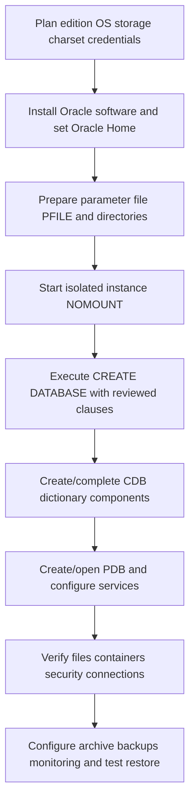

# Lesson 04 — Creating an Oracle Database Using SQL Commands (ภาษาไทย)

[Oracle Database](../README.md) · [Instance Administration](./README.md) · [Lab 04](../10-Labs/Lab-04-Manual-Database-Creation-Planning.md)

> **Source mapping:** Oracle University *19c Administration Workshop*, Lesson 4. บทนี้เรียบเรียงเป็นภาษาไทยใหม่ตามหัวข้อหลักสูตรและเอกสารทางการ ไม่ใช่การถอด Student Guide แบบ page-by-page (source-fidelity ยัง PENDING)  
> **Version policy:** ใช้ 19c เป็นพื้นฐาน; ตรวจการรองรับและ syntax อีกครั้งกับ Oracle 26ai version-specific docs ก่อนทำจริง  
> **Safety:** `CREATE DATABASE`, `STARTUP`, `ALTER DATABASE`, `CREATE SPFILE` เปลี่ยน state จริง ตัวอย่างสร้างฐานข้อมูลเป็น **conceptual skeleton เท่านั้น ห้าม copy ไป run ตรง ๆ**; ใช้ isolated disposable lab ที่ได้รับอนุญาตเท่านั้น

## Learning outcomes

เมื่อจบบทเรียนควรจะ (1) อธิบายลำดับการสร้าง database ด้วย SQL ได้ (2) เชื่อมความสัมพันธ์ระหว่าง PFILE/SPFILE, NOMOUNT, CREATE DATABASE, data dictionary, CDB/PDB และ service ได้ (3) วาง storage, redo, control files, character set และ recovery ก่อนสร้าง (4) รู้ว่า script ต้องตรวจ version/OS/edition/environment อะไรบ้าง (5) เปรียบเทียบ DBCA กับ manual creation และ (6) วาง evidence/rollback plan อย่างปลอดภัย

## 1. ทำไมต้องสร้างด้วย SQL เอง?

DBCA เหมาะกับการสร้างฐานข้อมูลมาตรฐานและลดขั้นตอนที่พลาดง่าย ส่วน manual creation ให้ DBA ควบคุม SQL clauses, parameter file และลำดับการ provision มากขึ้น จึงมีประโยชน์ต่อการเรียน architecture/automation แต่ **มีความเสี่ยงด้าน file overwrite, charset, recovery และ initialization สูงกว่า**. ถ้าไม่ได้มีข้อกำหนดเฉพาะ ให้พิจารณา DBCA ก่อนเสมอ

| หัวข้อ | DBCA | Manual SQL |
|---|---|---|
| วิธีทำ | Wizard หรือ silent mode | SQL*Plus + parameter file + scripts |
| ควบคุมรายละเอียด | มีตัวเลือกที่เครื่องมือรองรับ | ต้องกำหนด dependencies / options เอง |
| โอกาสผิดพลาด | มี defaults/validation ช่วย | สูงกว่าเมื่อ script ไม่สมบูรณ์ |
| เรียนรู้ internals | เห็นภาพรวม | เข้าใจ startup/creation sequence ลึกกว่า |
| Maintenance | ยังต้องจัดการหลังสร้าง | ยังต้องจัดการหลังสร้างเช่นกัน |

## 2. Sequence สำคัญ



ขั้นตอนหลัง `CREATE DATABASE` ขึ้นกับ version, template และการเลือก CDB/OMF: การเปิดฐานข้อมูลแล้วไม่ได้แปลว่า component scripts, PDB services, backup และ monitoring พร้อมใช้งานทั้งหมด

## 3. PFILE / SPFILE และ NOMOUNT

**PFILE** เป็น text initialization parameters; **SPFILE** เป็น binary server parameter file ที่ Oracle จัดการและบันทึกค่า persistent ได้ (ภายใต้ `SCOPE` ที่เลือก). เมื่อ instance เริ่ม Oracle ต้องรู้ `DB_NAME` และ parameters ที่เกี่ยวข้องจึงเข้าสู่ `NOMOUNT`; ยังไม่ได้ mount control files ของ database

ตัวอย่าง **PFILE template เพื่อการศึกษาเท่านั้น** ไม่ใช่ configuration ที่เหมาะกับ production:

```ini
# illustration only — do not install/run without approved build review
db_name='LABDB'
memory_target=0
sga_target=1024M
pga_aggregate_target=512M
processes=200
diagnostic_dest='/u01/app/oracle'
db_create_file_dest='/u02/oradata'
```

**ทำไมต้องระวัง:** ค่า memory, filesystem permissions, DB_UNIQUE_NAME, OMF, filesystem/ASM และ supported parameters แตกต่างกัน. การเปิด AMM / ASMM ต้องพิจารณา OS และรุ่นจริง ไม่ใช่ copy ชุดค่าแบบเหมารวม. Windows path แตกต่างจาก Linux/Solaris

## 4. CREATE DATABASE: ทำอะไรจริง?

Oracle สร้าง physical structures รวมถึง control files, redo logs, data files ของ system tablespaces และ database metadata ตาม clauses/defaults ที่ระบุ การเลือก `CHARACTER SET`, `NATIONAL CHARACTER SET`, `EXTENT MANAGEMENT`, `UNDO`, `LOGFILE`, `SYSAUX` และ file names มีผลต่อ design และ recovery ในระยะยาว

**Pseudo-SQL for reading only (incomplete):**

```sql
-- DO NOT EXECUTE. Incomplete illustration; not a valid production build script.
-- CREATE DATABASE LABDB
--   USER SYS IDENTIFIED BY <secure input>
--   USER SYSTEM IDENTIFIED BY <secure input>
--   ENABLE PLUGGABLE DATABASE
--   ... control files, redo, SYSTEM/SYSAUX, undo, charset, seed files ...
```

ห้ามใส่รหัสผ่านจริงใน SQL scripts, shell history, CI logs หรือ Git. Oracle's reference examples อาจมี password in statement เพื่อสาธิต syntax — การนำไปใช้จริงต้องออกแบบ secret handling และสิทธิ์ไฟล์ก่อน. อย่าทำ `REUSE` กับไฟล์ที่ยังไม่พิสูจน์ ownership ว่าเป็นของ lab

## 5. CDB / PDB และงานหลังฐานข้อมูลถูกสร้าง

ในระบบ multitenant: **CDB root** บริหาร shared metadata/instance ส่วน **PDB** แยก application data และ local users. `PDB$SEED` ใช้เป็น template ไม่ใช่พื้นที่ deploy แอป. การสร้าง CDB เพียงอย่างเดียวไม่รับประกันว่ามี application PDB ที่เชื่อมต่อได้ ต้องตรวจ `V$PDBS`, application service, user/privileges และ listener registration

**26ai note:** ใช้ CDB architecture เป็นแนวทางสำหรับ deployment รุ่นใหม่ และยืนยันข้อกำหนด non-CDB/multitenant จาก documentation ของรุ่นที่ติดตั้ง อย่านำตัวอย่าง non-CDB ในเอกสาร legacy มาถือว่าใช้ได้เหมือนกันกับ 26ai

## 6. Data integrity, storage, security, recovery

- **Charset:** เปรียบเทียบ source data กับ target ก่อนตัดสินใจ เช่น TH8TISASCII → AL32UTF8 ต้องวาง migration/validation โดยเฉพาะ
- **Control files:** ควรมี multiplexed copies ใน storage ที่มี failure domain ต่างกัน และสำรองหลัง structural changes
- **Redo:** จัด redo groups/members ตาม availability และ throughput; online redo ไม่เท่ากับ backup
- **OMF vs explicit paths:** Oracle Managed Files ลดการกำหนด path แต่ต้องกำหนด destinations, capacity และ governance ให้ถูก
- **FRA/ARCHIVELOG:** เตรียม recovery destination + monitoring; เปิด archivelog ไม่ได้หมายความว่ามี backup พร้อม restore
- **Accounts:** เลือก secure admin authentication; แยก SYSDBA ออกจาก application identity; จำกัด privileges

## 7. Read-only post-create validation

เมื่อต่อไปยัง lab database ที่มีอยู่แล้ว โดยมีสิทธิ์อ่าน view เหล่านี้:

```sql
SHOW CON_NAME
SELECT instance_name, status FROM v$instance;
SELECT name, open_mode, cdb, log_mode FROM v$database;
SELECT con_id, name, open_mode FROM v$pdbs ORDER BY con_id;
SELECT name, value FROM v$parameter
 WHERE name IN ('db_name','db_unique_name','spfile','db_create_file_dest','db_recovery_file_dest');
SELECT name FROM v$controlfile;
SELECT group#, member FROM v$logfile ORDER BY group#, member;
SELECT tablespace_name, status, contents FROM dba_tablespaces ORDER BY tablespace_name;
```

`DBA_TABLESPACES` และ `V$` ต้องมี privilege เหมาะสม; ไม่ต้อง grant DBA / SELECT ANY DICTIONARY เพื่อให้ lab ผ่าน

## 8. Failures & troubleshooting

| อาการ | ตรวจลำดับ |
|---|---|
| NOMOUNT ไม่ขึ้น | ORACLE_HOME/SID, PFILE syntax/permissions, OS memory/limits, alert log |
| ORA-01501 หรือ CREATE DATABASE fail | alert/trace, duplicate DB identity, files, parameter compatibility |
| File already exists | ตรวจว่าเป็นไฟล์ของใคร; **ห้าม overwrite ด้วย REUSE เพื่อให้ error หาย** |
| ORA-01034/ORA-27101 | instance availability, environment, instance startup state |
| Database OPEN แต่ PDB ไม่พร้อม | PDB open mode, service registration, client connect service |
| Text import ผิด charset | หยุด import เพิ่ม, preserve source, test migration transformation |
| FRA เต็ม | archive generation/retention/backup jobs/capacity; ไม่ลบ archived logs แบบสุ่ม |

## 9. Scenario & self-check

สถานการณ์: มีเครื่อง sandbox ใหม่พร้อม Oracle binaries แต่แอป legacy ต้องย้ายข้อมูลภาษาไทยและทำงานใน PDB ให้ได้
1. เลือก DBCA หรือ manual SQL เพราะอะไร?
2. จะจับคู่ `DB_NAME`, `ORACLE_SID`, PDB name และ service name อย่างไร?
3. จะพิสูจน์ charset conversion โดยไม่ทำลายข้อมูลต้นทางอย่างไร?
4. ก่อน execution ต้องมีหลักฐานเรื่องพื้นที่ disk, password handling, restore และ cleanup อะไร?
5. หลังสร้าง instance ขึ้นแล้ว แต่ app ต่อไม่ได้ จะตรวจ network → service → PDB → auth ในลำดับใด?

## Source references

- Primary private course: Oracle University 19c Administration Workshop Lesson 4 (topic map only; full fidelity pending)
- [Oracle 19c — Creating and Configuring an Oracle Database](https://docs.oracle.com/en/database/oracle/oracle-database/19/admin/creating-and-configuring-an-oracle-database.html)
- [Oracle 19c — Managing Control Files](https://docs.oracle.com/en/database/oracle/oracle-database/19/admin/managing-control-files.html)
- [Oracle 26ai — Database Administrator's Guide](https://docs.oracle.com/en/database/oracle/oracle-database/26/admin/)
