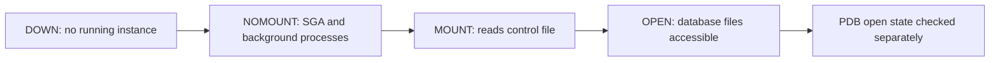

# Lesson 05 — Starting Up and Shutting Down a Database Instance (ภาษาไทย)

[Oracle Database](../README.md) · [Instance Administration](./README.md) · [Lab 05](../10-Labs/Lab-05-Instance-Lifecycle-Read-Only.md)

> **Source map:** Oracle University 19c Administration Workshop, Lesson 5. Original Thai teaching reconstruction based on lesson inventory and Oracle public docs; **not yet verified page by page against the private Student Guide**.  
> **Version boundary:** Oracle 19c foundation. Oracle AI Database 26ai SQL*Plus references are consulted for current syntax; platform-specific deployment (single instance / Oracle Restart / RAC / managed cloud / CDB-PDB) requires its own runbook.  
> **Safety:** `STARTUP`, `SHUTDOWN`, `ALTER DATABASE`, `ALTER PLUGGABLE DATABASE` change service state. Never use them on production without approved change window, dependency check, application coordination and restore plan.

## 1. Learning objectives

หลังอ่านควรอธิบายได้ว่า:
1. Instance lifecycle ต่างจาก PDB lifecycle และ listener lifecycle อย่างไร
2. อธิบาย DOWN → NOMOUNT → MOUNT → OPEN พร้อมไฟล์/ความพร้อมในแต่ละจุด
3. เปรียบเทียบ shutdown NORMAL, TRANSACTIONAL, IMMEDIATE, ABORT และผลต่อ transaction/recovery
4. แยกปัญหา Oracle Home/SID, parameter file, control file, data files และ service/PDB
5. เลือกเครื่องมือ lifecycle ให้ตรง ownership: SQL*Plus, SRVCTL / Oracle Restart / cluster / cloud service
6. ตรวจ state ด้วย read-only evidence และแปลผลอย่างไม่ทำให้ workload หยุด

## 2. Database lifecycle



| State | มีอะไร | ตรวจความพร้อมอะไรได้ |
|---|---|---|
| DOWN | instance ยังไม่ทำงาน | OS process/service logs / cluster manager |
| NOMOUNT / STARTED | SGA allocated, background processes running, initialization parameters loaded | instance-level diagnostics; ยังไม่ mount control files |
| MOUNTED | control files available, database mounted | control file/datafile mapping; ยังไม่เปิดให้ application ใช้ปกติ |
| OPEN | database open (READ WRITE หรือ READ ONLY ตาม role/mode) | services, application PDBs, permissions, sessions เพิ่มเติม |

**อย่าสับสน:** `V$INSTANCE.STATUS='OPEN'` ไม่ได้พิสูจน์ว่า PDB ของแอปเปิด `READ WRITE`. Listener เป็น process แยก และ service registration อาจช้าหรือผิด service name.

## 3. Startup: conceptual commands (NOT a runbook for production)

คำสั่งด้านล่างใช้ศึกษา syntax เท่านั้น; ต้องเป็น authorized **isolated lab** และมีสิทธิ์ administrative authentication:

```sql
-- STATE-CHANGING: DO NOT RUN ON PRODUCTION
STARTUP;
STARTUP NOMOUNT;
STARTUP MOUNT;
ALTER DATABASE OPEN;
-- STARTUP PFILE='/approved/lab/path/initLAB.ora';
```

`STARTUP` ปกติพยายามไปถึง OPEN; `NOMOUNT` ใช้กรณีเตรียมสร้าง database/บางงาน recovery; `MOUNT` ใช้ในขั้นตอน administrative/recovery ที่ต้องอ่าน control file. การ startup จาก parameter file ผิดหรือ service/OS environment ผิดอาจบ่งชี้ instance คนละตัวที่ตั้งใจ.

### PFILE vs SPFILE during startup

- **PFILE** เป็น text initialization parameters; ระบุได้ชัดเจนขณะ startup ใน supported configuration
- **SPFILE** เป็น binary managed parameter file และใช้สำหรับ persistent settings
- ค่าใน `V$PARAMETER` แสดง effective/current settings ตาม view; ค่า SPFILE และ next-start behavior อาจต่างกัน
- ต้องตรวจ `ORACLE_HOME`, `ORACLE_SID`, OS user, startup ownership และ cluster/cloud orchestration ก่อนแก้ไขใด ๆ

## 4. Shutdown modes — เลือกตามลักษณะ downtime

| Mode | รอใคร | Active transactions | Next startup |
|---|---|---|---|
| NORMAL | รอ sessions disconnect ทั้งหมด | ให้ sessions จัดการก่อนออก | ไม่ต้อง instance recovery จาก shutdown ปกติ |
| TRANSACTIONAL | รอ active transactions จบ | รอ commit/rollback ตาม client ก่อนปิด | ไม่ต้อง instance recovery |
| IMMEDIATE | ไม่รอ user logout; อาจใช้เวลานานเมื่อ rollback ใหญ่ | ยกเลิก active calls และ rollback uncommitted work | ไม่ต้อง instance recovery |
| ABORT | ไม่รอ transactions หรือ users | ไม่ rollback ระหว่าง shutdown | **ต้อง instance recovery เมื่อ start ครั้งถัดไป** |

**รายละเอียดสำคัญ:** `SHUTDOWN IMMEDIATE` ไม่ได้แปลว่าเสร็จทันที; long-running rollback อาจทำให้ใช้เวลานาน. `SHUTDOWN ABORT` เป็นทางเลือกฉุกเฉินเมื่อปกติใช้ไม่ได้ ไม่ใช่ปุ่ม restart ให้แก้ปัญหาชั่วคราว. <https://docs.oracle.com/en/database/oracle/oracle-database/19/admin/starting-up-and-shutting-down.html>

```sql
-- All commands below change state. Example only — do NOT execute in production.
SHUTDOWN NORMAL;
SHUTDOWN TRANSACTIONAL;
SHUTDOWN IMMEDIATE;
SHUTDOWN ABORT;
```

ใน SQL*Plus ที่ connected to a **PDB** คำสั่ง `SHUTDOWN` อาจปิดเฉพาะ PDB ภายใต้เงื่อนไข privileges; ถ้า connected to **CDB instance**, ผลกระทบกว้างถึงฐานข้อมูล/instance. ตรวจ `SHOW CON_NAME` **ก่อนทุกครั้ง** — อย่าคิดว่า scope เหมือนกัน. <https://docs.oracle.com/en/database/oracle/oracle-database/26/sqpug/SHUTDOWN.html>

## 5. Deployment ownership: ใครควรสั่ง stop/start?

- **Standalone single-instance:** SQL*Plus administrative workflow อาจเหมาะสมตาม runbook ของทีม
- **Oracle Restart-managed:** Oracle 19c documentation แนะนำ `srvctl stop database` / `srvctl start database` เพื่อรักษา orchestration/configuration
- **Oracle RAC:** ต้องใช้ cluster-aware operational plan, instance/service relocation strategy; ไม่สั่ง shutdown แบบ standalone ตามสัญชาตญาณ
- **Managed/cloud service:** ต้องยึด API/console/service operational contract; SQL*Plus startup อาจไม่ใช่ช่องทางที่รองรับ

**ไม่ให้คำสั่ง stop/start แบบคัดลอกได้สำหรับ environment ที่ยังไม่ได้ยืนยัน ownership**.

## 6. Read-only incident triage

คำสั่ง **SELECT-only** ขณะ connect ได้และมี view permissions:

```sql
SHOW USER
SHOW CON_NAME

SELECT instance_name, host_name, status, startup_time
FROM v$instance;

SELECT name, open_mode, database_role, log_mode, cdb
FROM v$database;

SELECT con_id, name, open_mode, restricted
FROM v$pdbs ORDER BY con_id;

SELECT name, value
FROM v$parameter
WHERE name IN ('db_name','db_unique_name','spfile','instance_name');

SELECT name, value
FROM v$diag_info
WHERE name IN ('Diag Alert','Diag Trace');
```

**Expected:** baseline current instance and PDB state. In legacy non-CDB Oracle 19c, `V$PDBS` is not relevant; skip with explanation. If database is DOWN, SQL view queries cannot run normally — use authorized OS/service/ADR evidence instead.

ระบบไม่เปิด: ตรวจ `ORACLE_HOME` / `ORACLE_SID` → control manager → alert log → parameter file → control files → datafiles/redo/recovery errors → permissions/capacity. รหัส ORA-01034, ORA-27101, ORA-00205, ORA-01157, ORA-01589 ต้องแปลตาม context ไม่เดาสาเหตุจาก code อย่างเดียว.

## 7. Incident scenarios

**Case A: Listener available, app cannot connect** — `lsnrctl status` มี listener แต่ service เป้าหมายไม่ปรากฏ ให้ตรวจ PDB open mode, registered services, instance status และ error จาก client; ไม่ restart listener ก่อนเก็บหลักฐาน.

**Case B: shutdown immediate seemingly hangs** — active rollback อาจกำลังทำงาน; ตรวจ logs/waits/transaction activity แบบ read-only หากยังเชื่อมต่อ/มี observability; ไม่ escalate เป็น ABORT อัตโนมัติ.

**Case C: หลัง power outage DB ยัง MOUNTED** — ตรวจ alert log และ recovery/media-recovery requirement; อย่า `ALTER DATABASE OPEN RESETLOGS` โดยไม่มี DBA-approved recovery plan.

## 8. Production change checklist

- [ ] ยืนยัน database / SID / service / PDB / host / environment / owner
- [ ] ตรวจ Oracle Restart / RAC / managed cloud ownership
- [ ] แจ้ง application owners และ dependency clients
- [ ] ตรวจ backup+restore readiness และ recovery point requirements
- [ ] เก็บ before evidence (state, sessions, alert log)
- [ ] กำหนด shutdown mode, timeout, escalation และ rollback path
- [ ] หลัง startup ตรวจ PDB/service/login/application smoke tests และ monitoring
- [ ] ตรวจ backup/monitoring jobs ที่อาจกระทบหลังงานจบ

## 9. Self-check

1. ทำไม instance เป็น OPEN แต่ application PDB ยังใช้งานไม่ได้?
2. `SHUTDOWN IMMEDIATE` ต่างจาก `ABORT` เรื่อง rollback/recovery อย่างไร?
3. ระบบ Oracle Restart-managed ควรใช้ orchestration ตัวใด?
4. ทำไม `STARTUP MOUNT` ไม่เท่ากับ database พร้อมรับ user queries?
5. ถ้าระบบล้มระหว่าง database open จะเริ่มเก็บ evidence จากที่ใด?

## Official references

- [19c — Starting Up and Shutting Down](https://docs.oracle.com/en/database/oracle/oracle-database/19/admin/starting-up-and-shutting-down.html)
- [26ai — SQL*Plus SHUTDOWN syntax and CDB/PDB scope](https://docs.oracle.com/en/database/oracle/oracle-database/26/sqpug/SHUTDOWN.html)
- [19c — Starting and Shutting Down with SQL*Plus](https://docs.oracle.com/en/database/oracle/oracle-database/19/ntqrf/starting-and-shutting-down-a-database-with-sql-plus.html)
