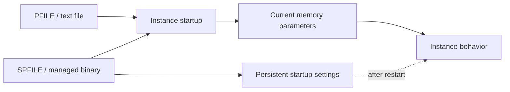
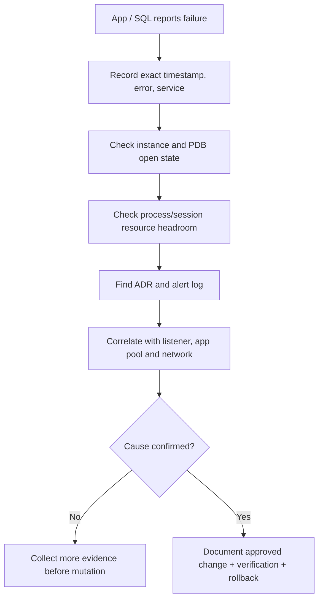

# Lesson 06 — Managing Database Instances (ภาษาไทย)

> 🧠 **ภาพจำก่อนอ่าน:** 🗄️ Data → ⚙️ Process → 🩺 Health  
> 🎨 [Visual Guide ของวิชานี้](../VISUAL-MEMORY-GUIDE-TH.md) — ภาพช่วยจำ ไม่แทนคำสั่งและเนื้อหาจริง

[Oracle Database](../README.md) · [Instance Administration](./README.md) · [Lab 06](../10-Labs/Lab-06-Instance-Parameters-and-Diagnostics-Read-Only.md)

> **Curriculum:** Oracle University 19c Administration Workshop (D106546GC10), Lesson 6 — lesson-topic alignment only; private Student Guide page-by-page verification **PENDING**. Written originally in Thai; not a transcript.
> **Version:** 19c administration foundation; current 26ai diagnostic differences labeled below. **Status:** authored, static review only; no SQL run on a live database.
> **Safety:** all runnable examples in this lesson are read-only. Changing initialization parameters, restarting services, purging diagnostic files, or enabling tracing is outside this lesson's execution scope.

## Learning outcomes

หลังเรียนจบควร (1) อ่านค่า initialization parameters และแยก current vs next startup (2) อธิบาย PFILE/SPFILE และ dynamic/static parameters (3) เข้าใจ `SCOPE=MEMORY|SPFILE|BOTH` โดยไม่เปลี่ยนค่าจริง (4) ใช้ `V$INSTANCE`, `V$PARAMETER`, `V$SPPARAMETER`, `V$DIAG_INFO` และ `V$RESOURCE_LIMIT` ตรวจสุขภาพเบื้องต้น (5) หา ADR/alert log และใช้ timeline สืบเหตุ (6) วาง change-control/rollback ที่ตรวจย้อนกลับได้

## 1. Mental model — configuration ที่ใช้งานอยู่ ≠ ค่าที่จะใช้หลัง restart



**PFILE** คือไฟล์ text ใช้ตอนเริ่ม instance และแก้ไขด้วย text editor ที่ authorized; **SPFILE** คือ binary server parameter file ไม่ควรแก้ด้วย editor. Oracle จะค้นหา default SPFILE ก่อน แล้ว fallback PFILE เมื่อเริ่มต้นโดยไม่ระบุพิเศษ. เมื่อ startup จาก SPFILE การเปลี่ยน parameter ที่เหมาะสมสามารถทำให้ persistent ได้; เมื่อ startup จาก PFILE ค่า runtime ที่เปลี่ยนจะไม่ถูกเขียนกลับสู่ PFILE อัตโนมัติ.

## 2. Dynamic vs static, modifiability และ SCOPE

| ชนิด/คำสั่ง (อธิบายเท่านั้น) | ผลกับ runtime | หลัง restart |
|---|---|---|
| Dynamic parameter + `SCOPE=MEMORY` | เปลี่ยนค่าปัจจุบัน | ไม่ persistent |
| Dynamic + `SCOPE=BOTH` | เปลี่ยน runtime และ SPFILE | persistent |
| `SCOPE=SPFILE` | ไม่เปลี่ยน runtime | ใช้ค่าที่บันทึกเมื่อ restart |
| Static parameter | ต้องเปลี่ยนการตั้งค่าสำหรับ restart | ไม่ใช่ค่าที่เปลี่ยน online ด้วย MEMORY/BOTH |

`SCOPE=SPFILE`/`BOTH` ต้องใช้กับ instance ที่ startup โดยใช้ SPFILE; การใช้กับ PFILE-only configuration ทำให้เกิด error. บาง dynamic parameters มีผลกับ **future sessions** ตาม semantics ของ parameter/DEFERRED; ไม่ควรอ้างว่าแก้แล้วทุก session เปลี่ยนทันที.

### ทำความเข้าใจ syntax แต่ไม่รัน

```sql
-- STATE-CHANGING EXAMPLES: FOR REFERENCE ONLY; DO NOT EXECUTE
-- ALTER SYSTEM SET some_parameter = some_value SCOPE=MEMORY;
-- ALTER SYSTEM SET some_parameter = some_value SCOPE=SPFILE;
-- ALTER SYSTEM SET some_parameter = some_value SCOPE=BOTH;
```

สังเกตค่าการแก้ไขได้จาก `ISSYS_MODIFIABLE`, `ISSES_MODIFIABLE` ของ `V$PARAMETER`; ค่า SPFILE ดู `V$SPPARAMETER`. อย่าแปล `ISDEFAULT` ว่าดี/ไม่ดีในทุกกรณี.

## 3. Read-only parameter inspection

ต่อเข้าระบบที่ได้รับอนุญาตและมี specific read privilege:

```sql
SHOW USER
SHOW CON_NAME

SELECT instance_name, status, startup_time FROM v$instance;
SELECT name, value, isdefault, issys_modifiable, isses_modifiable
FROM v$parameter
WHERE name IN ('db_name','instance_name','processes','sessions','sga_target',
               'pga_aggregate_target','open_cursors','diagnostic_dest','spfile')
ORDER BY name;

SELECT name, value, isspecified
FROM v$spparameter
WHERE name IN ('processes','sessions','sga_target','pga_aggregate_target','open_cursors')
ORDER BY name;
```

**ข้อควรระวัง:** `V$SPPARAMETER` อาจไม่มีค่า specified สำหรับทุก parameter; ค่าที่เกิดจาก default/calculation ไม่จำเป็นต้องมีรายการ persisted. การดู `SHOW PARAMETER` ใน SQL*Plus ก็มีประโยชน์ แต่ควรเก็บ query structured output สำหรับ audit.

## 4. Resource headroom ≠ performance diagnosis

```sql
SELECT resource_name, current_utilization, max_utilization, limit_value
FROM v$resource_limit
WHERE resource_name IN ('processes','sessions','transactions')
ORDER BY resource_name;
```

`CURRENT_UTILIZATION` เทียบกับ `LIMIT_VALUE` เพื่อดู headroom; `MAX_UTILIZATION` คือ high-water mark ในช่วงที่ระบบติดตาม ไม่ใช่หลักฐานว่าเคยเต็มตลอด. `LIMIT_VALUE` อาจแสดง string (เช่น UNLIMITED) จึงห้าม cast เป็นตัวเลขโดยไม่ตรวจ. เมื่อมี `ORA-12519`/`ORA-00020` ต้องไล่ listener/service/process capacity ด้วย ไม่เพิ่ม `PROCESSES` ทันทีโดยไม่ดู memory/connection pool/session behavior.

## 5. ADR: Automatic Diagnostic Repository

ADR ใช้เก็บ diagnostic data เช่น alert log และ trace files. พื้นที่/path ที่แท้จริงดูจาก `V$DIAG_INFO`:

```sql
SELECT name, value FROM v$diag_info ORDER BY name;
```

ตำแหน่ง `Diag Trace` และ `Diag Alert` มีไว้ตรวจ path; **ไม่จำเป็นว่า alert text และ XML จะอยู่ path/file เดียวกัน**. `DIAGNOSTIC_DEST` เป็น parameter หลัก ขณะที่ `BACKGROUND_DUMP_DEST`/`USER_DUMP_DEST` เป็น deprecated ใน current docs. อย่าแก้ parameter เพียงเพื่อให้ log ไปอยู่ตำแหน่งที่คุ้นเคย.

## 6. Evidence-first troubleshooting workflow



**Scenario:** Tomcat reports intermittent JDBC connection refusal; restart Tomcat gives short relief. Check pool configuration/leaked connections and Oracle `V$RESOURCE_LIMIT` snapshots with application/DB timeline. Sessions/resources reported below configured limit in one snapshot do **not** prove absence of saturation at incident time. Use trend and logs; don't automatically raise DB process limit.

## 7. Change-control worksheet

1. Scope: instance / database / CDB or PDB / host / standalone vs Restart/RAC
2. Observed baseline and timestamps
3. Parameter name, current value, SPFILE value, `ISSYS_MODIFIABLE`
4. Expected impact and whether restart needed
5. Privilege, change window, app owner approval, backup/recovery
6. Verification query and rollback plan
7. Save redacted before/after outputs and change ID

## 8. Review questions

1. ถ้า `V$PARAMETER` แสดงค่า A แต่ `V$SPPARAMETER` แสดง B อะไรอาจเกิดหลัง restart?
2. เหตุใด `SCOPE=BOTH` จึงใช้ไม่ได้กับ static parameter?
3. จะหา alert log จาก database query โดยไม่ hardcode path ได้อย่างไร?
4. ทำไม `MAX_UTILIZATION` ที่สูงในอดีตไม่ได้หมายความว่าปัจจุบันยังเต็ม?
5. ถ้า listener ทำงานแต่ app ต่อไม่ได้ parameter ไหนและ view ไหนควรดูคู่กับหลักฐานจาก app?

## Version and references

- Source: Oracle University 19c Administration Workshop, Lesson 6 (private Student Guide full-fidelity check pending).
- [Oracle 19c — Creating and Configuring / Managing initialization parameters](https://docs.oracle.com/en/database/oracle/oracle-database/19/admin/creating-and-configuring-an-oracle-database.html)
- [Oracle 19c — Startup and parameter files](https://docs.oracle.com/en/database/oracle/oracle-database/19/admin/starting-up-and-shutting-down.html)
- [Oracle 26ai — Diagnosing and Resolving Problems / ADR](https://docs.oracle.com/en/database/oracle/oracle-database/26/admin/diagnosing-and-resolving-problems.html)

### 26ai note
Oracle 26ai documents include revised diagnostic trace classification, rotation/segmentation and dump-size behavior; **do not assume identical alert/trace operational defaults between 19c and 26ai**. Confirm edition and settings before defining log-retention/monitoring policy.

## Source-page review (19c Lesson 06, slides 6-2 ถึง 6-22) — Dictionary, ADR, DDL Log และ Container Data

### 1. Parameter file search and change scope

On Unix-like systems common default parameter file locations are under `$ORACLE_HOME/dbs` (Oracle Home/Windows details differ). SPFILE เป็น binary initialization file ที่ Oracle ปรับผ่าน supported SQL; PFILE เป็น text file ที่ DBA version-controls privately. การแก้ binary SPFILE ด้วย text editor เป็นความผิดพลาดรุนแรง.

- `SCOPE=MEMORY`: runtime only (eligible dynamic parameter), lost on restart
- `SCOPE=SPFILE`: future startup only; requires SPFILE
- `SCOPE=BOTH`: current and persisted; constrained by parameter modifiability
- `ALTER SESSION` affects session scope where modifiable; `ALTER SYSTEM` may affect broader state, `DEFERRED` flags affect future sessions

### 2. ADR hierarchy and diagnostic evidence

```text
diagnostic_dest
  └─ diag/rdbms/<database>/<instance>/
       ├─ alert/          (including structured alert log)
       ├─ trace/          (text alert, process traces)
       ├─ incident/
       ├─ hm/             (health monitor)
       └─ log/            (DDL and other logs when configured)
```

`V$DIAG_INFO` ช่วยหา location ที่ Oracle ใช้จริง. `adrci` เป็นเครื่องมืออ่าน diagnostic data; หลีกเลี่ยง cleanup/purge ใน production ระหว่าง incident เพราะ logs เป็นหลักฐาน.

```sql
SELECT name,value FROM v$diag_info ORDER BY name;
SELECT instance_name,startup_time,status FROM v$instance;
```

### 3. DDL logging — ไม่ใช่ Unified Auditing

`ENABLE_DDL_LOGGING` รองรับการบันทึก DDL ที่กำหนดไว้ใน text/XML diagnostic logs ตาม version. **DDL logging ไม่ทดแทน Unified Auditing**, ไม่บันทึกทุก SQL หรือ SELECT และไม่รับรอง user attribution/forensics แบบเดียวกับ policies. ตรวจ edition และ Oracle Database Lifecycle Management Pack licensing ก่อน enable/ใช้ feature; ห้ามแก้ parameter ตาม tutorial โดยไม่ตรวจสิทธิ์และ audit requirement.

```sql
-- Observation only
SELECT name,value FROM v$parameter
WHERE name IN ('enable_ddl_logging','diagnostic_dest','max_dump_file_size');
```

### 4. Dynamic Performance Views vs Data Dictionary

| Category | Example | Interpretation |
|---|---|---|
| `V$*` | `V$INSTANCE`, `V$SESSION`, `V$PARAMETER` | Current instance/runtime information (often transient/cumulative) |
| `DBA_*` | `DBA_TABLESPACES`, `DBA_USERS`, `DBA_OBJECTS` | Dictionary metadata visible to privileged DBA |
| `ALL_*` | `ALL_TABLES`, `ALL_OBJECTS` | Objects accessible to current user |
| `USER_*` | `USER_TABLES`, `USER_OBJECTS` | Objects in current schema |
| `CDB_*` | `CDB_TABLES`, `CDB_USERS` | Multi-container metadata subject to current container and CONTAINER_DATA |

**`CONTAINER_DATA`** controls a common user's visibility across containers for certain CDB_/V$ views; do not assume root query returns all PDB metadata for every account. Querying as SYSDBA on production should not be the default way to bypass privilege restrictions.

```sql
SHOW USER
SHOW CON_NAME
SELECT owner,table_name FROM all_tables FETCH FIRST 10 ROWS ONLY;
SELECT username,common,account_status
FROM cdb_users FETCH FIRST 10 ROWS ONLY;
```

### Failure investigation checklist

1. Identify symptom: parameter ignored after restart, expected DDL log absent, wrong PDB scope or missing dictionary rows
2. Capture `V$PARAMETER` and `V$SPPARAMETER` delta (roles permitting), current instance and ORACLE_HOME
3. Validate ADR diag location, timestamps, trace permission and log retention before changes
4. If missing cross-PDB rows, test container, common-user privileges and `CONTAINER_DATA` rather than assuming data loss
5. Plan root cause/rollback; use approved changes only in isolated lab

Sources: [Oracle 19c Administrator's Guide](https://docs.oracle.com/en/database/oracle/oracle-database/19/admin/), [Oracle 19c Database Reference](https://docs.oracle.com/en/database/oracle/oracle-database/19/refrn/).
