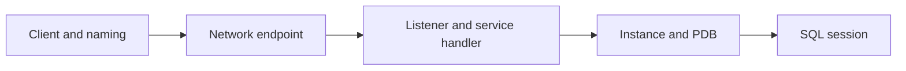

# Lesson 7 — Oracle Net Services Overview (ภาษาไทย)

[Oracle Hub](../README.md) · [Network Index](./README.md)

> Original Thai learning note mapped to Oracle University 19c Administration Workshop Lesson 7. **Student Guide page-level verification pending; static only, not tested live.** Oracle 26ai documentation is current-version comparison, not a claim that all 19c commands work unmodified.

## Learning outcomes
- อธิบาย Oracle Net component และ connection flow พร้อมเหตุผลในการเลือก configuration
- แยกปัญหา client naming, TCP listener, registered service, instance/PDB และ authentication
- ตรวจสอบด้วย read-only evidence ก่อนแก้ไขระบบ

## Concept
client → connect descriptor → listener → handler → database service; distinguish instance, PDB and service.



**จุดสำคัญ:** listener รับการเชื่อมต่อเริ่มต้น ไม่ได้ proxy SQL ทุกคำสั่งหลัง session ถูกสร้างเสมอไป. Service name เป็น endpoint เชิงตรรกะ ไม่ใช่ schema หรือ SID. การตั้งค่าต้องคำนึงถึง single-instance/Oracle Restart/RAC และสิทธิ์ของผู้ดูแลต่างกัน.

## Hands-on observation (read-only)

```sql
SHOW USER
SHOW CON_NAME
SELECT name,network_name FROM v$services;
```

บน server ที่ได้รับอนุญาตใช้ `lsnrctl status` และ `lsnrctl services` เพื่อดู service handlers (ไม่สั่ง start/stop). ควรบันทึก timestamp, target, Oracle Home, และตัด host/IP ที่ sensitive ก่อนส่งต่อ. ถ้าไม่มี privilege ของ V$ views ให้ขอ grant เฉพาะ view ไม่ใช่ DBA ทั้งชุด.

## Troubleshooting case
ORA-12514: listener works but requested service not registered; check PDB and LREG.

1. ยืนยัน exact client error และ connect string (ปิดบัง password)
2. ตรวจ DNS/TCP และ listener ตามด้วย service registration
3. ตรวจ PDB open mode, available handlers, process/session capacity เมื่อเกี่ยวข้อง
4. ผูก evidence กับ listener log, alert log และ application-side pool logs
5. เปลี่ยน configuration เฉพาะเมื่อมี approval, backup, validation และ rollback

## Practice & questions
- วาด flow และระบุจุดที่ failure นี้เกิดได้อย่างน้อยสามจุด
- ระบุหลักฐานที่ยืนยันว่า listener alive แต่ service unavailable
- ถ้ามีการเปลี่ยน port หรือ service จะทดสอบ client compatibility และ rollback อย่างไร?

**Safety:** อย่าแก้ listener.ora, sqlnet.ora, parameters, CMAN ACL หรือ restart service ใน production โดยไม่อนุมัติ.

## References
- [Oracle 26ai Net Services Administrator Guide](https://docs.oracle.com/en/database/oracle/oracle-database/26/netag/)
- [Oracle 19c Documentation](https://docs.oracle.com/en/database/oracle/oracle-database/19/)
- Private Student Guide: lesson 7 mapping only; fidelity review pending
