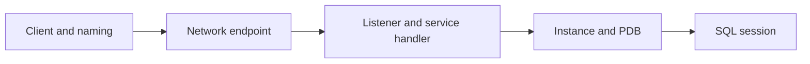

# Lesson 8 — Configuring Naming Methods (ภาษาไทย)

> 🧠 **ภาพจำก่อนอ่าน:** 🌐 Network → 🛡️ Rules → 🖥️ Backend  
> 🎨 [Visual Guide ของวิชานี้](../VISUAL-MEMORY-GUIDE-TH.md) — ภาพช่วยจำ ไม่แทนคำสั่งและเนื้อหาจริง

[Oracle Hub](../README.md) · [Network Index](./README.md) · [📘 พื้นฐาน Oracle Net: Lesson 07](./Lesson-07-Oracle-Net-Services-Overview-TH.md)

> Original Thai learning note mapped to Oracle University 19c Administration Workshop Lesson 8. **Student Guide page-level verification pending; static only, not tested live.** Oracle 26ai documentation is current-version comparison, not a claim that all 19c commands work unmodified.

## Learning outcomes
- เปรียบเทียบ Easy Connect กับ local naming ผ่าน `tnsnames.ora`
- ระบุการใช้ `TNS_ADMIN`, `sqlnet.ora` และ client configuration ที่เกี่ยวข้อง
- แยก client-side naming resolution ออกจาก TCP/listener/service registration จากหลักฐาน

> ทบทวน Network/Listener/Service flow ใน [Lesson 07](./Lesson-07-Oracle-Net-Services-Overview-TH.md); Lesson นี้เน้นขั้น **resolve connect identifier ก่อนติดต่อ listener**

## Concept
Easy Connect syntax, local naming via tnsnames.ora, LDAP naming, TNS_ADMIN and sqlnet.ora.



**เลือก Naming Method ให้ตรงอาการ:** client อาจใช้ Easy Connect หรือชื่อ alias ใน local naming; การใช้ Oracle Client หลายชุดทำให้ไฟล์ config ที่อ่านจริงต่างกันได้. Error การแปลชื่อ (เช่น ORA-12154) ต้องไล่ที่ naming ก่อนเปลี่ยน listener.

## Hands-on observation (read-only)

```sql
SHOW USER
SHOW CON_NAME
SELECT sys_context('USERENV','SERVICE_NAME') service_name FROM dual;
```

ตรวจคำสั่งเชื่อมต่อที่ application ใช้จริงว่าเป็น alias หรือ Easy Connect และบันทึก active Oracle Client/Oracle Home กับ `TNS_ADMIN` (ไม่บันทึกรหัสผ่าน). หากชื่อแก้ได้แล้วแต่ยังเชื่อมต่อไม่ได้ จึงค่อยใช้ read-only evidence จาก [Lesson 07](./Lesson-07-Oracle-Net-Services-Overview-TH.md) ตรวจ listener/service ต่อ.

## Troubleshooting case
**ORA-12154: client cannot resolve identifier** — อย่าเพิ่ง restart listener หรือเปลี่ยน network policy

1. จด connect identifier จาก client และ error ต้นฉบับโดยปิดบัง credential
2. ตรวจว่า client resolve alias จาก `tnsnames.ora` หรือใช้ Easy Connect และ Oracle Home/TNS_ADMIN ที่เกี่ยวข้องถูกชุดหรือไม่
3. ทบทวน `sqlnet.ora` naming method order กับรูปแบบ connect descriptor ตาม environment ที่ได้รับอนุญาต
4. เมื่อชื่อถูก resolve แล้ว จึงทดสอบ DNS/TCP และ listener/service registration เพื่อแยก ORA-12154 จาก service/handler errors
5. จัดทำ before/after test สำหรับหลาย client และแนวทาง rollback ก่อนเสนอแก้ config ผ่าน change approval

## Practice & questions
1. เครื่อง A เชื่อมต่อด้วย alias เดียวกันได้ แต่เครื่อง B ได้ ORA-12154: จะเปรียบเทียบ Oracle Home/TNS_ADMIN อย่างไร?
2. Easy Connect ใช้ได้แต่ `tnsnames.ora` alias ใช้ไม่ได้: ควรตรวจ configuration ชั้นใดก่อน?
3. อธิบายว่าข้อผิดพลาด ORA-12154 ต่างจากกรณี listener ไม่รู้จัก service อย่างไร และต้องเก็บหลักฐานฝั่งใดบ้าง

**Safety:** อย่าแก้ listener.ora, sqlnet.ora, parameters, CMAN ACL หรือ restart service ใน production โดยไม่อนุมัติ.

## References
- [Oracle 26ai Net Services Administrator Guide](https://docs.oracle.com/en/database/oracle/oracle-database/26/netag/)
- [Oracle 19c Documentation](https://docs.oracle.com/en/database/oracle/oracle-database/19/)
- Private Student Guide: lesson 8 mapping only; fidelity review pending
