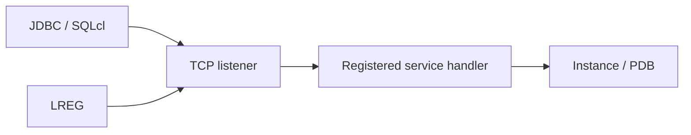

# Lesson 09 — Configuring and Administering the Listener (ภาษาไทย)

[Networking index](./README.md)

> Original Thai teaching, mapped to Oracle University 19c Administration Workshop Lesson 9. Source page-level fidelity and live execution: **PENDING**.

## Learning objectives
เข้าใจว่า listener ต่างจาก database instance; วินิจฉัย listener endpoint, dynamic service registration, dedicated handlers และ PDB services โดยไม่รีสตาร์ทระบบเพื่อเดาสาเหตุ

## Architecture


Listener รับ connection request และส่งต่อให้ handler ของ service; ส่วน LREG ทำ dynamic registration. Listener UP ไม่ได้แปลว่า PDB OPEN. `listener.ora` ใช้กำหนด listener endpoints และ options; dynamic registration ไม่ต้องกำหนดทุก service แบบ static SID_LIST.

## Read-only inspection
บน server ที่ได้รับอนุญาต:
```bash
lsnrctl status
lsnrctl services
```
บน SQL session ที่มี view privilege:
```sql
SHOW CON_NAME
SELECT name,network_name,con_id FROM v$services ORDER BY name;
SELECT instance_name,status FROM v$instance;
SELECT name,open_mode FROM v$pdbs;
SELECT name,value FROM v$parameter WHERE name IN ('local_listener','remote_listener');
```

## Incident lab: ORA-12514 / ORA-12519
1. ตรวจ host/port reachability และ service name ที่ client ขอ
2. เช็ก handler state จาก `lsnrctl services`
3. ตรวจ PDB state, registered service และ timestamp ของ logs
4. เมื่อ ORA-12519 ดู process/session headroom และ connection pool behavior; อย่าสรุปจาก error เพียงบรรทัด
5. ทำ change proposal พร้อม rollback ถ้าจำเป็นต้องปรับ configuration

`SERVICE_NAMES` ถูก deprecate สำหรับการจัดการ service ด้วยมือมาตั้งแต่ Oracle 19c: ใช้ DBMS_SERVICE/SRVCTL/GDSCTL ตาม topology. Listener control commands ที่เปลี่ยน state ต้องใช้ change approval.

## Review questions
- Listener UP แต่ service ไม่ขึ้น เกิดจากอะไรได้บ้าง?
- Dynamic registration แตกต่างจาก static registration อย่างไร?
- ทำไมการเพิ่ม processes อาจไม่แก้ JDBC connection leak?

## Official source
- https://docs.oracle.com/en/database/oracle/oracle-database/26/netag/overview-oracle-net-listener.html
- https://docs.oracle.com/en/database/oracle/oracle-database/26/netag/registering-information-local-listener.html
