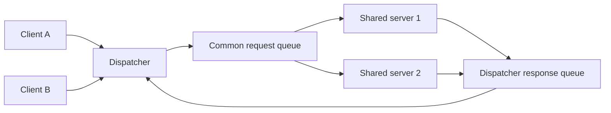

# Lesson 10 — Configuring a Shared Server Architecture (ภาษาไทย)

[Oracle Hub](../README.md) · [Networking](./README.md) · [Lab 07](../10-Labs/Lab-07-Shared-Server-and-CMAN-Read-Only.md)

> **Source:** Oracle University 19c Administration Workshop Lesson 10 (topic mapped, proprietary guide page-level check pending). Original Thai lesson, not copied training material. **Validation:** documented concepts reviewed against Oracle 19c Net Services Guide; SQL not executed.

## Outcomes
อธิบาย dedicated vs shared server, dispatcher, request/response queues, virtual circuits, UGA, initialization parameters และวิธีตรวจ bottlenecks โดยไม่ปรับ production.

## Dedicated vs Shared
Dedicated server มักใช้ server process รองรับแต่ละ connection ต่างจาก shared server ที่หลาย client sessions ใช้ pool ของ shared server processes ร่วมกัน เหมาะกับงานที่มี connection จำนวนมากและส่วนใหญ่รอ I/O/คำขอเป็นช่วง ๆ แต่ไม่ได้ทำให้ SQL ทุกประเภทเร็วขึ้นเสมอ



### ส่วนประกอบ
- **Dispatcher:** รับ client connections, จัดการ virtual circuits และรับ/ส่ง requests กับ shared-server queues
- **Shared server:** หยิบ request จาก common queue, ประมวลผล แล้วส่ง response กลับ dispatcher
- **Virtual circuit:** ใช้เก็บ state ของ client connection สำหรับ architecture นี้
- **UGA:** session state มี allocation/location ต่างจาก dedicated configuration; ประเมิน shared-memory sizing
- **Service handler:** Listener สามารถส่ง connection ไปยัง dispatcher หรือ dedicated server handler

### Parameters และ Scope
`SHARED_SERVERS`, `MAX_SHARED_SERVERS`, `DISPATCHERS`, `MAX_DISPATCHERS`, `SHARED_SERVER_SESSIONS`, `CIRCUITS` และ `LOCAL_LISTENER` มีบทบาทต่างกัน. ตั้งค่าใน sandbox เท่านั้นหลังตรวจ version/edition และ memory constraints.

Client connect descriptor สามารถขอ `(SERVER=SHARED)` หรือ `(SERVER=DEDICATED)`; หาก client บังคับ shared แต่ dispatcher ไม่พร้อม connection อาจถูกปฏิเสธ. ต้องตรวจ pool ที่ application ใช้ ไม่ใช่เปิด shared server เพื่อแก้ JDBC connection leak แบบไม่วิเคราะห์.

## Read-only diagnostics
```sql
SHOW CON_NAME
SELECT name, value FROM v$parameter
WHERE name IN ('shared_servers','max_shared_servers','dispatchers','max_dispatchers',
               'shared_server_sessions','circuits','local_listener');
SELECT server, COUNT(*) session_count FROM v$session GROUP BY server;
SELECT name, status, busy, idle FROM v$dispatcher;
SELECT name, status, requests, busy FROM v$shared_server;
SELECT type, queued, wait, totalq FROM v$queue;
```
> ต้องได้รับ view privileges; ค่า counter และ available columns ตรวจใน database reference รุ่นจริงก่อนรัน. `V$QUEUE` เป็น view ที่ควบคุมสิทธิ์เข้มงวด อย่าให้ `SELECT ANY TABLE`/DBA โดยไม่จำเป็น.

### Reading results
- `V$SESSION.SERVER` ใช้ดูการกระจาย session types ไม่ได้บอกว่า workload กำลังติดคอขวดแน่ ๆ
- เปรียบเทียบ queue trends และ dispatcher/shared server busy metrics ภายในช่วงเกิดเหตุ ไม่ใช้ snapshot เดียวตัดสิน
- ถ้า app session count สูง หาข้อมูล JDBC pool, session lifetime และ connection reuse ก่อนปรับ architecture

## Scenario
App มี 800 idle sessions แต่ระบบไม่ได้ใช้ CPU เต็ม: shared server อาจลด process overhead บางแบบ แต่ต้องตรวจ application driver support, transactions และ background jobs, ลักษณะ sessions และ memory usage ก่อน มิฉะนั้นอาจย้าย bottleneck ไปที่ request queue

## Self-check
1. Dispatcher ต่างจาก shared server process อย่างไร?
2. ทำไม listener up ไม่ได้ยืนยันว่า dispatcher พร้อม?
3. Shared server ช่วยและไม่ช่วย workload แบบไหน?
4. UGA ขยับ location อย่างไรและทำไมจึงเกี่ยวกับ memory?
5. จะใช้ counter อะไรพิสูจน์ queue saturation โดยไม่ restart?

## References
- [Oracle 19c Configuring a Shared Server Architecture](https://docs.oracle.com/en/database/oracle/oracle-database/19/netag/configuring-shared-server-architecture.html)
- [Oracle 19c Oracle Net Architecture](https://docs.oracle.com/en/database/oracle/oracle-database/19/netag/understanding-oracle-net-architecture.html)
- [Oracle 26ai documentation](https://docs.oracle.com/en/database/oracle/oracle-database/26/)
