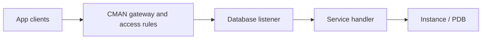

# Lesson 11 — Oracle Connection Manager (CMAN) (ภาษาไทย)

[Oracle Hub](../README.md) · [Networking](./README.md) · [Lab 07](../10-Labs/Lab-07-Shared-Server-and-CMAN-Read-Only.md)

> **Source:** Oracle University 19c Administration Workshop Lesson 11 topic map; original Thai teaching notes. Student Guide page-level cross-check pending. Commands below for inspection/planning only; no live CMAN deployment tested.

## Goals
แยก CMAN ออกจาก Listener/Connection Pool, เข้าใจ access control, connection concentration/multiplexing, gateway routing, CMON, CMCTL และ cman.ora

## Architecture


CMAN เป็น network middle tier ที่สามารถทำ access control และ connection concentration ตาม configuration; ไม่ใช่ database engine ไม่ใช่ firewall replacement และไม่ได้แก้ปัญหา SQL inefficient หรือ application connection leaks โดยอัตโนมัติ.

### Components
- **CMAN listener:** รับ connection ไปยัง gateway
- **Gateway processes:** จัดการ traffic ที่อนุญาตตาม routing/configuration
- **CMON:** monitoring/registration functions
- **CMCTL:** administration/control utility ใช้โดยผู้ได้รับอนุญาต
- **cman.ora:** `ADDRESS`, `RULE_LIST`, `PARAMETER_LIST` และ related settings

### Rule mechanics & security
Access rules กำหนด source/destination/service และ action ตาม syntax/เวอร์ชันจริง. **ใน Oracle 26ai หากไม่กำหนด rules การเชื่อมต่อจะถูกปฏิเสธ**; ต้องมี rules สำหรับ client และ CMCTL โดยเฉพาะ มิฉะนั้น access ของประเภทนั้นอาจถูกปฏิเสธ. อย่าเพิ่ม allow-all ใน production เพื่อทดสอบอย่างรวดเร็ว

### Multiplexing
Connection concentration หมายถึงลดจำนวน transport connections ในบาง topology โดยรวมหลาย client sessions ผ่าน connection ที่ share กับ dispatcher ซึ่งต้องวางแผน shared-server support และ configuration ไม่ใช่รวม SQL transactions เป็น session เดียว.

## Planning walkthrough — NO MUTATION
1. ระบุ client IP subnet, CMAN host/port, destination listener/service และ trust boundaries
2. ตัดสินใจ rule ตาม least privilege และแยก rule สำหรับ CMCTL administrators
3. ตรวจ `cman.ora` path ตาม Oracle Base Home/Oracle Home และ version
4. วาด connection descriptor chain ว่า client จะผ่าน gateway ที่ใด
5. กำหนด logs, metrics, timeout, capacity, failover และ recovery
6. ทำ positive/negative test plan ก่อน deployment

## Read-only checks
บน database หลัง client connect สำเร็จ:
```sql
SHOW CON_NAME
SELECT sys_context('USERENV','SERVICE_NAME') service_name FROM dual;
SELECT name, network_name FROM v$services ORDER BY name;
```
บน host สามารถตรวจ **ไฟล์ config ในโหมดอ่านอย่างเดียว** ตาม change policy ได้: เก็บ hash/config snapshot โดยไม่เผย private addresses หรือ authentication data. สำหรับ CMCTL คำสั่ง inspection และ syntax แตกต่างตามรุ่น; ตรวจ official help ของ installed build ก่อนใช้.

## Troubleshooting
| Symptom | Hypothesis | Evidence |
|---|---|---|
| Client ต่อ CMAN ไม่ได้ | DNS/TCP/gateway listener | TCP test and CMAN logs |
| CMAN reachable แต่ database ต่อไม่ได้ | access rule deny, backend address/service | sanitized cman.ora rules, backend listener services |
| Connections ขัดข้องเป็นช่วง | gateway process exhaustion / timeout / backend busy | CMAN logs, resource trend, DB process/session utilization |
| Application login failed | identity/grants/PDB | database audit/alert and client error |

## Hands-on learning questions
1. CMAN ต่างจาก database listener ตรงไหน?
2. เหตุใดต้องแยก client rules และ CMCTL administration rules?
3. Connection concentration กับ session pooling ของ Java ต่างกันอย่างไร?
4. หากเพิ่ม CMAN อีก hop latency และ fault domain เปลี่ยนอย่างไร?
5. มีขั้นตอน rollback อะไรบ้างหากเปิด CMAN แล้ว clients บางกลุ่มใช้ไม่ได้?

## References
- [Oracle 26ai — Configure cman.ora](https://docs.oracle.com/en/database/oracle/oracle-database/26/netag/configuring-cman-ora-file-oracle-connection-manager-host.html)
- [Oracle 26ai — CMAN parameters and rules](https://docs.oracle.com/en/database/oracle/oracle-database/26/netrf/oracle-connection-manager-parameters.html)
- [Oracle 19c — Shared-server/session multiplexing](https://docs.oracle.com/en/database/oracle/oracle-database/19/netag/configuring-shared-server-architecture.html)
