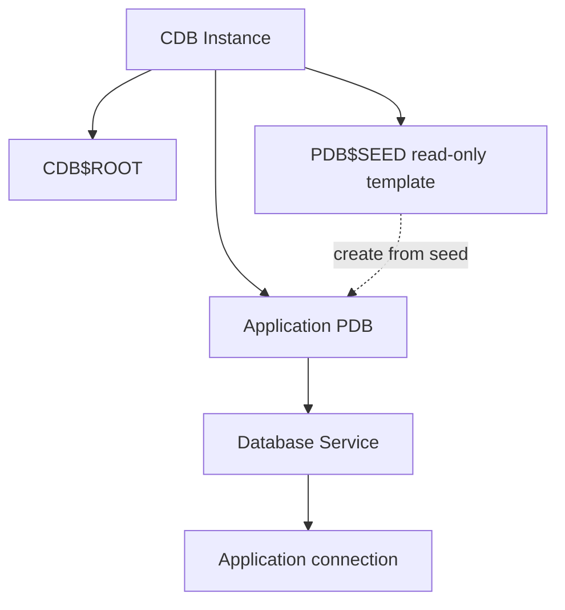

# Lesson 12 — Creating PDBs from Seed (ภาษาไทย)

[Multitenant Index](./README.md) · [Lab 08](../10-Labs/Lab-08-PDB-Lifecycle-Read-Only.md)

> **Source:** Oracle University 19c Administration Workshop Lesson 12. Original Thai teaching; page-level Student Guide fidelity **pending**. SQL mutation examples here are **illustrative only** and were not executed.

## เป้าหมาย
อธิบาย CDB$ROOT, PDB$SEED, user PDB; วางแผนชื่อ PDB, datafiles, administrator, open mode, service และการตรวจสอบหลังสร้างได้อย่างถูกต้อง

## Mental model



PDB$SEED เป็น read-only template สำหรับสร้าง PDB; application ไม่ควรไปสร้าง objects ใน Seed หรือ CDB$ROOT. การสร้าง PDB ไม่เท่ากับเปิด PDB ให้ app ใช้ทันที. หลังสร้างต้องวาง service/account/grant และตรวจว่าเปิดถูก mode.

## Preflight
1. ยืนยัน `SHOW CON_NAME` เป็น `CDB$ROOT` ก่อนงานระดับ CDB
2. ตรวจ version, privileges, PDB count/edition, storage free space และ OMF/ASM path
3. ตั้งชื่อ PDB และ local administrator โดยไม่ฝังรหัสผ่านใน script หรือ Git
4. วาง template การสร้างจาก `PDB$SEED`; ตรวจ file destination ใช้ `CREATE_FILE_DEST`, OMF หรือ `FILE_NAME_CONVERT` ให้เหมาะกับ environment
5. วาง backup/recovery plan, post-create services, audit, monitoring, resource limits

## SQL creation sequence — **state-changing, NOT executable lab**

```sql
-- Illustration only: DO NOT RUN. Credentials and storage mapping intentionally omitted.
-- In authorized disposable sandbox, DBA reviews:
-- CREATE PLUGGABLE DATABASE labpdb ADMIN USER labadmin IDENTIFIED BY <secure-secret>
--   CREATE_FILE_DEST = '<approved-lab-location>';
-- ALTER PLUGGABLE DATABASE labpdb OPEN;
-- ALTER PLUGGABLE DATABASE labpdb SAVE STATE;
```

คำสั่ง `SAVE STATE` เก็บเป้าหมาย open state สำหรับ subsequent CDB restart ตาม support/instance scope ไม่ใช่การเปิดฐานข้อมูล ณ เวลาที่ใช้คำสั่งนั้น. ควรตรวจ state ของ PDB และ listener/service แยกจากกัน. `CREATE_FILE_DEST` ใช้ได้ตามเงื่อนไข target destination และ storage type ในเอกสารของรุ่นนั้น.

## Verification (read-only)

```sql
SHOW CON_NAME
SELECT con_id,name,open_mode,restricted FROM v$pdbs ORDER BY con_id;
SELECT pdb_name,status FROM cdb_pdbs ORDER BY pdb_name;
SELECT name,network_name,con_id FROM v$services ORDER BY name;
```

## Scenario
Oracle instance OPEN แต่ `SALES_PDB` แสดง `MOUNTED`. DBA ต้องตรวจ target container และ change approval ก่อนสั่งเปิด PDB; การ restart listener ไม่ได้แก้ PDB open state.

## Review
1. Seed กับ application PDB ต่างกันอย่างไร?
2. ทำไม PDB CREATE สำเร็จแต่ JDBC ยังเชื่อมต่อไม่ได้?
3. หากมี CDB เดียวหลาย PDB จะวาง memory and service governance อย่างไร?
4. File path/OMF/Mount point ผิดจะมีความเสี่ยงแบบใด?

## Official references
- [19c Creating a PDB from Scratch](https://docs.oracle.com/en/database/oracle/oracle-database/19/multi/creating-a-pdb-from-scratch.html)
- [19c Overview of PDB Creation](https://docs.oracle.com/en/database/oracle/oracle-database/19/multi/overview-of-pdb-creation.html)
