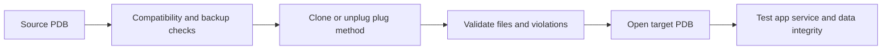

# Lesson 13 — Using Other Techniques to Create PDBs (ภาษาไทย)

[Multitenant Index](./README.md) · [Lab 08](../10-Labs/Lab-08-PDB-Lifecycle-Read-Only.md)

> **Source:** Oracle University 19c Administration Workshop Lesson 13. Original teaching material; Student Guide page-by-page verification **pending**. No clone/unplug/plug operations executed.

## เป้าหมาย
เปรียบเทียบ local clone, remote clone, refreshable clone, unplug/plug และ relocate; อ่านข้อกำหนด/หลักฐาน compatibility ก่อน migration

| Technique | เหมาะกับกรณี | ต้องตรวจเพิ่ม |
|---|---|---|
| Clone from local PDB | สร้าง UAT/ทดสอบจาก source ใน CDB เดียว | datafiles, clone state, source workload, TDE |
| Remote clone | คัดลอกจาก source ต่าง CDB ผ่าน database link | user/network privilege, connectivity, version, storage |
| Refreshable clone | สำเนาเพื่อ refresh จาก source | refresh mode/schedule, undo/archive dependencies |
| Unplug/Plug | เคลื่อน PDB พร้อม metadata manifest | XML/PDB archive, version/options, file compatibility, plug violations |
| Relocate | ย้าย PDB ตาม supported architecture | service cutover, downtime, connection handling, redo requirements |

## Clone flow



Hot clone requirements depend on `ARCHIVELOG`, local undo mode and supported source/target configuration. เก็บ archive logs ที่จำเป็นจนการ clone จบสมบูรณ์. การ copy ไม่เท่ากับการยืนยันว่าข้อมูล business ถูกต้อง.

## Read-only assessment

```sql
SHOW CON_NAME
SELECT con_id,name,open_mode FROM v$pdbs ORDER BY con_id;
SELECT name,open_mode,log_mode,cdb FROM v$database;
SELECT name,cause,type,message,status
FROM pdb_plug_in_violations
ORDER BY time DESC FETCH FIRST 15 ROWS ONLY;
```

`PDB_PLUG_IN_VIOLATIONS` อาจมี columns แตกต่างตาม version และ privileges; หาก query ไม่ผ่านให้ตรวจ catalog/reference ของรุ่นจริงก่อน อย่าให้ blanket grants.

## Migration decision worksheet
1. Source/target version/patch, architecture, edition/features and timezone/charset
2. Source PDB open mode, volume, file count, storage and free capacity
3. Encryption/TDE wallet or keystore handling and key availability
4. Downtime and application/connection/service cutover plan
5. Backup and validated restore of source and destination
6. Validation by schema object counts, invalid objects, application smoke tests and business data checks
7. Rollback route if target cannot open or violates compatibility

## Failure scenarios
- **Plug-in violations:** หาสาเหตุจาก compatibility ก่อนเปิด target
- **File conflict:** อย่า overwrite source files; ตรวจ `FILE_NAME_CONVERT`/OMF mappings
- **PDB mounted after plug:** อาจเป็น expected state; เปิดตาม approved procedure โดยตรวจ violation status
- **Wrong service:** ตรวจ registration และ app connection string; SID ไม่ใช่ PDB service

## Review questions
1. Remote clone ต่างจาก unplug/plug อย่างไร?
2. ทำไม TDE keys เป็นเงื่อนไขสำคัญในการย้าย PDB?
3. Hot clone มีข้อกำหนดด้าน redo/undo อะไร?
4. Plug สำเร็จแต่ PDB ไม่เปิด ควรเก็บหลักฐานใด?

## Official references
- [19c Cloning a PDB or Non-CDB](https://docs.oracle.com/en/database/oracle/oracle-database/19/multi/cloning-a-pdb.html)
- [19c Plugging in an Unplugged PDB](https://docs.oracle.com/en/database/oracle/oracle-database/19/multi/plugging-in-a-pdb.html)

## Source-objective deepening — Non-CDB migration, Hot Clone, Relocate and Proxy PDB

Lesson 13 ต้นฉบับมีความครอบคลุมกว่าวิธี clone/plug ทั่วไป: รวม **non-CDB → PDB**, **hot clone**, **near-zero downtime relocation**, และ **proxy PDB**.

- **Non-CDB → PDB:** วาง compatibility, dictionary conversion, `noncdb_to_pdb.sql` (ตาม release ที่รองรับ), upgrade requirements, backup/restore และ client services. Migration plan ต้องทดสอบ objects/data completeness.
- **Hot clone:** ที่มา local/remote, source open mode, local undo, ARCHIVELOG และ redo/availability requirements แตกต่างตาม configuration; การเปิด source READ WRITE ระหว่าง clone ต้องมี prerequisites รองรับ.
- **Relocation:** ไม่ใช่เพียง copy datafiles; ต้องวาง remote CDB link, application service cutover, source/target modes, transaction drain, redo and recovery. ชื่อ near-zero downtime เป็นเป้าหมายของ workflow ที่มี prerequisites ไม่ใช่การรับประกัน downtime = 0.
- **Proxy PDB:** เป็น local container ที่อ้างถึง **referenced PDB** ใน CDB ระยะไกล คำสั่งที่สั่งผ่าน proxy ถูกดำเนินงานที่ปลายทาง ไม่ได้หมายถึง data replica ทั่วไป. Syntax concept ใช้ `CREATE PLUGGABLE DATABASE ... AS PROXY FROM ...@db_link` (ห้าม execute production); ต้องออกแบบ database link, identity, local undo, ARCHIVELOG, remote availability และ privilege.

**เปรียบเทียบ:** หากต้องการ staging copy สำหรับ UAT → clone; หากต้องการ move app PDB พร้อม cutover → relocation; หากต้องการ local logical access to remote PDB → proxy. Security/latency/availability blast radius ไม่เหมือนกัน.

Reference: [19c Proxy PDB](https://docs.oracle.com/en/database/oracle/oracle-database/19/multi/creating-a-proxy-pdb.html), [19c PDB Relocation](https://docs.oracle.com/en/database/oracle/oracle-database/19/multi/relocating-a-pdb.html).
