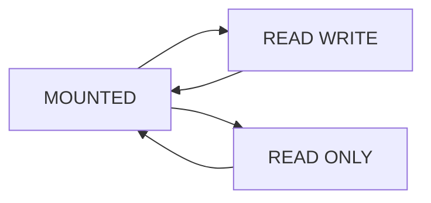

# Lesson 14 — Managing Pluggable Databases (ภาษาไทย)

[Multitenant](./README.md) · [Companion Lab](../10-Labs/Lab-08-PDB-Lifecycle-Read-Only.md)

> Oracle University 19c Administration Workshop Lesson 14 topic mapping. Original Thai educational reconstruction; Student Guide page-level fidelity PENDING. Read-only teaching; lifecycle commands must not be executed on production without approval.

## Learning outcomes
เข้าใจ CDB กับ PDB administrative scope, open modes, save state, common vs local users, service registration, monitoring และ troubleshooting.

## State diagram



PDB อาจเป็น MOUNTED แม้ instance และ CDB จะ OPEN. `SAVE STATE` สามารถบันทึกสถานะการเปิดสำหรับ startup ครั้งถัดไปใน configuration ที่รองรับ แต่ไม่ใช่การรับประกันว่า service/client พร้อมใช้งาน.

## Query ที่ปลอดภัย

```sql
SHOW USER
SHOW CON_NAME
SELECT con_id,name,open_mode,restricted FROM v$pdbs ORDER BY con_id;
SELECT name,network_name,con_id FROM v$services ORDER BY name;
SELECT name,open_mode,cdb FROM v$database;
```

## Administration model
- CDB$ROOT: ดูแล shared instance, common users และ CDB-wide metadata.
- PDB: application users/schemas and workload อยู่ใน tenant scope.
- Service: client ควรระบุ service ของ target PDB; SID ไม่ใช่ PDB name.
- คำสั่ง `ALTER SESSION SET CONTAINER`, `ALTER PLUGGABLE DATABASE OPEN/CLOSE`, `SAVE STATE` มีผลต่อ state/scope; **ไม่อยู่ใน lab แบบ read-only**.
- ต้องพิจารณา roles, application sessions, monitoring, open mode และ impact ก่อนทำ lifecycle action.

## Incident walkthrough
หลัง reboot แอปแจ้ง ORA-12514 ทั้งที่ listener ยังทำงาน:
1. ตรวจ listener services และ client SERVICE_NAME
2. ตรวจ `V$INSTANCE`, `V$DATABASE` และ `V$PDBS.OPEN_MODE`
3. ตรวจ service registration/log timeline
4. ตรวจ common/local account scope และ auth เมื่อ connection ผ่าน listener แล้ว
5. เสนอ approved PDB lifecycle fix แทน restart instance แบบเดาสาเหตุ

## Scenario & review
1. ถ้า CDB OPEN แต่ target PDB MOUNTED จะเกิดอะไรกับ login?
2. ทำไม listener UP ≠ PDB READY?
3. จะตรวจว่า service ไหนชี้ container ไหน?
4. Save state เปลี่ยนพฤติกรรมเมื่อ restart อย่างไร?
5. จะ rollback อย่างไรถ้า application cutover ไปผิด PDB?

## References
- [Oracle 19c Multitenant Administrator's Guide](https://docs.oracle.com/en/database/oracle/oracle-database/19/multi/)
- [Oracle 26ai documentation](https://docs.oracle.com/en/database/oracle/oracle-database/26/)

## Source-objective deepening — PDB-level Parameters, HOST/PORT and Safe Drop

Lesson 14 ต้นฉบับมีวัตถุประสงค์ให้ DBA พิจารณาผลกระทบของ **initialization parameter scope**, การกำหนด **HOST/PORT ของ PDB**, และการ **DROP PDB** อย่างถูกต้อง.

- **Parameter scope:** parameter บางตัวปรับได้เฉพาะ CDB บางตัวปรับระดับ PDB ได้; ตรวจ `V$SYSTEM_PARAMETER`, `V$PARAMETER`, `ISPDB_MODIFIABLE` ของ release จริง และเก็บค่า baseline ของ root/PDB ก่อนเปลี่ยน. ไม่มีสิทธิ์สมมติว่าค่าใน root จะ override local ทุกตัวแบบเดียวกัน.
- **HOST/PORT:** Oracle SQL PDB clauses สำหรับ endpoint naming โดยเฉพาะกรณี PDB ที่ถูกอ้างอิงโดย proxy ต้องใช้ตาม prerequisites, listener/VIP topology และ service registration; **ไม่ใช่คำสั่งตั้ง HTTP port ของ application**.
- **DROP PDB:** destructive operation อาจลบไฟล์ถ้าเลือก clause ที่รวม datafiles. ต้องเก็บ source backup, verify target GUID/CON_ID/PDB name, close sessions, ตรวจ user workloads, export metadata และ change approvals ก่อน. ห้ามทดลอง DROP ใน read-only Lab 08.
- **Restricted mode:** PDB `READ WRITE` แต่ `RESTRICTED=YES` อาจยัง block ordinary application users.

```sql
-- Safe observation only
SELECT con_id,name,open_mode,restricted FROM v$pdbs ORDER BY con_id;
SELECT name,value,ispdb_modifiable FROM v$parameter
WHERE name IN ('open_cursors','optimizer_mode','sessions');
```

Reference: [Oracle 19c Multitenant Administration](https://docs.oracle.com/en/database/oracle/oracle-database/19/multi/overview-of-managing-a-multitenant-environment.html).
