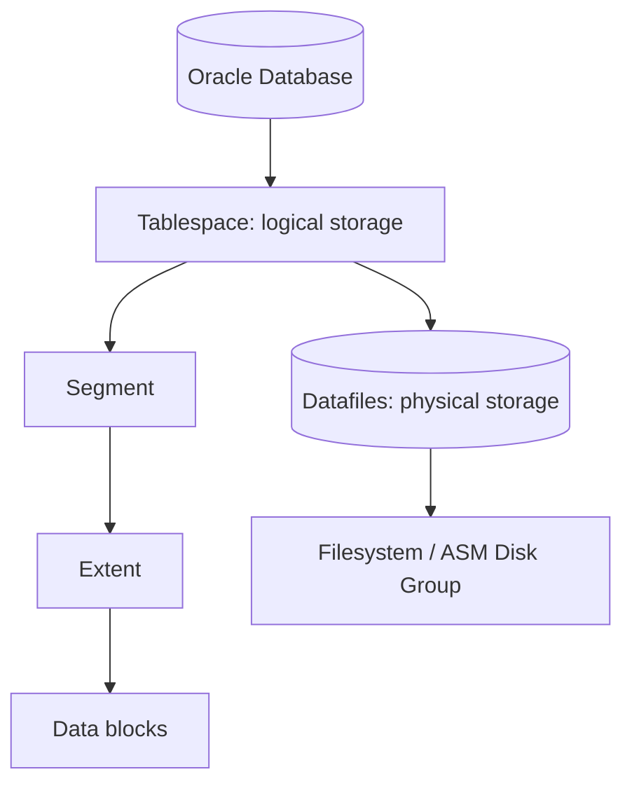

# Lesson 16 — Creating and Managing Tablespaces (ภาษาไทย)

[Storage index](./README.md) · [Lab 09](../10-Labs/Lab-09-Storage-and-Undo-Inspection.md)

> **Oracle University 19c Administration Workshop Lesson 16** mapped by source inventory. Original Thai teaching reconstruction; not page-verified against proprietary Student Guide. **Static authored; no Oracle live run.** 19c foundation with 26ai documentation as current reference.

## เป้าหมาย
เข้าใจ **Permanent, Temporary and Undo Tablespaces** พร้อมวิเคราะห์ Oracle storage problems อย่างเป็นลำดับ ไม่แก้ด้วยการเพิ่ม datafile หรือเปลี่ยน initialization parameters โดยไม่มีหลักฐาน.

## Mental model



## Core concepts
Permanent stores user segments; temporary supports workareas; undo stores before images. Smallfile/bigfile, autoextend NEXT/MAXSIZE, quotas, read-only/offline and underlying storage limits all matter.

**Operational distinction:** Logical space, allocated bytes, recoverable/reclaimable segment space, autoextend maximum, and free filesystem/ASM capacity are separate measurements. A single percent-used number is insufficient to decide a resize.

| ประเด็น | ต้องตรวจ | ตัดสินใจอย่างไร |
|---|---|---|
| Capacity | bytes, free, maxbytes, autoextend | หา bottleneck จริงก่อนขยาย |
| Container scope | current CDB/PDB, datafile scope | ห้ามเปลี่ยน object ผิด tenant |
| Performance | I/O pressure, segment growth, transactions | วิเคราะห์ช่วงเวลาและ workload |
| Recovery | archive/backup and rollback | ตรวจ restore proof ก่อน DDL |

## Read-only SQL

ต้องมี approved SELECT privileges. `DBA_*` views แสดงตาม container/role; output อาจรวม path ที่ sensitive — ห้ามเผยแพร่ path ภายในแบบไม่ redact.

```sql
SHOW CON_NAME
SELECT tablespace_name,contents,status,bigfile FROM dba_tablespaces ORDER BY tablespace_name;
```

### How to interpret
ตรวจว่าเป็น permanent, temporary, undo หรือ application tablespace; เก็บ timestamp และเทียบย้อนหลัง ถ้าดูแค่ DBA_FREE_SPACE จะพลาด autoextend headroom, temp และ underlying storage capacity. เมื่อ SQL เจอ ORA-00942/ORA-01031 ให้ขอ grant เฉพาะ view แทนการ grant DBA.

## Incident & troubleshooting
ORA-01653 relates to segment allocation; ORA-01652 is commonly temp segment growth. Confirm datafile autoextend and host/ASM free capacity before change.

1. เก็บ exact ORA error, time, SQL/workload, affected schema and PDB.
2. ตรวจ class of tablespace, file allocations, free extents, maxbytes and actual filesystem/ASM free.
3. ตรวจ application growth, long transactions, backup/archiving and alert log.
4. แยก emergency mitigation จาก root-cause fix; เขียน impact/rollback แล้วขอ change approval.
5. ทำ post-change verification และติดตาม trend ไม่ตัดสินจาก snapshot เดียว.

## Practice exercise
- อธิบายเหตุที่ `DBA_DATA_FILES.BYTES` ไม่เท่ากับ used space ของ table.
- อธิบายข้อแตกต่าง free extents vs unused blocks below HWM.
- ทำ capacity worksheet: allocated, max autoextend, storage free, projected growth, escalation threshold.
- ระบุสิ่งที่จะต้อง rollback/restore หากมีการเปลี่ยนแปลง.

## Knowledge check
1. ถ้าพื้นที่ database เต็ม แต่ filesystem ยังเหลือ จะตรวจอะไร?
2. ถ้า autoextend ON แต่ MAXBYTES เท่าปัจจุบัน มี headroom จริงหรือไม่?
3. ถ้า PDB ต้องใช้ quota จะตรวจ owner และสิทธิ์อะไร?
4. ทำไม DELETE อาจไม่ทำให้ disk usage ลดทันที?
5. ปัญหา space สามารถเกิดร่วมกับ undo/redo/backup ได้อย่างไร?

## Sources
- Oracle University Lesson 16: title-level mapping, full fidelity pending.
- [Oracle 19c DBA Guide](https://docs.oracle.com/en/database/oracle/oracle-database/19/admin/)
- [Oracle 26ai DBA Guide](https://docs.oracle.com/en/database/oracle/oracle-database/26/admin/)
- [Oracle 26ai Managing Undo](https://docs.oracle.com/en/database/oracle/oracle-database/26/admin/managing-undo.html)

## Source-objective deepening — Oracle Managed Files and Online Datafile Move

Lesson 16 ครอบคลุม creation/alter/drop tablespace รวมถึง **Oracle Managed Files (OMF)** และ **moving/renaming online datafiles**. OMF ให้ Oracle จัดการ file naming/lifecycle ตาม destinations เช่น `DB_CREATE_FILE_DEST`; ช่วยลด manual naming errors แต่ยังต้องตรวจ volume ownership, ASM/OS capacity และ delete/restore safety.

**Online datafile move:** Oracle รองรับ `ALTER DATABASE MOVE DATAFILE` ในการย้าย/เปลี่ยนชื่อ datafile ขณะ database เปิด. ต้องมีพื้นที่เพียงพอสำหรับ original และ copy ระหว่าง operation; ปลายทางที่มีชื่อซ้ำเป็นความเสี่ยงอย่างมากเมื่อใช้ `REUSE`. สำรวจ file mapping/read-only ก่อนและหลังที่ DBA อนุมัติ:

```sql
SELECT tablespace_name,file_id,file_name,bytes,status,autoextensible,maxbytes
FROM dba_data_files ORDER BY tablespace_name,file_id;
SELECT name,value FROM v$parameter WHERE name IN ('db_create_file_dest','db_recovery_file_dest');
```

**Change-control worksheet (do not execute):** source file owner → target filesystem/ASM and free capacity → supported SQL syntax → standby/backup dependencies → application load and window → after-move datafile path verification → rollback. DROP TABLESPACE ต้องแยก metadata removal กับ deletion of datafiles; ไม่ใช่คำสั่งล้างไฟล์ทดลองแบบปลอดภัย.

Official: [Oracle 19c Managing Data Files](https://docs.oracle.com/en/database/oracle/oracle-database/19/admin/managing-data-files-and-temp-files.html).
