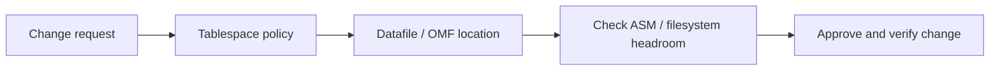

# Lesson 16 — Creating and Managing Tablespaces (ภาษาไทย)

> 🧠 **ภาพจำก่อนอ่าน:** 🗄️ Data → ⚙️ Process → 🩺 Health  
> 🎨 [Visual Guide ของวิชานี้](../VISUAL-MEMORY-GUIDE-TH.md) — ภาพช่วยจำ ไม่แทนคำสั่งและเนื้อหาจริง

[Storage index](./README.md) · [Lab 09](../10-Labs/Lab-09-Storage-and-Undo-Inspection.md) · [📘 Storage Fundamentals: Lesson 15](./Lesson-15-Database-Storage-Overview-TH.md)

> **Oracle University 19c Administration Workshop Lesson 16** mapped by source inventory. Original Thai teaching reconstruction; not page-verified against proprietary Student Guide. **Static authored; no Oracle live run.** 19c foundation with 26ai documentation as current reference.

## เป้าหมาย
- เข้าใจการสร้าง/แก้ไข Tablespace และผลต่อ Datafile โดยแยก Metadata กับ Physical Storage
- อ่านค่า `BIGFILE`, Autoextend และ OMF เพื่อประเมินข้อจำกัดก่อนย้ายหรือขยายไฟล์
- วางแผน Verification, Change Window และ Rollback โดยไม่รัน DDL บน Production

> ความต่างระหว่าง logical vs physical space และแนวคิด capacity พื้นฐานอยู่ใน [Lesson 15](./Lesson-15-Database-Storage-Overview-TH.md)

## Mental model



## Core concepts

- **Permanent / Temporary / Undo:** แต่ละชนิดมีหน้าที่ต่างกัน; ก่อนแก้ต้องตรวจให้แน่ใจว่า Tablespace ไหนเป็นเป้าหมาย
- **Smallfile vs Bigfile:** พิจารณาความเหมาะสมกับขนาดและการจัดการ Datafile ไม่เลือกจากชื่อเพียงอย่างเดียว
- **Autoextend NEXT/MAXSIZE:** การเปิด Autoextend ไม่ได้แปลว่าพื้นที่ปลายทางเพียงพอ ต้องดูขีดจำกัดและ ASM/Filesystem
- **Oracle Managed Files (OMF):** ช่วยจัดการชื่อและวงจรชีวิตไฟล์ แต่การย้าย/ลบต้องตรวจ backup, standby และ ownership ก่อน

| Operation ที่วางแผน | หลักฐาน Read-only ที่ควรมี | สิ่งต้องตรวจ |
|---|---|---|
| เพิ่ม Capacity | Current/Max Bytes, ASM/FS free, trend | NEXT/MAXSIZE และ growth |
| Move Datafile | File Name/ID, destination, dependencies | พื้นที่สำหรับไฟล์เดิมและไฟล์ใหม่ |
| Alter Tablespace | Contents, status, tenant, quota | Impact ต่อ session, object และ application |
| Drop / Cleanup | Owner, backup proof, restore path | การลบ metadata vs physical files |

> สำหรับหลักการวัด Logical Space กับ Allocated Bytes ดู [Lesson 15](./Lesson-15-Database-Storage-Overview-TH.md)

## Read-only SQL

ต้องมี approved SELECT privileges. `DBA_*` views แสดงตาม container/role; output อาจรวม path ที่ sensitive — ห้ามเผยแพร่ path ภายในแบบไม่ redact.

```sql
SHOW CON_NAME
SELECT tablespace_name,contents,status,bigfile FROM dba_tablespaces ORDER BY tablespace_name;
```

### How to interpret
`DBA_TABLESPACES` ใช้ยืนยันชนิดและสถานะ Tablespace ใน Container ที่ถูกต้อง; ถ้าจะพิจารณา Datafile Move/Resize ให้ตรวจ `DBA_DATA_FILES` และการกำหนด OMF ต่อในส่วน Source-objective deepening. ไม่มีสิทธิ์อ่าน View ให้ขอ Read-only Access ที่จำเป็นแทนการยกระดับเป็น DBA.

## Incident & troubleshooting
**ORA-01653:** Segment ไม่สามารถ Allocate Extent; อย่าสรุปว่าเพิ่ม Datafile อย่างเดียวจะแก้ได้เสมอ

1. บันทึก Object, Tablespace, Container/PDB, เวลาและ SQL ที่ล้มเหลว
2. ตรวจ Datafile Capacity, Autoextend MAXSIZE, Tablespace Quota และ ASM/FS free space
3. แยกปัญหาขนาดไฟล์ปลายทางออกจากกรณี Object/Quota/Allocation Constraint
4. ประเมินแนวทาง Add/Resize/Move และ Backup/Standby Dependencies ก่อน Change
5. หลัง Change ที่อนุมัติและทดสอบแล้ว ตรวจ file mapping, object access, alert log และ growth trend

## Practice exercise
- สร้าง Worksheet (ไม่รัน DDL) เปรียบเทียบ Smallfile/Bigfile สำหรับ workload ที่โตเร็ว
- วาด Flow สำหรับการย้าย Datafile: source path → destination → sufficient space → verification → rollback
- อธิบายความต่างของการเปลี่ยน `MAXSIZE` กับการเพิ่ม Capacity ของ ASM/Filesystem

## Knowledge check
1. เหตุใด Autoextend ON จึงไม่รับประกันว่าเพิ่ม Extent สำเร็จ?
2. `DB_CREATE_FILE_DEST` เกี่ยวข้องกับ OMF และการจัดการไฟล์อย่างไร?
3. การย้าย Datafile ควรประเมินผลกระทบ Backup/Standby และพื้นที่ปลายทางอย่างไร?
4. การ Drop Tablespace อาจกระทบ Metadata และ Files ต่างกันอย่างไร?

## Sources
- Oracle University Lesson 16: title-level mapping, full fidelity pending.
- [Oracle 19c DBA Guide](https://docs.oracle.com/en/database/oracle/oracle-database/19/admin/)
- [Oracle 26ai DBA Guide](https://docs.oracle.com/en/database/oracle/oracle-database/26/admin/)
- [Oracle 26ai Managing Undo](https://docs.oracle.com/en/database/oracle/oracle-database/26/admin/managing-undo.html)

## 🛡️ Official-document validation — Online Datafile Move Side Effects (2026-10-21)

`ALTER DATABASE MOVE DATAFILE` เป็นการแก้ไข File Mapping/Physical Storage จริง **ไม่ใช่ Safe Read-only Example**; ห้ามนำไปรันใน Production หรือ Companion Lab ที่กำหนดว่า Read-only

| หัวข้อ | พฤติกรรมที่ต้องระบุใน Change Plan |
|---|---|
| `KEEP` | เก็บไฟล์เดิมไว้แต่ Control File ชี้ Datafile ที่ Location ใหม่หลัง Move สำเร็จ |
| `REUSE` | **มีความเสี่ยง overwrite** ไฟล์ปลายทางชื่อซ้ำ — ห้ามใช้โดยไม่ยืนยัน Owner/Backup/Approval |
| `OFFLINE` Datafile | Oracle ยก Error ถ้าใช้ Online `MOVE DATAFILE` กับ Datafile ที่ Offline |
| Data Guard Standby | Online Move บน Primary ไม่ได้ย้าย Standby File ให้อัตโนมัติ ต้องวางแผนแยก |
| Flashback Database | Flashback ไม่ย้าย File กลับ Path เดิม แม้ Content จะย้อนตามเวลา |
| Windows | ตาม Oracle 19c Guide ไฟล์เดิม **อาจยังค้างอยู่** หลัง Move แม้ไม่ได้ระบุ `KEEP`; อย่าลบไฟล์ด้วยมือจนกว่าจะตรวจ Active Path/Backup/Change Approval |

```sql
-- Authorized read-only inspection; no ALTER or DROP.
SELECT tablespace_name,file_id,file_name,status,bytes,autoextensible,maxbytes
FROM dba_data_files
ORDER BY tablespace_name,file_id;
```

**Official 19c source:** [Managing Data Files — Moving Online Data Files](https://docs.oracle.com/en/database/oracle/oracle-database/19/admin/managing-data-files-and-temp-files.html). ข้อมูลนี้เป็น Version-linked Supplement ไม่ใช่การอ้างว่าได้ทำ File Move จริง.

## Source-objective deepening — Oracle Managed Files and Online Datafile Move

Lesson 16 ครอบคลุม creation/alter/drop tablespace รวมถึง **Oracle Managed Files (OMF)** และ **moving/renaming online datafiles**. OMF ให้ Oracle จัดการ file naming/lifecycle ตาม destinations เช่น `DB_CREATE_FILE_DEST`; ช่วยลด manual naming errors แต่ยังต้องตรวจ volume ownership, ASM/OS capacity และ delete/restore safety.

**Online datafile move:** Oracle รองรับ `ALTER DATABASE MOVE DATAFILE` ในการย้าย/เปลี่ยนชื่อ datafile ขณะ database เปิด. ต้องมีพื้นที่เพียงพอสำหรับ original และ copy ระหว่าง operation; ปลายทางที่มีชื่อซ้ำเป็นความเสี่ยงอย่างมากเมื่อใช้ `REUSE`. สำรวจ file mapping/read-only ก่อนและหลังที่ DBA อนุมัติ:

```sql
SELECT tablespace_name,file_id,file_name,bytes,status,autoextensible,maxbytes
FROM dba_data_files ORDER BY tablespace_name,file_id;
SELECT name,value FROM v$parameter WHERE name IN ('db_create_file_dest','db_recovery_file_dest');
```

**Change-control worksheet (do not execute):** source file owner → target filesystem/ASM and free capacity → supported SQL syntax → standby/backup dependencies → application load and window → after-move datafile path verification → rollback. DROP TABLESPACE ต้องแยก metadata removal กับ deletion of datafiles; ไม่ใช่คำสั่งล้างไฟล์ทดลองแบบปลอดภัย.

Official: [Oracle 19c Managing Data Files](https://docs.oracle.com/en/database/oracle/oracle-database/19/admin/managing-data-files-and-temp-files.html).
