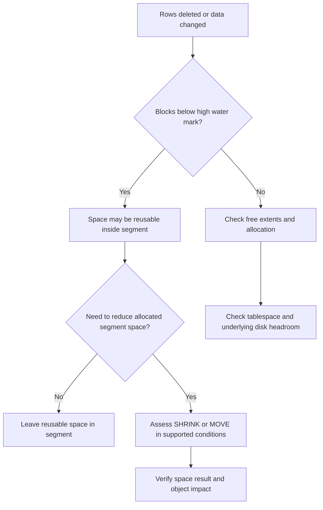

# Lesson 17 — Improving Space Usage (ภาษาไทย)

> 🧠 **ภาพจำก่อนอ่าน:** 🗄️ Data → ⚙️ Process → 🩺 Health  
> 🎨 [Visual Guide ของวิชานี้](../VISUAL-MEMORY-GUIDE-TH.md) — ภาพช่วยจำ ไม่แทนคำสั่งและเนื้อหาจริง

[Storage index](./README.md) · [Lab 09](../10-Labs/Lab-09-Storage-and-Undo-Inspection.md)

> **Oracle University 19c Administration Workshop Lesson 17** mapped by source inventory. Original Thai teaching reconstruction; not page-verified against proprietary Student Guide. **Static authored; no Oracle live run.** 19c foundation with 26ai documentation as current reference.

## 🎯 เป้าหมาย

เข้าใจว่าเหตุใด Segment ใช้พื้นที่มากกว่าข้อมูลจริง และเลือกวิธี **Reuse, Reclaim หรือเพิ่ม Capacity** ได้อย่างมีเหตุผล โดยไม่สับสนระหว่างขนาด Segment, Tablespace และ Datafile

> 📘 พื้นฐาน Tablespace / Segment / Extent / Block และวิธีอ่าน Capacity อยู่ใน [Lesson 15 — Database Storage Overview](./Lesson-15-Database-Storage-Overview-TH.md) บทนี้จะต่อยอดเฉพาะการใช้พื้นที่ให้มีประสิทธิภาพ

## 🧠 Mental model — พื้นที่กลับไปอยู่ตรงไหน?



**จำง่าย ๆ:** DELETE ไม่ได้ย่อ Datafile อัตโนมัติ; Reuse ภายใน Segment, คืน Extents ให้ Tablespace และย่อ Datafile เป็นคนละขั้นตอน

## 1. Core concepts เฉพาะบทนี้

| แนวคิด | ใช้ทำอะไร | จุดที่ต้องระวัง |
|---|---|---|
| High Water Mark (HWM) | ระบุตำแหน่งขอบเขต Blocks ที่เคยถูกใช้งาน | DELETE บางส่วนไม่รับประกันว่า HWM จะลด |
| Automatic Segment Space Management (ASSM) | ใช้ Bitmap ติดตามพื้นที่ว่างภายใน Segment | เป็นคนละชั้นกับการดู Free Space ของ Filesystem |
| Segment Advisor | ช่วยประเมินโอกาสคืนพื้นที่บางประเภท | ต้องตรวจข้อกำหนด/สิทธิ์และคำแนะนำก่อนลงมือ |
| SHRINK SPACE | บาง Segment คืนพื้นที่ที่ไม่ได้ใช้ภายใต้เงื่อนไขที่รองรับ | อาจต้องใช้ Row Movement และกระทบ ROWID/Concurrency |
| MOVE / Rebuild | จัดวางข้อมูลหรือโครงสร้างใหม่ | ตรวจ Index, Constraints, Lock/Availability ตาม Operation และ Version |
| Datafile RESIZE | ลดขนาดไฟล์เมื่อพื้นที่ท้ายไฟล์สามารถปล่อยได้ | Segment shrink อย่างเดียวไม่รับประกันว่า Resize สำเร็จ |

**ข้อควรจำ:** `DBA_SEGMENTS.BYTES` แสดงพื้นที่ที่ Segment จัดสรรไว้ ไม่ใช่จำนวน Bytes ที่แถวข้อมูลใช้งานจริงหรือจำนวน Bytes ที่สามารถคืนได้ทั้งหมด

## 2. Read-only inspection

ใช้เฉพาะกับระบบที่ได้รับอนุญาต และยืนยันชื่อ PDB/Schema ก่อนเสมอ View `DBA_*` ต้องมีสิทธิ์อ่านตามที่องค์กรกำหนด

```sql
SHOW CON_NAME

SELECT owner, segment_name, segment_type, tablespace_name,
       bytes, blocks, extents
FROM   dba_segments
WHERE  owner = 'LAB_OWNER'
ORDER BY bytes DESC;

SELECT tablespace_name, SUM(bytes) AS free_bytes
FROM   dba_free_space
GROUP BY tablespace_name
ORDER BY tablespace_name;
```

เมื่อเทียบสองชุดข้อมูลนี้ ห้ามลบ `DBA_SEGMENTS.BYTES` ออกจาก `DBA_FREE_SPACE` โดยตรงแล้วตีความเป็น Reclaimable Space — ทั้งสอง View วัดคนละมิติ และพื้นที่ว่างภายใน Segment อาจยังไม่คืนเป็น Free Extents

### อ่านผลอย่างไร

1. ตรวจว่า Segment ไหนโตผิดปกติและมี Growth Trend หรือไม่
2. แยก Allocated Segment Bytes, Free Extents ของ Tablespace และ Headroom ของ Datafile/ASM
3. ทบทวนการลบ/อัปเดตข้อมูลที่ผ่านมา: รูปแบบข้อมูล, HWM, Transaction และสถิติที่อาจล้าสมัย
4. ก่อนพิจารณา Reclaim ตรวจว่า Object Type, Tablespace Mode, Version และ Licensing/Privileges รองรับวิธีนั้นจริง
5. ตรวจ Performance Baseline, Backup/Restore Capability และ Window ที่ได้รับอนุมัติ

ถ้าขาดสิทธิ์อ่าน View อย่าแก้ด้วยการ Grant DBA โดยอัตโนมัติ ให้ประสาน DBA เพื่อสิทธิ์ Read-only เท่าที่จำเป็น

## 3. Troubleshooting — ORA-01653 / พื้นที่โตผิดปกติ

**สถานการณ์:** งาน Batch ไม่สามารถ Allocate Extent ใหม่ได้ แต่ผู้ดูแลเห็นว่าเครื่องยังมี Disk ว่าง

1. บันทึก Error Message, Object, Tablespace, Container, เวลา, SQL และ Transaction ที่เกี่ยวข้อง
2. ตรวจ Tablespace Free Extents, Datafile Autoextend Limit, Quota และพื้นที่ Filesystem/ASM
3. ถ้าปัญหาอยู่ที่ความจุ ให้แก้ Capacity ตาม Change Process ไม่เลือก SHRINK เพียงเพราะเห็นจำนวนแถวลด
4. ถ้าข้อมูลถูกลบจำนวนมากแล้ว Segment ยังจองพื้นที่ ให้ประเมิน Reuse ก่อน และค่อยตรวจว่ามีเหตุผลต้อง Reclaim หรือไม่
5. ประเมินผลกระทบ ROWID, Index, Lock, Redo/Undo, Long-running Queries และ Time Window ก่อน Change
6. เมื่อทำใน Sandbox ภายใต้สิทธิ์ที่ได้รับแล้ว ให้ตรวจ Size, Query Performance, Availability และ Rollback Plan อีกครั้ง

## 🧪 Practice exercise — ตัดสินใจจากหลักฐาน

- ตาราง Staging ลบข้อมูลไป 80% แต่ Batch ถัดไปจะโหลดข้อมูลใหม่ปริมาณใกล้เดิม: เหตุใดการ Reuse อาจดีกว่าการ Shrink?
- ตาราง Audit โตต่อเนื่องและไม่มีการลบข้อมูล: การ Shrink จะช่วยแก้ Root Cause หรือไม่?
- Datafile ใกล้ MAXBYTES แต่ Storage มีพื้นที่ว่าง: ควรตรวจอะไร ก่อนเพิ่ม Autoextend Limit?
- ถ้าต้องย้าย Segment, คำถามเรื่อง Row Movement, Index, Downtime และ Rollback มีอะไรบ้าง?

## ✅ Knowledge check

1. HWM ของ Segment กับขนาด Datafile ต่างกันอย่างไร?
2. Free Space ใน Segment สามารถกลับไปเป็น Free Extent ใน Tablespace ได้ภายใต้เงื่อนไขอะไร?
3. DELETE จำนวนมากแล้ว `DBA_SEGMENTS.BYTES` ไม่ลด แปลว่า Database ผิดปกติหรือไม่?
4. ทำไม SHRINK / MOVE จึงอาจเป็น Change ที่มีผลต่อ Application?
5. จะเลือก Reuse, Capacity Increase, Compression หรือ Reclaim โดยดู Metric/Constraints อะไร?

## Sources
- Oracle University Lesson 17: title-level mapping, full fidelity pending.
- [Oracle 19c DBA Guide](https://docs.oracle.com/en/database/oracle/oracle-database/19/admin/)
- [Oracle 26ai DBA Guide](https://docs.oracle.com/en/database/oracle/oracle-database/26/admin/)
- [Oracle 26ai Managing Undo](https://docs.oracle.com/en/database/oracle/oracle-database/26/admin/managing-undo.html)

## Source-objective deepening — Private Temporary Tables, Compression, Resumable Allocation

จุดที่ Lesson 17 ต้นฉบับเน้นเพิ่ม ได้แก่:
- **Private Temporary Table (PTT):** temporary table มี metadata/data แบบ session-private ภายใต้ naming conventions และ duration ที่รองรับ. ต่างจาก Global Temporary Table ซึ่ง definition shared และ data private ตาม session/transaction. ควรใช้สำหรับ staging ที่ต้องการ isolation และ lifecycle สั้น ไม่ใช่แก้ปัญหา permanent table bloat.
- **Compression:** การลดขนาด storage และ I/O อาจแลก CPU/latency และมี compression modes ที่ขึ้นกับ license/edition. ต้อง benchmark insert/update/query และแน่ใจว่า compression ที่เลือกได้รับอนุญาตก่อนนำไปใช้.
- **Segment shrink:** คืน unused allocated segment space ใน supported segments/tablespace types; อาจเปลี่ยน ROWID และกระทบ long-running queries/index management. ต้องแยก shrink segment จาก resize datafile.
- **Resumable space allocation:** คำสั่งที่พบ space errors แบบรองรับอาจ suspend ชั่วคราวรอ DBA เพิ่มพื้นที่ แทนล้มเหลวทันที; ต้องกำหนด timeout/alerting และระวัง long-running suspended transactions. ไม่ใช่ auto-extend ที่รับประกันว่าจะมี disk space.
- **Locally managed tablespace/ASSM:** bitmaps จัดการ extents/segment free space ต่างชั้นกัน.

**Practice tabletop:** load 1M records ลง staging แล้วเจอ ORA-01653: จะตัดสินใจขยาย tablespace, resume statement, compression หรือแก้ batch/segment design อย่างไร? เก็บ available disk, maxbytes, job timeout, licenses, locks และ transaction impact ก่อนตอบ.

Oracle reference: [Oracle Database 19c Administrator's Guide](https://docs.oracle.com/en/database/oracle/oracle-database/19/admin/).
