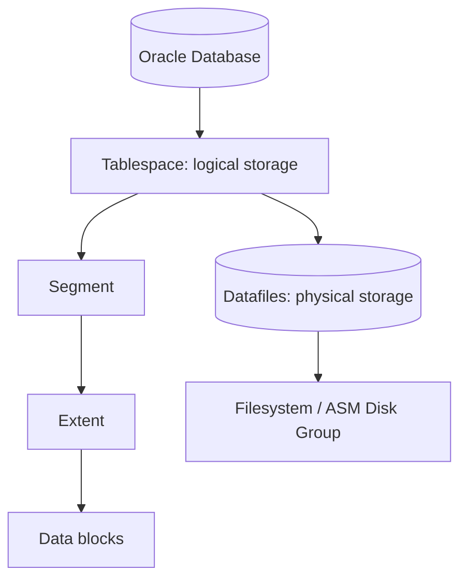

# Lesson 17 — Improving Space Usage (ภาษาไทย)

> 🧠 **ภาพจำก่อนอ่าน:** 🗄️ Data → ⚙️ Process → 🩺 Health  
> 🎨 [Visual Guide ของวิชานี้](../VISUAL-MEMORY-GUIDE-TH.md) — ภาพช่วยจำ ไม่แทนคำสั่งและเนื้อหาจริง

[Storage index](./README.md) · [Lab 09](../10-Labs/Lab-09-Storage-and-Undo-Inspection.md)

> **Oracle University 19c Administration Workshop Lesson 17** mapped by source inventory. Original Thai teaching reconstruction; not page-verified against proprietary Student Guide. **Static authored; no Oracle live run.** 19c foundation with 26ai documentation as current reference.

## เป้าหมาย
เข้าใจ **Space allocation, HWM and reclaim** พร้อมวิเคราะห์ Oracle storage problems อย่างเป็นลำดับ ไม่แก้ด้วยการเพิ่ม datafile หรือเปลี่ยน initialization parameters โดยไม่มีหลักฐาน.

## Mental model



## Core concepts
ASSM, high water mark, segment advisor and shrink/move. DELETE doesn't immediately reduce allocated datafile size. DBMS_SPACE and advisor outputs have privilege requirements.

**Operational distinction:** Logical space, allocated bytes, recoverable/reclaimable segment space, autoextend maximum, and free filesystem/ASM capacity are separate measurements. A single percent-used number is insufficient to decide a resize.

| ประเด็น | ต้องตรวจ | ตัดสินใจอย่างไร |
|---|---|---|
| Capacity | bytes, free, maxbytes, autoextend | หา bottleneck จริงก่อนขยาย |
| Container scope | current CDB/PDB, datafile scope | ห้ามเปลี่ยน object ผิด tenant |
| Performance | I/O pressure, segment growth, transactions | วิเคราะห์ช่วงเวลาและ workload |
| Recovery | archive/backup and rollback | ตรวจ restore proof ก่อน DDL |

## Read-only SQL

ต้องมี approved SELECT privileges. `DBA_*` views แสดงตาม container/role; output อาจรวม path ที่ sensitive — ห้ามเผยแพร่ path ภายในแบบไม่ redact.

```sql
SHOW CON_NAME
SELECT tablespace_name,file_name,bytes,autoextensible,maxbytes FROM dba_data_files ORDER BY tablespace_name;
```

### How to interpret
ตรวจว่าเป็น permanent, temporary, undo หรือ application tablespace; เก็บ timestamp และเทียบย้อนหลัง ถ้าดูแค่ DBA_FREE_SPACE จะพลาด autoextend headroom, temp และ underlying storage capacity. เมื่อ SQL เจอ ORA-00942/ORA-01031 ให้ขอ grant เฉพาะ view แทนการ grant DBA.

## Incident & troubleshooting
Space reclamation can lock objects/change ROWIDs and affect indexes: assess impact and test in lab rather than running SHRINK blindly.

1. เก็บ exact ORA error, time, SQL/workload, affected schema and PDB.
2. ตรวจ class of tablespace, file allocations, free extents, maxbytes and actual filesystem/ASM free.
3. ตรวจ application growth, long transactions, backup/archiving and alert log.
4. แยก emergency mitigation จาก root-cause fix; เขียน impact/rollback แล้วขอ change approval.
5. ทำ post-change verification และติดตาม trend ไม่ตัดสินจาก snapshot เดียว.

## Practice exercise
- อธิบายเหตุที่ `DBA_DATA_FILES.BYTES` ไม่เท่ากับ used space ของ table.
- อธิบายข้อแตกต่าง free extents vs unused blocks below HWM.
- ทำ capacity worksheet: allocated, max autoextend, storage free, projected growth, escalation threshold.
- ระบุสิ่งที่จะต้อง rollback/restore หากมีการเปลี่ยนแปลง.

## Knowledge check
1. ถ้าพื้นที่ database เต็ม แต่ filesystem ยังเหลือ จะตรวจอะไร?
2. ถ้า autoextend ON แต่ MAXBYTES เท่าปัจจุบัน มี headroom จริงหรือไม่?
3. ถ้า PDB ต้องใช้ quota จะตรวจ owner และสิทธิ์อะไร?
4. ทำไม DELETE อาจไม่ทำให้ disk usage ลดทันที?
5. ปัญหา space สามารถเกิดร่วมกับ undo/redo/backup ได้อย่างไร?

## Sources
- Oracle University Lesson 17: title-level mapping, full fidelity pending.
- [Oracle 19c DBA Guide](https://docs.oracle.com/en/database/oracle/oracle-database/19/admin/)
- [Oracle 26ai DBA Guide](https://docs.oracle.com/en/database/oracle/oracle-database/26/admin/)
- [Oracle 26ai Managing Undo](https://docs.oracle.com/en/database/oracle/oracle-database/26/admin/managing-undo.html)

## Source-objective deepening — Private Temporary Tables, Compression, Resumable Allocation

จุดที่ Lesson 17 ต้นฉบับเน้นเพิ่ม ได้แก่:
- **Private Temporary Table (PTT):** temporary table มี metadata/data แบบ session-private ภายใต้ naming conventions และ duration ที่รองรับ. ต่างจาก Global Temporary Table ซึ่ง definition shared และ data private ตาม session/transaction. ควรใช้สำหรับ staging ที่ต้องการ isolation และ lifecycle สั้น ไม่ใช่แก้ปัญหา permanent table bloat.
- **Compression:** การลดขนาด storage และ I/O อาจแลก CPU/latency และมี compression modes ที่ขึ้นกับ license/edition. ต้อง benchmark insert/update/query และแน่ใจว่า compression ที่เลือกได้รับอนุญาตก่อนนำไปใช้.
- **Segment shrink:** คืน unused allocated segment space ใน supported segments/tablespace types; อาจเปลี่ยน ROWID และกระทบ long-running queries/index management. ต้องแยก shrink segment จาก resize datafile.
- **Resumable space allocation:** คำสั่งที่พบ space errors แบบรองรับอาจ suspend ชั่วคราวรอ DBA เพิ่มพื้นที่ แทนล้มเหลวทันที; ต้องกำหนด timeout/alerting และระวัง long-running suspended transactions. ไม่ใช่ auto-extend ที่รับประกันว่าจะมี disk space.
- **Locally managed tablespace/ASSM:** bitmaps จัดการ extents/segment free space ต่างชั้นกัน.

**Practice tabletop:** load 1M records ลง staging แล้วเจอ ORA-01653: จะตัดสินใจขยาย tablespace, resume statement, compression หรือแก้ batch/segment design อย่างไร? เก็บ available disk, maxbytes, job timeout, licenses, locks และ transaction impact ก่อนตอบ.

Oracle reference: [Oracle Database 19c Administrator's Guide](https://docs.oracle.com/en/database/oracle/oracle-database/19/admin/).
