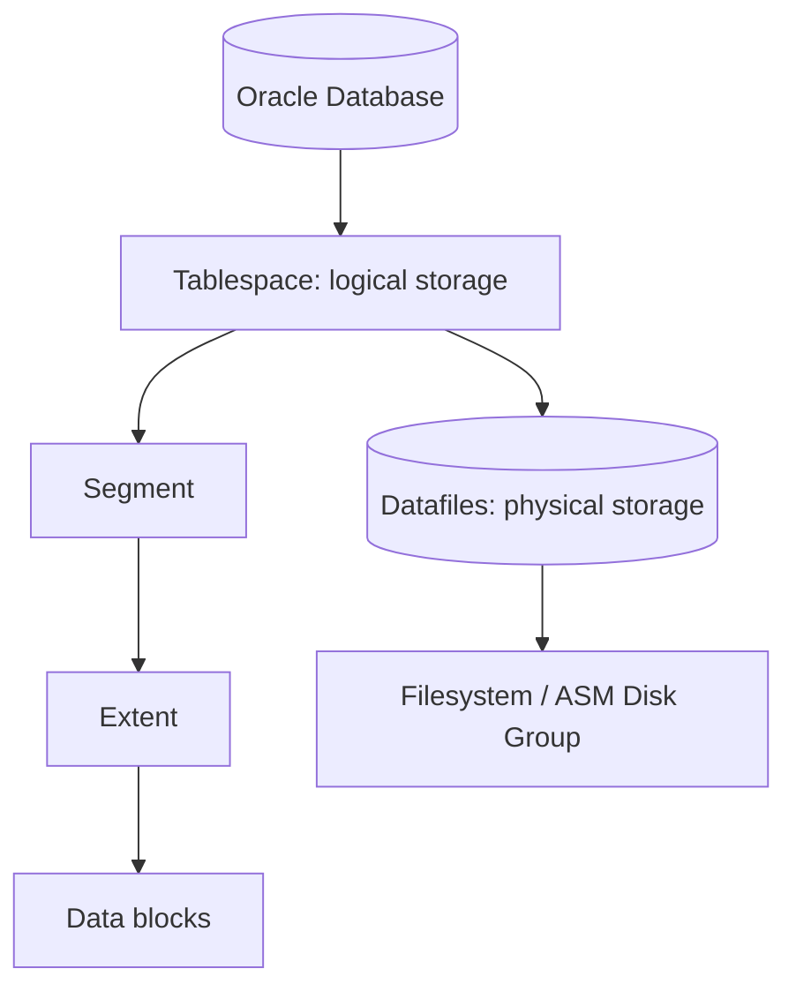

# Lesson 18 — Managing Undo Data (ภาษาไทย)

> 🧠 **ภาพจำก่อนอ่าน:** 🗄️ Data → ⚙️ Process → 🩺 Health  
> 🎨 [Visual Guide ของวิชานี้](../VISUAL-MEMORY-GUIDE-TH.md) — ภาพช่วยจำ ไม่แทนคำสั่งและเนื้อหาจริง

[Storage index](./README.md) · [Lab 09](../10-Labs/Lab-09-Storage-and-Undo-Inspection.md)

> **Oracle University 19c Administration Workshop Lesson 18** mapped by source inventory. Original Thai teaching reconstruction; not page-verified against proprietary Student Guide. **Static authored; no Oracle live run.** 19c foundation with 26ai documentation as current reference.

## เป้าหมาย
เข้าใจ **Rollback, read consistency and retention** พร้อมวิเคราะห์ Oracle storage problems อย่างเป็นลำดับ ไม่แก้ด้วยการเพิ่ม datafile หรือเปลี่ยน initialization parameters โดยไม่มีหลักฐาน.

## Mental model



## Core concepts
Undo enables consistent reads and rollback. Automatic Undo Management, UNDO_RETENTION, tuned retention, expired/unexpired/active extents and retention guarantee must be distinguished.

**Operational distinction:** Logical space, allocated bytes, recoverable/reclaimable segment space, autoextend maximum, and free filesystem/ASM capacity are separate measurements. A single percent-used number is insufficient to decide a resize.

| ประเด็น | ต้องตรวจ | ตัดสินใจอย่างไร |
|---|---|---|
| Capacity | bytes, free, maxbytes, autoextend | หา bottleneck จริงก่อนขยาย |
| Container scope | current CDB/PDB, datafile scope | ห้ามเปลี่ยน object ผิด tenant |
| Performance | I/O pressure, segment growth, transactions | วิเคราะห์ช่วงเวลาและ workload |
| Recovery | archive/backup and rollback | ตรวจ restore proof ก่อน DDL |

## Read-only SQL

ต้องมี approved SELECT privileges. `DBA_*` views แสดงตาม container/role; output อาจรวม path ที่ sensitive — ห้ามเผยแพร่ path ภายในแบบไม่ redact.

```sql
SHOW CON_NAME
SELECT status,SUM(bytes) bytes FROM dba_undo_extents GROUP BY status;
```

### How to interpret
ตรวจว่าเป็น permanent, temporary, undo หรือ application tablespace; เก็บ timestamp และเทียบย้อนหลัง ถ้าดูแค่ DBA_FREE_SPACE จะพลาด autoextend headroom, temp และ underlying storage capacity. เมื่อ SQL เจอ ORA-00942/ORA-01031 ให้ขอ grant เฉพาะ view แทนการ grant DBA.

## Incident & troubleshooting
ORA-01555 snapshot too old: correlate longest query, workload churn, undo sizing and tuned undo retention. RETENTION GUARANTEE can cause DML failures.

1. เก็บ exact ORA error, time, SQL/workload, affected schema and PDB.
2. ตรวจ class of tablespace, file allocations, free extents, maxbytes and actual filesystem/ASM free.
3. ตรวจ application growth, long transactions, backup/archiving and alert log.
4. แยก emergency mitigation จาก root-cause fix; เขียน impact/rollback แล้วขอ change approval.
5. ทำ post-change verification และติดตาม trend ไม่ตัดสินจาก snapshot เดียว.

## Practice exercise
- อธิบายเหตุที่ `DBA_DATA_FILES.BYTES` ไม่เท่ากับ used space ของ table.
- อธิบายข้อแตกต่าง free extents vs unused blocks below HWM.
- ทำ capacity worksheet: allocated, max autoextend, storage free, projected growth, escalation threshold.
- ระบุสิ่งที่จะต้อง rollback/restore หากมีการเปลี่ยนแปลง.

## Knowledge check
1. ถ้าพื้นที่ database เต็ม แต่ filesystem ยังเหลือ จะตรวจอะไร?
2. ถ้า autoextend ON แต่ MAXBYTES เท่าปัจจุบัน มี headroom จริงหรือไม่?
3. ถ้า PDB ต้องใช้ quota จะตรวจ owner และสิทธิ์อะไร?
4. ทำไม DELETE อาจไม่ทำให้ disk usage ลดทันที?
5. ปัญหา space สามารถเกิดร่วมกับ undo/redo/backup ได้อย่างไร?

## Sources
- Oracle University Lesson 18: title-level mapping, full fidelity pending.
- [Oracle 19c DBA Guide](https://docs.oracle.com/en/database/oracle/oracle-database/19/admin/)
- [Oracle 26ai DBA Guide](https://docs.oracle.com/en/database/oracle/oracle-database/26/admin/)
- [Oracle 26ai Managing Undo](https://docs.oracle.com/en/database/oracle/oracle-database/26/admin/managing-undo.html)

## Source-objective deepening — Temporary Undo, Redo Comparison and Retention Guarantee

**Undo versus Redo:** Undo เก็บข้อมูลที่ต้องใช้คืนค่าก่อนหน้าเพื่อ rollback และ consistent reads ส่วน Redo บันทึกการเปลี่ยนแปลงใน redo stream เพื่อ recovery. Undo tablespace ไม่ใช่ archive log หรือ RMAN backup.

**Temporary undo:** Oracle รองรับ temporary undo สำหรับ DML ที่เกิดกับ temporary tables ภายใต้ configuration ที่รองรับ ช่วยลดบางส่วนของ undo/redo overhead; `TEMP_UNDO_ENABLED` มี semantics ระดับ instance/session/PDB ที่ต้องตรวจ Oracle Reference ของ release นั้นและ environment ก่อนปรับ.

**UNDO_RETENTION vs RETENTION GUARANTEE:** ค่า retention เป็นเป้าหมายเวลาที่ต้องเก็บ undo แต่ actual tuned retention ขึ้นกับพื้นที่และ workload. ถ้าเปิด retention guarantee, database อาจปฏิเสธ DML เมื่อพื้นที่ undo ไม่พอแทนการ overwrite unexpired extents. ต้องวาง capacity ตาม longest query และ transaction volume.

```sql
SELECT begin_time,end_time,tuned_undoretention,ssolderrcnt,nospaceerrcnt
FROM v$undostat ORDER BY begin_time DESC FETCH FIRST 12 ROWS ONLY;
SELECT name,value FROM v$parameter
WHERE name IN ('undo_management','undo_retention','temp_undo_enabled');
SELECT tablespace_name,retention FROM dba_tablespaces WHERE contents='UNDO';
```

**Case:** ORA-01555 ไม่ได้แปลว่าเพิ่ม `UNDO_RETENTION` แล้วหายเสมอไป — ตรวจ query runtime, data churn, undo pressure, read-consistency needs และ actual disk capacity.
