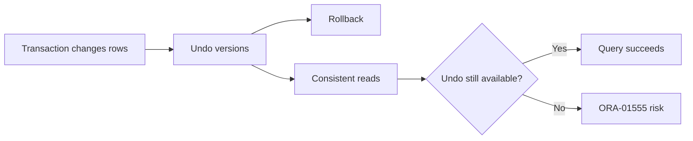

# Lesson 18 — Managing Undo Data (ภาษาไทย)

> 🧠 **ภาพจำก่อนอ่าน:** 🗄️ Data → ⚙️ Process → 🩺 Health  
> 🎨 [Visual Guide ของวิชานี้](../VISUAL-MEMORY-GUIDE-TH.md) — ภาพช่วยจำ ไม่แทนคำสั่งและเนื้อหาจริง

[Storage index](./README.md) · [Lab 09](../10-Labs/Lab-09-Storage-and-Undo-Inspection.md) · [📘 Storage Fundamentals: Lesson 15](./Lesson-15-Database-Storage-Overview-TH.md)

> **Oracle University 19c Administration Workshop Lesson 18** mapped by source inventory. Original Thai teaching reconstruction; not page-verified against proprietary Student Guide. **Static authored; no Oracle live run.** 19c foundation with 26ai documentation as current reference.

## เป้าหมาย
- เข้าใจ Undo สำหรับ Rollback และ Consistent Reads โดยไม่สับสนกับ Redo/Backup
- อ่าน Undo Retention, Extent Status และ `V$UNDOSTAT` เพื่อวิเคราะห์ ORA-01555
- ประเมิน Trade-off ของ Retention Guarantee และ Capacity ก่อนเปลี่ยน Parameter

> พื้นฐาน Tablespace/Datafile และ Capacity Metrics ใช้ [Lesson 15](./Lesson-15-Database-Storage-Overview-TH.md) เป็นจุดอ้างอิง

## Mental model



## Core concepts

- Undo records ช่วย Rollback และสร้าง Read-consistent View ขณะมี Concurrent Transactions
- `UNDO_RETENTION` เป็นค่า Threshold ที่ต้องอ่านคู่กับ Release Update, Tablespace Size, Autoextend, Workload และ Retention Guarantee; อย่าอธิบายว่า fixed-size Undo ใน Oracle 19c ทุก RU ละเลย Parameter นี้เหมือนกัน
- `DBA_UNDO_EXTENTS` แยก Active, Unexpired และ Expired Extents; ไม่ควรนับทุก Extent เป็นพื้นที่ reclaim ได้ทันที
- `V$UNDOSTAT` ใช้ดู Trend ของ Tuned Retention, Snapshot-too-old และพื้นที่ขาดตลอดช่วงเวลา
- **Retention Guarantee:** ลดความเสี่ยง overwrite บางกรณี แต่เมื่อ Undo Space ไม่พออาจกระทบ DML

| อาการ | สิ่งที่ควรเทียบ | การตัดสินใจ |
|---|---|---|
| ORA-01555 | Long-query duration, data churn, `V$UNDOSTAT` | แยก Query/Capacity/Retention Cause |
| Undo Space Pressure | Active/Unexpired Extents, File Limits | ดู Peak Workload ก่อนคิดเพิ่มพื้นที่ |
| DML ล้มเหลวหลัง Retention Policy | Guarantee State, Undo Capacity | ประเมิน Trade-off กับ Long-running Query |

> พื้นฐานด้าน Datafile Capacity และ Free Extents ดู [Lesson 15](./Lesson-15-Database-Storage-Overview-TH.md)

## Read-only SQL

ต้องมี approved SELECT privileges. `DBA_*` views แสดงตาม container/role; output อาจรวม path ที่ sensitive — ห้ามเผยแพร่ path ภายในแบบไม่ redact.

```sql
SHOW CON_NAME
SELECT status,SUM(bytes) bytes FROM dba_undo_extents GROUP BY status;
```

### How to interpret
ผล `DBA_UNDO_EXTENTS` เป็น Snapshot ของ Undo Extent State; ควรเทียบกับช่วงเวลาที่ Error เกิดและ `V$UNDOSTAT` ใน Source-objective deepening แทนการดูเปอร์เซ็นต์พื้นที่ว่างครั้งเดียว. ตรวจ PDB/Instance Scope และสิทธิ์ก่อนตีความ.

## Incident & troubleshooting
**ORA-01555 — snapshot too old:** อย่าสรุปทันทีว่าเพิ่ม `UNDO_RETENTION` แล้วจะหาย

1. เก็บ SQL/Query Elapsed Time, Error Timestamp และ Container/Instance ที่เกี่ยวข้อง
2. เทียบ Query Duration กับ Undo Generation, Tuned Retention และ `SSOLDERRCNT` ช่วงเวลานั้น
3. ตรวจ Undo Extent Status, File Autoextend/Capacity และ Long-running Transactions
4. ตรวจ Retention Guarantee ก่อนปรับ เพราะอาจทำให้ DML ล้มเหลวเมื่อพื้นที่ไม่พอ
5. สรุปทางเลือก: ลด Query Runtime, ปรับ Workload, เพิ่ม Capacity หรือเปลี่ยน Retention โดยผ่าน Change Approval และมี Rollback

## Practice exercise
- จำลองวิเคราะห์ Report SQL ที่ใช้เวลานานเทียบกับ Undo Generation Trend โดยใช้ข้อมูล Read-only
- ทำ Decision Tree สำหรับ ORA-01555 แยก Query Problem ออกจาก Undo Capacity Issue
- เปรียบเทียบผลดี/เสียของ Retention Guarantee ต่อ Read Consistency และ Write Availability

## Knowledge check
1. Undo กับ Redo ทำหน้าที่ต่างกันอย่างไร?
2. เหตุใด `UNDO_RETENTION` สูงขึ้นแต่ยังเกิด ORA-01555 ได้?
3. `SSOLDERRCNT` กับ `NOSPACEERRCNT` ช่วยแยกอาการอย่างไร?
4. เมื่อเปิด Retention Guarantee แล้ว Undo เต็ม จะมีผลต่อ DML อย่างไร?

## Sources
- Oracle University Lesson 18: title-level mapping, full fidelity pending.
- [Oracle 19c DBA Guide](https://docs.oracle.com/en/database/oracle/oracle-database/19/admin/)
- [Oracle 26ai DBA Guide](https://docs.oracle.com/en/database/oracle/oracle-database/26/admin/)
- [Oracle 26ai Managing Undo](https://docs.oracle.com/en/database/oracle/oracle-database/26/admin/managing-undo.html)

## Source-objective deepening — Temporary Undo, Redo Comparison and Retention Guarantee

**Undo versus Redo:** Undo เก็บข้อมูลที่ต้องใช้คืนค่าก่อนหน้าเพื่อ rollback และ consistent reads ส่วน Redo บันทึกการเปลี่ยนแปลงใน redo stream เพื่อ recovery. Undo tablespace ไม่ใช่ archive log หรือ RMAN backup.

**Temporary undo:** Oracle รองรับ temporary undo สำหรับ DML ที่เกิดกับ temporary tables ภายใต้ configuration ที่รองรับ ช่วยลดบางส่วนของ undo/redo overhead; `TEMP_UNDO_ENABLED` มี semantics ระดับ instance/session/PDB ที่ต้องตรวจ Oracle Reference ของ release นั้นและ environment ก่อนปรับ.

**UNDO_RETENTION vs RETENTION GUARANTEE (19c RU-specific):** `UNDO_RETENTION` กำหนดค่าขั้นต่ำเป้าหมายเป็นวินาที และ Oracle Automatic Undo Management จะปรับค่าตามสภาพแวดล้อมด้วย ต้องตรวจค่า `TUNED_UNDORETENTION` และพื้นที่จริง ไม่ตีความ Parameter เพียงตัวเดียว

- **ก่อน 19c RU 19.7:** สำหรับ Fixed-size Undo Tablespace ระบบ Auto-tune ให้เก็บได้นานที่สุดตามพื้นที่/Workload โดยปกติไม่ใช้ `UNDO_RETENTION` เว้นแต่กำหนด Retention Guarantee; Autoextend มีพฤติกรรมต่างกัน
- **ตั้งแต่ 19c RU 19.7:** Oracle Reference ระบุการรักษาค่า `UNDO_RETENTION` สำหรับทั้ง Autoextend และ Fixed-size Tablespaces ร่วมกับ Automatic Tuning — ต้องตรวจ RU/Patch Level ก่อนอธิบายพฤติกรรม
- **Retention Guarantee:** เป็นตัวเลือกแยกจาก `UNDO_RETENTION`; เมื่อพื้นที่ Undo ไม่พอ อาจทำให้ DML ล้มเหลวแทนการเขียนทับ Undo ที่ยังไม่หมดอายุ
- `ORA-01555` ยังเกิดได้จาก Query Duration, Undo Generation, Undo Pressure, Read Consistency และข้อจำกัด Capacity; การเพิ่มตัวเลขอย่างเดียวไม่ใช่ Root-cause Fix

**ยืนยัน Release Update แบบ Read-only ก่อนตีความ Behavior:**

```sql
SELECT banner_full FROM v$version;
SELECT begin_time, end_time, tuned_undoretention, ssolderrcnt, nospaceerrcnt
FROM v$undostat ORDER BY begin_time DESC FETCH FIRST 12 ROWS ONLY;
```

**เอกสารทางการ (ตรวจ 2026-10-21):** [Oracle 19c Parameter Reference — UNDO_RETENTION](https://docs.oracle.com/en/database/oracle/oracle-database/19/refrn/UNDO_RETENTION.html) และ [Oracle 19c Administrator's Guide — Managing Undo](https://docs.oracle.com/en/database/oracle/oracle-database/19/admin/managing-undo.html). ตารางพฤติกรรมควรตรวจตาม RU จริง ไม่อ้างว่าเหมือนกันทุก 19c.

```sql
SELECT begin_time,end_time,tuned_undoretention,ssolderrcnt,nospaceerrcnt
FROM v$undostat ORDER BY begin_time DESC FETCH FIRST 12 ROWS ONLY;
SELECT name,value FROM v$parameter
WHERE name IN ('undo_management','undo_retention','temp_undo_enabled');
SELECT tablespace_name,retention FROM dba_tablespaces WHERE contents='UNDO';
```

**Case:** ORA-01555 ไม่ได้แปลว่าเพิ่ม `UNDO_RETENTION` แล้วหายเสมอไป — ตรวจ query runtime, data churn, undo pressure, read-consistency needs และ actual disk capacity.
