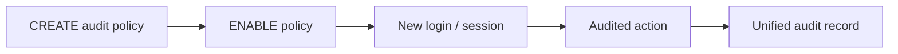

# Lesson 22 — Implementing Oracle Database Auditing (ภาษาไทย)

> 🧠 **ภาพจำก่อนอ่าน:** 👤 Identity → 🔑 Access → 🛡️ Controls  
> 🎨 [Visual Guide ของวิชานี้](../VISUAL-MEMORY-GUIDE-TH.md) — ภาพช่วยจำ ไม่แทนคำสั่งและเนื้อหาจริง

[Security index](./README.md) · [Lab 10](../10-Labs/Lab-10-Users-Roles-Security-Inspection.md) · [👤 Identity Fundamentals: Lesson 19](./Lesson-19-User-Accounts-TH.md)

> **Provenance:** Oracle University 19c Administration Workshop Lesson 22 topic-level alignment. Original Thai learning material; not full page-by-page source fidelity. SQL is read-only; live test NOT RUN. Version-specific behavior of 26ai must be confirmed before change.

## 🎯 เป้าหมายเฉพาะ Lesson นี้
- แยกการ Define Policy, Enable Policy และการเกิด Records ใน Unified Audit Trail
- ตรวจ Audit Policy Scope/Enabled State โดยไม่เผย PII หรือ Audit Evidence
- วาง Audit Retention/Export/Purge และ Chain-of-custody ก่อน Change

> พื้นฐานการแยก Identity/Authentication/Authorization และ Scope อยู่ใน [Lesson 19](./Lesson-19-User-Accounts-TH.md)

## เนื้อหาและแนวปฏิบัติ

**Unified auditing** บันทึกกิจกรรมที่กำหนดผ่าน policy โดยดู `UNIFIED_AUDIT_TRAIL`; แยกการสร้าง policy, การ enable policy และ audit records. `AUDIT_ADMIN` และ `AUDIT_VIEWER` เป็น roles ที่ควรแยกตามหน้าที่. Oracle 19c มี mixed/pure unified auditing deployment differences ต้องตรวจ installed state ก่อนอ้างพฤติกรรม.

**Governance:** scope CDB/PDB, policy condition, audited action, retention, access controls, personal/sensitive data, overhead และ incident correlation. ไม่ควรเปิด policy ครอบคลุมทุก SELECT โดยไม่มี capacity/security plan.

```sql
SHOW CON_NAME
SELECT policy_name,enabled_option,entity_name
FROM audit_unified_enabled_policies;
SELECT event_timestamp,dbusername,action_name,return_code
FROM unified_audit_trail
ORDER BY event_timestamp DESC FETCH FIRST 20 ROWS ONLY;
```

**Audit drill:** การไม่พบ event ไม่พิสูจน์ว่าไม่มีการกระทำ: ตรวจ enabled policies, scope, privileges, filters, write delay และระบบรวบรวม audit logs. ห้าม export unredacted audit trails ไป public repository.

## 🔐 Official-document validation — Policy Enabled ≠ Existing Session Audited (2026-10-21)

Oracle 19c Security Guide ระบุว่า **การ Enable Unified Audit Policy มีผลกับ Session ใหม่หลัง User Login อีกครั้ง**. ถ้า User มี Session ค้างอยู่ตั้งแต่ก่อน Enable Policy การไม่พบ Audit Event จาก Session นั้นยังไม่พิสูจน์ว่า Policy ไม่ทำงาน



```sql
-- Read-only verification; authorized auditing account only.
SELECT policy_name,enabled_option,entity_name,success,failure
FROM audit_unified_enabled_policies
ORDER BY policy_name;
SELECT event_timestamp,dbusername,action_name,return_code
FROM unified_audit_trail
ORDER BY event_timestamp DESC FETCH FIRST 10 ROWS ONLY;
```

**ก่อนสรุปผล:** ตรวจ `POLICY_NAME`, `ENABLED_OPTION`, `ENTITY_NAME`, Success/Failure Filter, Container, Login Timeline และสิทธิ์เห็น Trail. แยก **policy created**, **policy enabled**, **session eligible**, **event generated/visible** เป็นคนละสถานะ. Lab นี้ไม่สร้างหรือ Enable Policy

แหล่งทางการ: [Oracle 19c — Enabling Unified Audit Policies](https://docs.oracle.com/en/database/oracle/oracle-database/19/dbseg/enabling-and-applying-unified-audit-policies-users-and-roles.html) · [AUDIT_UNIFIED_ENABLED_POLICIES Columns](https://docs.oracle.com/en/database/oracle/oracle-database/19/refrn/AUDIT_UNIFIED_ENABLED_POLICIES.html).

## 🔎 Workflow เมื่อเกิด Incident — Unified Auditing & Evidence
1. จด Event, Timestamp, Identity, Container และ Audit Requirement ที่ต้องพิสูจน์
2. ตรวจว่า Relevant Audit Policy ถูก Enable สำหรับ Identity/Scope จริงหรือไม่
3. อ่าน Audit Trail ตามสิทธิ์ขั้นต่ำ และตรวจ Filter, Log Delivery Lag, Missing Event Context
4. เทียบ Audit Evidence กับ Application/Listener Logs โดยไม่เปิดเผย Credential/PII
5. หากต้องเปลี่ยน Policy หรือ Purge ให้ทำ Retention/Export/Approval/Verification ก่อนเสมอ

## 🧠 Self-check — Unified Auditing & Evidence
1. Policy ถูก CREATE แล้วแต่ไม่ได้ ENABLE จะคาดหวัง Audit Records ได้หรือไม่?
2. ทำไมไม่พบ Record ใน Audit Trail จึงยังไม่ยืนยันว่าเหตุการณ์ไม่เกิด?
3. `AUDIT_VIEWER` กับ `AUDIT_ADMIN` ต่างกันในหลักการแยกหน้าที่อย่างไร?
4. เหตุใด Purge Audit Trail ต้องผูกกับ Retention และ Evidence Preservation?

## Official references
- [Oracle 19c Security Guide](https://docs.oracle.com/en/database/oracle/oracle-database/19/dbseg/index.html)
- [Oracle 26ai Security Guide](https://docs.oracle.com/en/database/oracle/oracle-database/26/dbseg/)

## Source-objective deepening — Activate Policies and Maintain Audit Trails

Oracle University Lesson 22 ไม่ได้หยุดที่การอ่าน `UNIFIED_AUDIT_TRAIL`: DBA ต้องรู้ขั้นตอนแยก **enable unified auditing**, **define/enable audit policies**, และ **maintain/retain audit trails**.

1. **Architecture and mode:** Oracle 19c environments อาจเป็น mixed-mode หรือ pure unified auditing; migration/feature state ต้องตรวจ Oracle binaries/options และ current version ก่อนเปลี่ยน mode. ไม่ใช่คำสั่ง toggle เล็ก ๆ.
2. **Policy lifecycle:** เลือก security-relevant actions/privileges, users/roles, container, success/failure conditions → define policy → enable for applicable identities → verify generated events → document ownership and change impact.
3. **Audit trail maintenance:** การ archive/cleanup ผ่าน supported mechanisms (เช่น `DBMS_AUDIT_MGMT` ตาม implementation) ต้องมี retention requirement, chain-of-custody, access control, backup/export, storage health และ approval; purge ก่อนเก็บหลักฐานอาจทำลาย forensic trail.
4. **Visibility:** Audit roles/privileges เป็น sensitive access; app user ทั่วไปไม่ควร query all security events.

**Read-only checks**:

```sql
SELECT policy_name,enabled_option,entity_name
FROM audit_unified_enabled_policies ORDER BY policy_name;
SELECT event_timestamp,dbusername,action_name,return_code
FROM unified_audit_trail
ORDER BY event_timestamp DESC FETCH FIRST 10 ROWS ONLY;
```

**Tabletop:** DBA พบ failed login จาก service account จำนวนมาก: จะออกแบบ policy ที่บันทึกเหตุการณ์ที่ต้องการและ retention ที่ปกป้อง PII ได้อย่างไร? ระบุ incident response ก่อนพิจารณา purge.

References: [19c Database Security Guide](https://docs.oracle.com/en/database/oracle/oracle-database/19/dbseg/), [26ai Security](https://docs.oracle.com/en/database/oracle/oracle-database/26/dbseg/).
