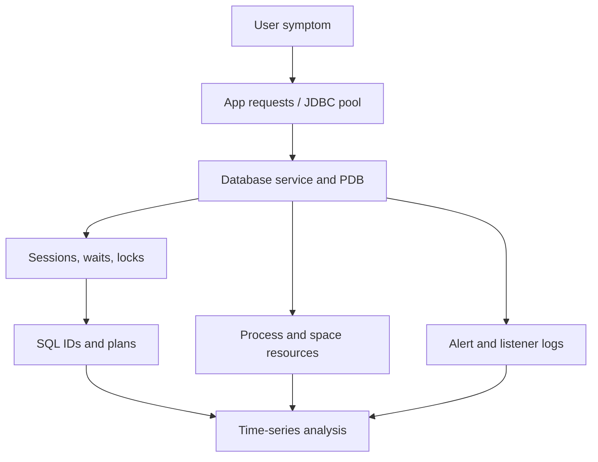

# Lesson 30 — Monitoring Database Performance (ภาษาไทย)

> 🧠 **ภาพจำก่อนอ่าน:** 🗄️ Data → ⚙️ Process → 🩺 Health  
> 🎨 [Visual Guide ของวิชานี้](../VISUAL-MEMORY-GUIDE-TH.md) — ภาพช่วยจำ ไม่แทนคำสั่งและเนื้อหาจริง

[Monitoring & Troubleshooting](./README.md) · [Lab 13](../10-Labs/Lab-13-Oracle-Performance-Triage-Read-Only.md)

> Original Thai teaching mapped to Oracle University 19c Administration Workshop Lesson 30. Source guide fidelity NOT VERIFIED, no SQL executed. SQL examples read-only; avoid unlicensed performance packs.

## Goals
ออกแบบ Oracle DB monitoring ที่สัมพันธ์กับ application SLA และรู้วิธีตรวจ instance/PDB, process/sessions, waits, locks, alert log, tablespaces, logins and time series

## 1. Layers of observability



Good monitoring is **symptom + timestamp + correlation**, not a dashboard of random percentages. A single snapshot at 10:20 does not disprove an ORA-12519 error at 10:05.

## 2. Operational checklist

| Layer | Signal | Notes |
|---|---|---|
| Instance | status, startup_time | Distinguish restart from PDB close |
| Database/PDB | open_mode, role and services | CDB OPEN != PDB ready |
| Capacity | V$RESOURCE_LIMIT process/session HWM | LIMIT_VALUE may be string |
| Connection | listener registered handlers; JDBC pool | listener UP != service available |
| Sessions | ACTIVE/INACTIVE, SQL_ID, wait, blocking | INACTIVE not necessarily leak |
| SQL | executions, elapsed time, plan_hash_value | Compare deltas not lifetime totals |
| Storage | tablespace free, autoextend, archive/FRA | Underlying OS/ASM space matters |
| Security | account expiry/lock and audit | Logs may contain sensitive data |

## 3. Read-only SQL snapshots

```sql
SHOW CON_NAME
SELECT name,open_mode,cdb FROM v$database;
SELECT con_id,name,open_mode FROM v$pdbs ORDER BY con_id;

SELECT resource_name,current_utilization,max_utilization,limit_value
FROM v$resource_limit WHERE resource_name IN ('processes','sessions');

SELECT status,COUNT(*) AS sessions FROM v$session GROUP BY status;

SELECT sid,serial#,username,status,event,wait_class,blocking_session
FROM v$session
WHERE type='USER' AND username IS NOT NULL
FETCH FIRST 20 ROWS ONLY;
```

`V$SESSION` มีข้อมูลของ users/processes จริง: อย่าเผย usernames/SQL text ใน public logs. Query ระหว่าง peak ต้องมี authorized DBA privileges และ limit result. `V$SESSION` data ณ เวลานั้น ไม่ใช่ reliable history จนมี sampling.

## 4. Incident analysis: ORA-12519 and stale connections
Possible causes include listener available handlers, database process capacity, busy shared servers, JDBC pool starvation/leaks or network interruptions. Validate logs + resource time series + app pool and listener handler states. Do not `ALTER SYSTEM SET PROCESSES` or kill sessions without app owner/DBA review.

**Safe mitigation planning:** timeout validation, idle connection health checks, max pool size and abandoned connection detection may be relevant, but must test because killing sessions can break transactions.

## 5. Monitoring implementation notes
- Collect at reasonable intervals with least privilege; distinguish availability checks versus metrics collectors
- Set warning/critical thresholds from workload baselines, not only generic 80%/90%
- Store timestamps with timezone and incident correlation
- Alert on actionable service failures and verify notification pipeline
- Before increasing sampling/query cardinality, assess impact on production

## Review questions
1. Why does high inactive session count not prove leak?
2. Which metrics distinguish JDBC pool exhaustion from database limits?
3. What is the difference between PDB CLOSED and listener down?
4. Why is max utilization not a current utilization value?
5. How will monitoring detect a 2-minute incident between 15-minute polls?

## References
- [Oracle 26ai Measuring Database Performance](https://docs.oracle.com/en/database/oracle/oracle-database/26/tgdba/measuring-database-performance.html)
- [Oracle 26ai Database Reference](https://docs.oracle.com/en/database/oracle/oracle-database/26/refrn/)

## Source-objective deepening — Server Metrics, Threshold Alerts and Monitoring Tools

Lesson 30 เน้น **performance views/tools** และ **statistics/metrics collected by Oracle**. ต้องแยก cumulative statistics, interval metrics, alert thresholds, instance vs PDB scope และ notification pipeline.

- **System and session stats:** `V$SYSSTAT`, `V$SESSTAT` และ SQL counters ใช้เปรียบเทียบแบบ delta ระหว่าง timestamp สองจุด ไม่แปล lifetime totals ว่า requests ต่อวินาที
- **Metric views:** `V$SYSMETRIC`, `V$SYSMETRIC_HISTORY` ใช้ดู metric periods ตามรุ่น/privileges; historical retention ของ views ไม่แทน monitoring TSDB
- **Server-generated alerts:** ตรวจ advisory/threshold settings และ outstanding alerts จาก views ที่ available ภายใต้ edition/version, เช่น `DBA_OUTSTANDING_ALERTS` / alert history
- **Tools:** SQL*Plus read-only, Enterprise Manager, independent monitoring platform และ ADR/log collectors มี coverage/permissions ต่างกัน. Enterprise Manager email/alert setup ต้องมี delivery tests.
- **Risk:** AWR/ASH/ADDM access ต้องตรวจ Diagnostics Pack entitlement; ไม่มี pack ก็ยังเก็บ OS/DB metrics และ application latency ผ่าน authorized methods ได้

```sql
-- Read-only, approved sandbox account only
SELECT metric_name,value,metric_unit,begin_time,end_time
FROM v$sysmetric
WHERE rownum <= 20;
SELECT object_name,reason,message_type,message_level
FROM dba_outstanding_alerts
WHERE rownum <= 20;
```

**Drill:** ตั้ง threshold สำหรับ sessions/processes อย่างไรให้ตรวจ intermittent saturation ได้? ออกแบบ sampling interval, false positives, incident timestamp, escalation path และ remediation owner โดยไม่รัน ALTER SYSTEM.

## 🔎 Official-document validation — Metric Scope and Collection Window (2026-10-21)

`V$SQL.ELAPSED_TIME` เป็น Cumulative Elapsed Time ของ Child Cursor จึงไม่ควรใช้ชี้ Incident ล่าสุดโดยไม่มี Delta/Executions. `V$SYSMETRIC` เป็น Windowed Metric ส่วน `V$SESSION` เป็น Current Session Snapshot

```sql
SHOW CON_NAME
SELECT name,value FROM v$parameter
WHERE name='control_management_pack_access';
SELECT resource_name,current_utilization,max_utilization,limit_value
FROM v$resource_limit WHERE resource_name IN ('processes','sessions');
```

**สำหรับ Monitoring Dashboard:** ทุกจุดต้องระบุ Timestamp, Collection Interval, Container/Instance, Unit, Database Permission และ Alert Threshold. `V$RESOURCE_LIMIT` ไม่มีข้อมูล Handler READY/BLOCKED แทน `lsnrctl services` และไม่ใช่หลักฐานว่า Client Connection Pool ทำงานถูกต้อง

Official: [19c Pack Licensing](https://docs.oracle.com/en/database/oracle/oracle-database/19/dblic/Licensing-Information.html) · [Optimizer Stats](https://docs.oracle.com/en/database/oracle/oracle-database/19/tgsql/gathering-optimizer-statistics.html).

**Status:** DOC_REVIEWED / NO LIVE METRIC SAMPLING.
