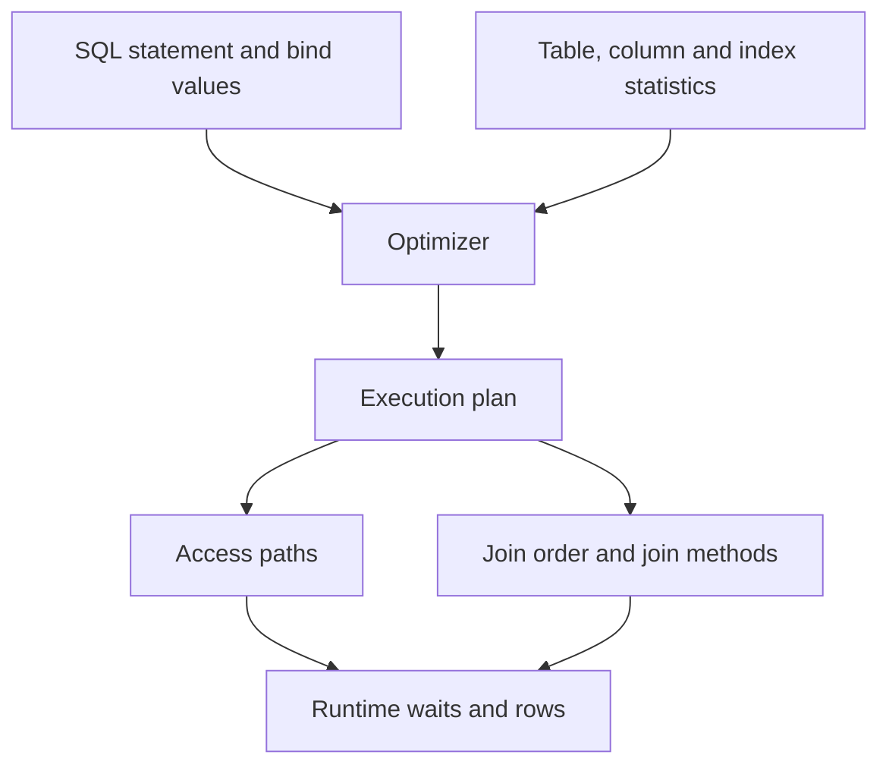

# Lesson 31 — Analyzing SQL and Optimizing Access Paths (ภาษาไทย)

> 🧠 **ภาพจำก่อนอ่าน:** 🗄️ Data → ⚙️ Process → 🩺 Health  
> 🎨 [Visual Guide ของวิชานี้](../VISUAL-MEMORY-GUIDE-TH.md) — ภาพช่วยจำ ไม่แทนคำสั่งและเนื้อหาจริง

[Monitoring & Troubleshooting](./README.md) · [Lab 13](../10-Labs/Lab-13-Oracle-Performance-Triage-Read-Only.md)

> Curriculum: Oracle University 19c Administration Workshop Lesson 31. Original Thai guide, not reproduced from proprietary material. Page-level Student Guide check and actual Oracle testing: **PENDING**. SQL examples read existing metadata only; `EXPLAIN PLAN` may write PLAN_TABLE rows so it is not part of read-only lab.

## Goals
- อ่าน SQL execution plan จาก operation/access predicates/cardinality/cost
- เปรียบเทียบ full table scan, index access and join methods โดยใช้ estimated/actual row data
- เข้าใจ statistics, skew, histograms, bind variables, plan changes และ cardinality errors
- ทำการวิเคราะห์อย่างปลอดภัยก่อน index/SQL rewrite/hints/stats change

## 1. SQL optimizer mental model



Oracle's cost-based optimizer ประเมินต้นทุนของหลาย candidate plans จาก object statistics, predicates, estimated rows และ available access methods. **Cost ไม่ใช่ milliseconds** และแผนที่ cost ต่ำกว่าไม่ได้การันตี response time ต่ำกว่าในทุก runtime.

## 2. Common access paths

| Operation | ทำอะไร | เหมาะเมื่อ |
|---|---|---|
| TABLE ACCESS FULL | อ่าน table blocks จำนวนมาก | ต้องคืนหลายแถว หรือ table เล็ก/parallel เหมาะ |
| INDEX UNIQUE SCAN | หา entry ที่ match unique key | Equality predicate บน unique index |
| INDEX RANGE SCAN | อ่านช่วง index keys | Selective range/equality predicates |
| TABLE ACCESS BY INDEX ROWID | ไป table block ตาม rowid จาก index | ต้องคืน columns ที่ไม่ได้อยู่ใน index |
| HASH JOIN | สร้าง/probe hash สำหรับ matching keys | Many-row joins; memory และ spill สำคัญ |
| NESTED LOOPS | lookup inner row source ต่อ outer row | Outer cardinality เล็กและ inner access ดี |
| SORT MERGE JOIN | sort/merge inputs | บาง sorted/range workloads |

**อย่าติดป้าย TABLE ACCESS FULL ว่าผิดเสมอ**: ถ้าต้องอ่าน 70% ของตาราง ใช้ full scan อาจดีกว่า index lookup+random table I/O.

## 3. Estimated vs actual cardinality

Optimizer stats เช่น `NUM_ROWS`, NDV, histogram และ extended statistics มีผลต่อ estimate. หาก estimate 10 rows แต่จริง 2,000,000 rows อาจเลือก join order/index strategy ผิด.

```sql
-- Read-only: existing metadata from authorized tables only.
SHOW CON_NAME
SELECT owner,table_name,num_rows,last_analyzed,stale_stats
FROM dba_tab_statistics
WHERE owner='LAB_OWNER' AND object_type='TABLE'
ORDER BY table_name;

SELECT sql_id,child_number,plan_hash_value,executions,elapsed_time
FROM v$sql
WHERE executions > 0 AND parsing_schema_name='LAB_OWNER'
ORDER BY elapsed_time DESC FETCH FIRST 10 ROWS ONLY;
```

**Important:** `V$SQL.ELAPSED_TIME` สะสมตลอด lifetime ของ child cursor (microseconds ใน documentation); ต้องเปรียบเทียบ deltas/time window, executions และ variance ก่อนสรุป. Output `DBA_TAB_STATISTICS.NUM_ROWS` เป็น optimizer statistic ไม่ใช่ transactional COUNT(*) แบบ real-time.

## 4. Display existing cursor plan, without EXPLAIN PLAN

```sql
-- Example only: replace literal values with an approved SQL_ID and child number.
-- Requires suitable SELECT grants and DBMS_XPLAN execution permissions.
SELECT plan_table_output
FROM TABLE(DBMS_XPLAN.DISPLAY_CURSOR(
  sql_id => 'abcdef1234567',
  cursor_child_no => 0,
  format => 'TYPICAL'
));
```

`DISPLAY_CURSOR` อ่าน execution plan ที่อยู่ใน cursor cache. ผลอาจไม่มีเมื่อ cursor aged out หรือสิทธิ์ไม่เพียงพอ. รูปแบบ `ALLSTATS LAST` ใช้ runtime plan stats ได้เมื่อมีการเก็บ execution statistics; อย่าสมมติว่า A-Rows มีให้ทุกแผน.

**License rule:** `DISPLAY_AWR` และ AWR/ASH/ADDM ต้องตรวจ Oracle Diagnostics Pack entitlement. SQL Tuning Advisor, SQL Profiles และ Real-Time SQL Monitoring มักอยู่ภายใต้ Tuning Pack; ควรตรวจ 26ai Licensing Manual ตาม edition/deployment ก่อนใช้งาน.

## 5. SQL tuning workflow
1. ระบุ actual user impact, target SQL_ID, average/p95 latency and workload window.
2. Capture baseline plan_hash_value, child cursor, parameter/bind-sensitive behavior and stats age.
3. Compare estimated vs actual rows, key operations, predicates and join choice.
4. Correlate wait events, buffer gets, physical reads, I/O latency and application fetch patterns.
5. Simulate change in sandbox (index, rewrite, stats refresh, bind use) **one variable at a time**.
6. Measure consistent test data/run plans; consider DML overhead of indexes, storage and locking.
7. Have rollback and post-change verification before production deployment.

## 6. Case studies

**Case A: query has an index but optimizer chooses full scan.** If predicate selects most rows, full scan may be correct; inspect NDV, histogram, estimated rows, table size and projection.

**Case B: SQL slow after statistics maintenance.** Compare plan hash and input values before/after; stats can change plan without code change. Never indiscriminately lock statistics as a first reaction.

**Case C: high CPU?** SQL with high cumulative elapsed_time could be waiting on I/O/locks rather than CPU. Compare timed waits and CPU accounting; lifetime cumulative totals cannot prove a recent incident.

## Self-check
1. Cost vs actual elapsed time แตกต่างกันอย่างไร?
2. เมื่อใด full table scan จึงเหมาะ?
3. ทำไม bind-sensitive SQL อาจมี child cursors หลายตัว?
4. จะตรวจว่าการเพิ่ม index ช่วย SELECT แต่ทำให้ DML แย่ลงอย่างไร?
5. เพราะเหตุใด `EXPLAIN PLAN` ไม่เท่ากับแผนที่ cursor ใช้งานจริง?

## References
- [Oracle 26ai Optimizer Concepts](https://docs.oracle.com/en/database/oracle/oracle-database/26/tgsql/query-optimizer-concepts.html)
- [Oracle 26ai Execution Plan Display](https://docs.oracle.com/en/database/oracle/oracle-database/26/tgsql/generating-and-displaying-execution-plans.html)
- [Oracle 26ai DBMS_XPLAN](https://docs.oracle.com/en/database/oracle/oracle-database/26/arpls/DBMS_XPLAN.html)
- [Oracle 26ai Licensing Information](https://docs.oracle.com/en/database/oracle/oracle-database/26/dblic/Licensing-Information.html)

## Source-objective deepening — SQL Tuning Advisor and SQL Access Advisor

วัตถุประสงค์ Lesson 31 รวมการรู้จัก tools ที่ช่วย tune SQL และ workload. **ห้ามสรุปว่าแค่ใช้ DBMS_XPLAN เท่ากับใช้ SQL Advisors**

- **SQL Tuning Advisor:** วิเคราะห์ SQL statement/high-load SQL และเสนอ SQL profile, statistics, index หรือ SQL rewrite candidates ตาม feature; ต้องตรวจ **Tuning Pack licensing** ใน environment จริง. Recommendation ไม่ใช่ auto-safe change.
- **SQL Access Advisor:** วิเคราะห์ workload เพื่อเสนอ physical-design alternatives เช่น indexes/materialized views/partitioning ตาม features/edition ที่รองรับ; ต้องทดสอบผลรวมของ workload ไม่ optimize แค่ query เดียว. Check licensing and supported feature/version before calls.
- **Methodology:** identify most expensive SQL by time/CPU/IO → analyze optimizer stats/cardinality and actual plan → evaluate advisor suggestion → test individually → test whole application/workload → document adverse effects on DML, storage, concurrency and rollback
- **Stats management:** `DBMS_STATS` workflows มีผลต่อ optimizer plan. ค่าที่ stale หรือ histogram ที่เลือกไม่เหมาะอาจกระทบ cardinality; ห้าม gather stats production แบบไม่วาง window/backup of stats.
- **Security:** ข้อมูล SQL text/binds และ advisor reports อาจมี sensitive literals; อย่าคัดลอกลง public issue logs.

**Tabletop:** SQL A เร็วขึ้น 40% หลังเพิ่ม index แต่ batch DML B ช้าลง 35%. สรุปผลรวม workload ไม่ใช่ยกเลิกการวัด B; ระบุ plan stability, storage/redo impacts และ backout plan.

References: [Oracle SQL Tuning Guide 26ai](https://docs.oracle.com/en/database/oracle/oracle-database/26/tgsql/), [Oracle 26ai Licensing](https://docs.oracle.com/en/database/oracle/oracle-database/26/dblic/).

## 🔎 Official-document validation — Cached Cursor Plan and Actual Rows (2026-10-21)

`DBMS_XPLAN.DISPLAY_CURSOR` อ่าน Execution Plan ของ Cached Cursor ตาม `SQL_ID` และ `CHILD_NUMBER` — ไม่ใช่คำสั่ง Execute Business Query ซ้ำ. Oracle Package Reference ระบุสิทธิ์ `READ/SELECT` บน `V$SQL`, `V$SQL_PLAN`, `V$SESSION`, `V$SQL_PLAN_STATISTICS_ALL` (และสิทธิ์ Package ที่เกี่ยวข้อง) ไม่ควรยกระดับเป็น SYSDBA เพื่ออ่านแผน

```sql
-- Approved read-only session: replace placeholder with authorized SQL_ID.
SELECT plan_table_output
FROM TABLE(DBMS_XPLAN.DISPLAY_CURSOR(
  sql_id => 'abcdef1234567',
  cursor_child_no => 0,
  format => 'TYPICAL'
));
```

**Plan Semantics:** `E-Rows` คือ Estimate ส่วน `A-Rows` ใน `ALLSTATS LAST` ต้องมี Row-source Runtime Statistics ถูกเก็บจริง จึงไม่รับประกันว่ามีทุก Cursor. `EXPLAIN PLAN` อาจเขียน `PLAN_TABLE` และ Plan จาก Explain ไม่จำเป็นต้องตรงกับ Child Cursor ที่ใช้จริง

**License:** `DISPLAY_CURSOR` (Cache) ต้องแยกจาก `DISPLAY_AWR` ที่อ่าน AWR; SQL Tuning Advisor/Real-Time SQL Monitoring มี Tuning Pack Requirement ตาม Edition/License. ห้ามเรียก Adviser/Monitoring เพื่อทดลองใน Lab ที่ไม่ยืนยันสิทธิ์ก่อน

Official: [19c DBMS_XPLAN Security Model](https://docs.oracle.com/en/database/oracle/oracle-database/19/arpls/DBMS_XPLAN.html) · [Oracle 19c Licensing](https://docs.oracle.com/en/database/oracle/oracle-database/19/dblic/Licensing-Information.html).

**Status:** DOC_REVIEWED / CURSOR PLAN NOT EXECUTED.
