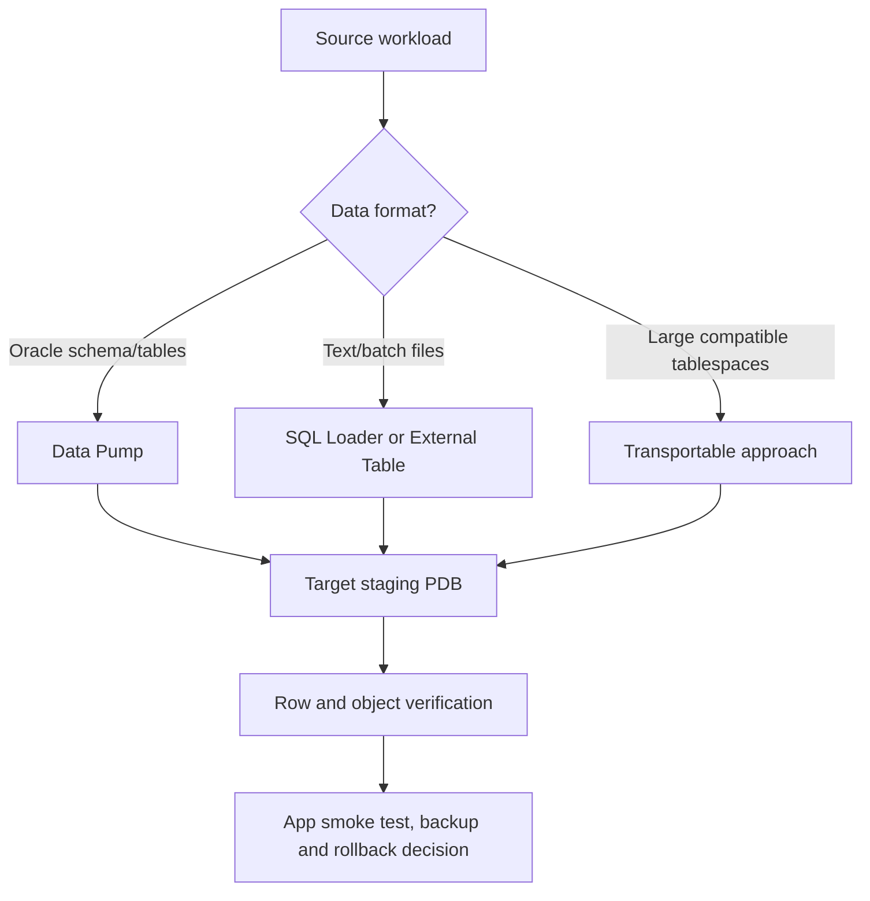

# Lesson 23 — Introduction to Loading and Transporting Data (ภาษาไทย)

[Oracle Database](../README.md) · [Data Movement](./README.md) · [Lab 11](../10-Labs/Lab-11-Data-Movement-Read-Only.md)

> Source mapping: Oracle University 19c Administration Workshop, Lesson 23. เรียบเรียงเนื้อหาใหม่จากหัวข้อบทและ Oracle 19c/26ai manuals — **ยังไม่ได้ตรวจเทียบ Student Guide รายหน้า** และยังไม่ทดสอบบน Oracle จริง

## เป้าหมายการเรียน
เลือกเครื่องมือเคลื่อนย้ายข้อมูลที่เหมาะกับเป้าหมาย, ตรวจ source/target ก่อนย้าย, อธิบายข้อจำกัด version/charset/PDB, แยก export success ออกจาก validated restore และวาง downtime/rollback ได้

## 1. เลือกเครื่องมืออย่างไร

| Method | ย้ายอะไร | Use case | จุดเสี่ยง |
|---|---|---|---|
| Data Pump `expdp`/`impdp` | logical objects, data และ metadata | ย้าย schema, tables, PDB-level data, refresh UAT | สิทธิ์, edition/version, character set, object remap |
| SQL*Loader `sqlldr` | แถวจากไฟล์ text/CSV-like records | batch ingest จากไฟล์ | format, rejects, constraints, encoding |
| External Table | อ่านข้อมูล file ผ่าน SQL (หรือบาง driver เขียน dump) | staging/ELT ด้วย SQL | OS directory/object privileges, parsing |
| Transportable Tablespaces | physical datafiles + metadata | data volume ใหญ่และ compatible environments | self-containment, downtime, endian, encryption |
| Network Data Pump | direct import over database link | database-to-database migration | network/privileges/cross-version limitations |



## 2. Migration checklist ที่ DBA ต้องทำก่อน
1. **Source inventory:** Oracle version/RU, database character set, timezone, endian/platform, container (CDB/PDB), application dependencies
2. **Target readiness:** space, temporary/undo headroom, PDB, service, users/roles, schemas, tablespaces, compatible features and edition/licensing
3. **Consistency & recovery:** backup/restore proof, flashback/logical consistency method, transaction change rate and downtime window
4. **Object compatibility:** constraints, indexes, sequences, synonyms, grants, packages, invalid objects, directory objects and external dependencies
5. **Security:** database-link passwords, Data Pump dump confidentiality, TDE wallet/keystore handling, OS grants to directory
6. **Verification:** export job state, file set, import logs/errors, schema/object counts, business row checks, SQL and application smoke test
7. **Rollback:** source kept intact until acceptance, target cleanup and cutover procedure documented

**เรื่อง Charset:** การ export/import ระหว่าง TH8TISASCII และ AL32UTF8 ต้องพิสูจน์ conversion กับข้อมูลไทยจริง ไม่รับรองความถูกต้องเพียงเพราะ Import จบโดยไม่มี error.

## 3. Directory object และ Data Pump server-side files

`DIRECTORY` เป็น database object ที่ map ไปยัง path ฝั่ง database server. Client ที่เรียก `expdp` อาจอยู่คนละเครื่อง: dump ที่ `DUMPFILE=...` โดยทั่วไปถูกเขียนฝั่ง server ตาม DIRECTORY ไม่ใช่ลง laptop ของ operator. ต้องมี OS permissions และ database READ/WRITE grants ที่เหมาะสม.

```sql
-- Read-only metadata; DBA views require approved privileges.
SHOW CON_NAME
SELECT directory_name, directory_path FROM dba_directories ORDER BY directory_name;
SELECT owner_name, job_name, operation, job_mode, state
FROM dba_datapump_jobs ORDER BY owner_name,job_name;
```

เมื่อพบ job ปรากฏใน view ไม่ได้แปลว่ากำลังย้ายข้อมูลอยู่ ณ ตอนนั้น: ตรวจ STATE และ log. อย่า kill/stop job เพียงเพราะชื่อดูแปลก.

## 4. Workflow: logical migration แบบปลอดภัย

**Planning only** ไม่รัน `expdp` หรือ `impdp` ใน Lab นี้:
- กำหนด source schema → target schema/PDB, tablespace remap, transforms และ exclude/include rules
- ทำ dry inventory ของ grants and object types ที่ต้อง recreate
- วาง read-consistent source extraction และ target staging
- ทำ restore/import rehearsal ใน disposable sandbox เท่านั้น
- ใช้ source-provided checksums/row snapshots เมื่อได้ และระบุข้อจำกัดของ row count
- กำหนด cutover criteria, rerun/idempotence และ rollback plan

## 5. Troubleshooting scenarios

**ORA-39087 / invalid directory object**: ตรวจ `DBA_DIRECTORIES`, current PDB, object privilege, OS path และ container; อย่าสร้าง path เดาสุ่ม.

**ORA-12154 / database link connectivity**: แยก source client naming, link descriptor, network และ target listener/service.

**Import สำเร็จแต่ application ใช้งานไม่ได้**: ตรวจ cross-schema grants, invalid objects, synonyms, sequences, users/password lifecycle, triggers, configuration และ connection pool.

## 6. Self-check

1. Data Pump กับ SQL*Loader ต่างกันตรงไหน?
2. ทำไม dump file อาจไปอยู่ database server แทน local client?
3. ทำไม row counts รวมอย่างเดียวไม่เพียงพอสำหรับ data verification?
4. ในการย้ายข้อมูลไทย legacy จะออกแบบ charset test อย่างไร?
5. ทำไม export success ไม่เท่ากับ disaster-recovery readiness?

## Official references
- [Oracle 26ai Data Pump overview](https://docs.oracle.com/en/database/oracle/oracle-database/26/sutil/oracle-data-pump.html)
- [Oracle 26ai External Tables](https://docs.oracle.com/en/database/oracle/oracle-database/26/sutil/oracle-external-tables-concepts.html)
- [Oracle 19c Database Utilities](https://docs.oracle.com/en/database/oracle/oracle-database/19/sutil/)
