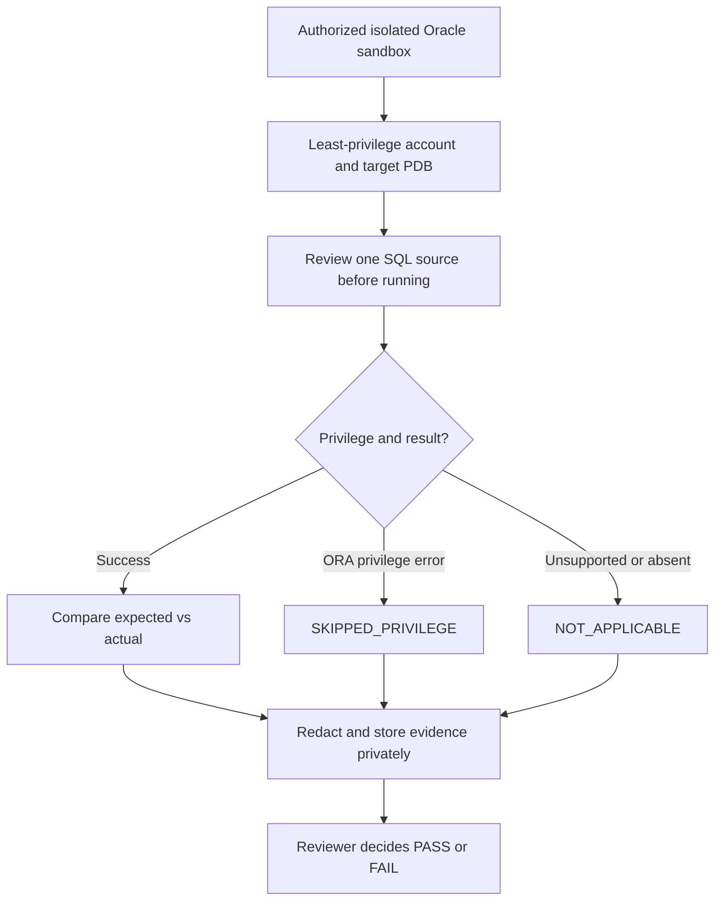

# 🧪 Oracle Sandbox Validation — Read-only Execution Pack

> **Status: READY_FOR_AUTHORIZED_SANDBOX · NOT_EXECUTED** (2026-10-21)
> Original companion validation pack for Oracle Database 19c / Oracle AI Database 26ai. Not an Oracle University Activity Guide reproduction.

[🏠 Oracle Hub](../../README.md) · [🧪 All 13 Labs](../README.md) · [📋 Expected vs Actual Template](./VALIDATION-EVIDENCE-TEMPLATE.md) · [📘 Technical Reference QA](../../TECHNICAL-REFERENCE-QA-2026-10-21.md)

## 🎯 เป้าหมาย

Lab 01–13 มีคำอธิบายแบบฝึกและ Read-only SQL แต่ยังไม่มีหลักฐานว่าผู้เรียนรันจริง. Pack นี้เพิ่ม SQL Script ที่รันด้วยตัวเอง **ทีละไฟล์**, Expected Results, สิทธิ์ที่จำเป็น และ Evidence Template สำหรับนำไปทำ Lab Portfolio โดยไม่เผยแพร่ผลลัพธ์ Production.



## 🔐 ก่อนรัน — สิทธิ์และความปลอดภัย

- **Environment:** Oracle 19c หรือ 26ai VM/PDB แบบ Isolated ที่ได้รับอนุญาตชัดเจน. **ห้ามรัน Pack นี้บน Production**; ห้ามใช้ Production SYSDBA เพียงเพื่อให้ Lab ผ่าน
- **Client:** SQL*Plus หรือ SQLcl บน Windows/Linux/Solaris. ตรวจ Client startup configuration (`glogin.sql`, `login.sql`) และ Automation ก่อนใช้ เพราะอาจมีการรันคำสั่งเพิ่มเติมนอก Script Pack
- **Database account:** `CREATE SESSION` พร้อม `SELECT` หรือ `READ` บน View เฉพาะที่จำเป็น; ไม่ยกระดับเป็น `DBA`, `SYSDBA` หรือ `SELECT ANY DICTIONARY` เพียงเพื่อให้ได้ผล
- **Scope:** จด Oracle Full Version/RU, OS, Instance, Current Container, Time Zone และ Approval Privately; `V$PDBS` อาจแสดงข้อมูลต่างกันเมื่อ Query จาก Root และ PDB
- **Data privacy:** Service Name, Job Metadata, SQL_ID, Directory Names, Audit Policy และ Object Names อาจเป็นข้อมูลภายใน. ห้าม Commit Raw Output, Username, Hostname, Internal IP, Password, Tokens หรือ SQL Text/Bind ลง Public Repository
- **License:** AWR/ASH/ADDM และ SQL Tuning Advisor/SQL Monitoring เป็นคนละกรณีกับ Simple V$ Views. `CONTROL_MANAGEMENT_PACK_ACCESS` ไม่ใช่ใบเสร็จรับรองสิทธิ์ Pack
- **Failure rule:** ORA-00942 / ORA-01031 ให้บันทึก `SKIPPED_PRIVILEGE`; Version หรือ Feature ไม่รองรับให้ `NOT_APPLICABLE`. **อย่า Grant สิทธิ์เอง หรือ Restart/Modify Instance**

## 📂 SQL Scripts — เลือกตาม Lab

| ลำดับ | SQL Script (ดู Source ก่อน) | คู่มืออ้างอิง | Expected Evidence |
|---|---|---|---|
| 00 | [Environment / Version](https://github.com/somkid-s5/Personal-Knowledge-Base/blob/main/Oracle-Database/10-Labs/Sandbox-Validation/sql/00-context.sql) | Lab 01/02 | Current User/Container, Full Version, Instance/DB Mode |
| 01 | [Service / PDB / Limits](https://github.com/somkid-s5/Personal-Knowledge-Base/blob/main/Oracle-Database/10-Labs/Sandbox-Validation/sql/01-services-pdb.sql) | Lab 02/08 | Service Registration in DB, PDB State, Capacity Snapshot |
| 02 | [Storage / Undo](https://github.com/somkid-s5/Personal-Knowledge-Base/blob/main/Oracle-Database/10-Labs/Sandbox-Validation/sql/02-storage-undo.sql) | Lab 09 | Tablespace Types, Undo Extent States, 10-minute Undo History |
| 03 | [Data Pump Metadata](https://github.com/somkid-s5/Personal-Knowledge-Base/blob/main/Oracle-Database/10-Labs/Sandbox-Validation/sql/03-data-pump-metadata.sql) | Lab 11 | DIRECTORY Names, Existing Job Metadata — NO export/import |
| 04 | [Unified Audit Metadata](https://github.com/somkid-s5/Personal-Knowledge-Base/blob/main/Oracle-Database/10-Labs/Sandbox-Validation/sql/04-audit-policy-metadata.sql) | Lab 10 | Enabled Policy Name / Scope / Success & Failure Flags |
| 05 | [AutoTask / Windows](https://github.com/somkid-s5/Personal-Knowledge-Base/blob/main/Oracle-Database/10-Labs/Sandbox-Validation/sql/05-autotask-metadata.sql) | Lab 12 | Client Enabled vs Latest Job Result; Pack Parameter |
| 06 | [Performance Metadata](https://github.com/somkid-s5/Personal-Knowledge-Base/blob/main/Oracle-Database/10-Labs/Sandbox-Validation/sql/06-performance-metadata.sql) | Lab 13 | SQL_ID, Child, Plan Hash, Cumulative Time and Limits |
| 07 | [Optional Cached Cursor Plan](https://github.com/somkid-s5/Personal-Knowledge-Base/blob/main/Oracle-Database/10-Labs/Sandbox-Validation/sql/07-cursor-plan-optional.sql) | Lab 13 | DBMS_XPLAN for Approved SQL_ID; requires extra V$ grants |

### ▶️ วิธีรันด้วย SQL*Plus

จาก Working Copy ให้เปิด Terminal ไปที่ `Oracle-Database/10-Labs/Sandbox-Validation/` ก่อน. เชื่อมต่อด้วย User ปกติและให้ SQL*Plus ถาม Password (ไม่ใส่รหัสผ่านใน Command):

```text
sqlplus -L /nolog
SQL> CONNECT sandbox_ro@//sandbox.example.test:1521/sandboxpdb.example.test
Enter password: (type privately at the prompt)
SQL> @sql/00-context.sql
SQL> @sql/01-services-pdb.sql
SQL> @sql/02-storage-undo.sql
SQL> EXIT ROLLBACK
```

- `sandbox.example.test` เป็น Placeholder เท่านั้น; **ห้ามคัดลอกไปรันบน Target Production**
- `@sql/...` อ้างจาก Current Working Directory ของ SQL*Plus; Windows ใช้ Absolute Path `@C:/.../sql/00-context.sql` ได้หากอยู่คนละ Folder
- **รันทีละ Script หลัง Review** — ไม่มี Auto-runner. ไม่ต้องรันทุก Case ถ้า View หรือ License ไม่รองรับ
- ไม่ใช้ `SPOOL` เก็บ Raw Output ที่เสี่ยงเผยแพร่; จดเฉพาะ Redacted Summary ใน Private Evidence File
- File 07 ต้องแก้ Literal `REPLACE_SQL_ID` ใน Working Copy ส่วนตัวเป็น SQL_ID ที่อนุมัติ และเลือก Child Number ให้ตรง. หากไม่มีสิทธิ์หรือ Cursor ไม่มีแล้วให้ Skip ไม่สร้าง Workload เพื่อให้ผ่าน
- สำหรับ Listener Handler ให้ใช้ `lsnrctl status` และ `lsnrctl services` บน Authorized Host เท่านั้น แยกจาก SQL Script; **ห้าม start/stop/reload**. `V$RESOURCE_LIMIT` ไม่ใช่ Listener Handler State

## ✅ Expected vs Actual แบบตรวจรับ

| Case | Expected | การตัดสินใจ |
|---|---|---|
| Environment | Container/Version ตรง Sandbox ที่ได้รับอนุมัติ | Wrong Target → STOP, no experiment |
| Listener / PDB | Service/Container กับ Open Mode แยกกัน; Listener Handler ต้องตรวจบน Host | PDB MOUNTED/RESTRICTED ไม่ถือว่า App-ready |
| Storage / Undo | เห็น Undo Extent Status และ History เมื่อมีสิทธิ์ | ไม่เห็น History ≠ Retention ดี/แย่; RU 19.7 ข้อจำกัด |
| Data Pump | Metadata เท่านั้น ไม่มีการ Export/Import | No rows อาจไม่มี Job Active ไม่ใช่ข้อผิดพลาด |
| Audit | Policy Enabled ไม่เท่ากับ Audit Trail Events | Unified Auditing Mode/Privilege ไม่พร้อม → Skip |
| AutoTask | Job History แยกจาก Client Enabled | Pack entitlement ต้องยืนยันก่อน Advisor |
| Performance | เห็น Existing SQL_ID / Plan Hash (หากมี) | A-Rows ไม่รับประกัน, Cursor อาจ aged out |

## 🧰 ตรวจรับ Expected vs Actual แบบ Offline (ไม่ต่อ Oracle)

หลังอ่าน Script และรันเฉพาะกับ Sandbox ที่ได้รับอนุญาต สามารถใช้ [EVIDENCE-INPUT-TEMPLATE.json](./EVIDENCE-INPUT-TEMPLATE.json) เป็นตัวช่วยตรวจว่าไม่ได้กรอกสถานะ `PASSED` ลอย ๆ

1. คัดลอก JSON Template ไปเก็บในโฟลเดอร์ `Oracle-Database/10-Labs/Sandbox-Validation/private/` ของ Working Copy ส่วนตัว หรือใน Private Storage **นอก Repository**; โฟลเดอร์ `private/` ถูกเพิ่มใน `.gitignore`
2. ค่าเริ่มต้น `NOT_EXECUTED` ทั้ง 8 เคส และฟิลด์การอนุมัติยังเป็น `false`. อย่าแก้เป็น `approved: true` หากยังไม่ได้รับอนุญาตจริง
3. หลังรันจริงจึงบันทึก `executed_at` แบบ ISO 8601 ที่มี Timezone, Oracle Full Version/RU, Container, Operator, Reviewer, แหล่ง Approval และคำอธิบายผลที่ Redact แล้ว
4. เคส `PASSED`/`FAILED` ต้องมี `actual_summary` และเลขอ้างอิงหลักฐานใน Private Storage รูปแบบ `EVID-001`. **อย่าใส่ Raw SQL Output หรือ Path ที่มีข้อมูลภายในลง JSON**
5. เรียกตัวตรวจจาก Repository Root:

```bash
python3 Oracle-Database/qa/assess_sandbox_evidence.py
python3 Oracle-Database/qa/assess_sandbox_evidence.py --file Oracle-Database/10-Labs/Sandbox-Validation/private/my-sandbox-evidence.json
```

คำสั่งแรกตรวจ Public Template และชุด Negative Tests; คำสั่งที่สองตรวจความครบถ้วนของผลที่ผู้ใช้รายงาน **โดยไม่ติดต่อ Oracle และไม่แสดง Actual Summary**. หาก Case มี `NOT_EXECUTED` แต่มี Output, เคส `PASSED` แต่ไม่มี Approval/Reviewer/Evidence หรือมีข้อมูลคล้าย Secret/IP จะไม่ผ่าน

**ขอบเขต:** เครื่องมือนี้ตรวจความสอดคล้องของการกรอกข้อมูลเท่านั้น; ใครก็กรอกข้อมูลปลอมให้ผ่าน Validation ได้ถ้ามีฟิลด์ครบ. ต้องมี Reviewer ตรวจ Private Evidence จริงก่อนเรียกว่า `LAB_VALIDATED`. CI ไม่อ่านหรืออัปโหลด Private Results

## 🧾 Evidence & Portfolio

คัดลอก [VALIDATION-EVIDENCE-TEMPLATE.md](./VALIDATION-EVIDENCE-TEMPLATE.md) ไปเก็บใน Private Location และเริ่มด้วยสถานะ `NOT_EXECUTED`. บันทึก Approval, Oracle RU/Edition, SQL Script ID, Expected/Actual, ORA Error, Screenshot/Log ที่ Redact, Reviewer Verdict และ Cleanup (ใน Pack นี้ไม่มี Resource เปลี่ยนแปลง). เมื่อทำ Portfolio ให้เผยแพร่เฉพาะ Architecture + Anonymized Verification Summary + Lessons Learned. **CI PASS ≠ LAB PASS.**

## 📚 Oracle Official Documentation

- [V$INSTANCE 19c](https://docs.oracle.com/en/database/oracle/oracle-database/19/refrn/V-INSTANCE.html)
- [V$UNDOSTAT 19c](https://docs.oracle.com/en/database/oracle/oracle-database/19/refrn/V-UNDOSTAT.html)
- [AUDIT_UNIFIED_ENABLED_POLICIES 19c](https://docs.oracle.com/en/database/oracle/oracle-database/19/refrn/AUDIT_UNIFIED_ENABLED_POLICIES.html)
- [SQL*Plus Security 19c](https://docs.oracle.com/en/database/oracle/oracle-database/19/sqpug/SQL-Plus-security.html)
- [DBMS_XPLAN 19c](https://docs.oracle.com/en/database/oracle/oracle-database/19/arpls/DBMS_XPLAN.html)

**Validation boundary:** GitHub Actions runs a **static allowlist inspection** of the eight `.sql` files only. It does not make a database connection or prove that any SQL is executable/semantically correct on your database.
