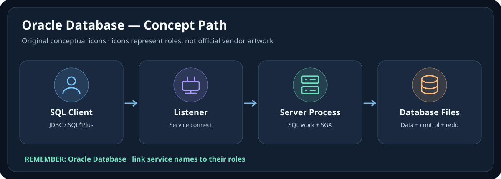

# Oracle Database — Personal DBA Learning System

> 📘 **สมุดโน้ต Oracle DBA ของฉัน** — เรียน Architecture, Instance, Listener, Storage, Security และ Labs
> 🧭 **ขอบเขตเวอร์ชัน:** พื้นฐาน Oracle Database 19c พร้อมหัวข้อปัจจุบันของ Oracle AI Database 26ai
> 🗓️ **อัปเดตหัวข้อที่ตรวจแล้ว:** 2026-10-10 (ยังมีหัวข้อที่ต้องตรวจสอบ/ทดสอบเพิ่มเติม)

[← Repository root](../README.md)

## 🗄️ Visual Memory — ดูภาพก่อนอ่านบทเต็ม

**🧠 💻 Client → 📡 Listener → ⚙️ Instance → 🗄️ Datafiles** — 📌 Database = Persistent Files; Instance = SGA + Processes. Listener รับ/จัดการขั้นตอน Connect ไม่ได้ Proxy ทุกคำสั่ง SQL

[📘 เปิด Visual Guide แบบ Icon-First (Concept + Troubleshooting)](./VISUAL-MEMORY-GUIDE-TH.md) · [🎨 มาตรฐาน Visual ร่วม](../docs/ICON-FIRST-LEARNING-STANDARD.md)

## 📖 โน้ต Oracle Database ที่ฉันใช้เรียน

เริ่มจากการทำความเข้าใจ Database Architecture และวงจรชีวิต Instance แล้วเรียน Listener, CDB/PDB, Tablespace, Users, Monitoring และวิธีแก้ปัญหา ต่อด้วย Labs เพื่อฝึกตามงาน DBA จริง

โน้ตแยกความรู้พื้นฐาน 19c ออกจากการเปลี่ยนแปลงของ 26ai อย่างชัดเจน เพื่อไม่เอาพฤติกรรมต่างเวอร์ชันมาปะปนกัน

## Current draft teaching resources

- **Standalone Thai lessons 01–31** — browse learning layer folders below; original teaching drafts, not full Student Guide fidelity
- [Lessons 10–31 compact Thai Teaching Atlas](./LESSONS-10-31-TH-TEACHING-ATLAS-DRAFT.md) — earlier working atlas retained as supplementary outline; all 31 have since been expanded into standalone teaching drafts
- [Eight-group original practice workbook](./10-Labs/LESSONS-07-31-PRACTICE-WORKBOOK-TH.md) — exercises not executed
- [Data Movement and Maintenance Lessons 23–28](./08-Data-Movement-Maintenance/), [Monitoring and SQL Lessons 29–31](./07-Monitoring-Troubleshooting/) and [Companion Labs 01–13](./10-Labs/) are available as teaching drafts

**Standalone lessons: 31/31 (100% of file coverage, not 100% verified).** All 31 lesson topics represented including Atlas, but full semantic source verification, 26ai cross-version review, CI and live lab testing remain pending.

## October 2026 source-audit milestone

- **31/31** original Thai standalone lesson files verified in GitHub; **31/31 private Student Guide objective sections inspected** via connected Drive and source-gap teaching additions written to 18 lessons.
- [Student Guide learning-objective audit](./SOURCE-OBJECTIVE-COVERAGE-AUDIT.md) — objective-level comparison; page/slide-by-page fidelity pending.
- [Activity Guide practice gap audit](./OFFICIAL-ACTIVITY-GAP-MAP.md) — companion read-only Labs 01–13 do not establish official hands-on execution success.
- [System QA](./SYSTEM-QA.md) — both GitHub Actions workflows passed a verified structural/lint baseline on 2026-10-10.
- **Not yet Full Fidelity Verified:** full PDF semantic comparison, 26ai release testing and controlled Oracle sandbox labs remain pending.

## First six lessons — detailed source-text review

- [Lessons 01–06: 74-slide source-topic crosswalk](./SOURCE-PAGE-CROSSWALK-L01-L06.md) — source-text index and newly expanded Thai lesson coverage; diagrams, source examples and live Oracle validation remain open

## Full-fidelity verification

- [31-Lesson Full-Fidelity QA Tracker](./FULL-FIDELITY-QA-TRACKER.md) — GitHub readback confirmed all lesson files; separate PENDING gates for source-page comparison, 26ai, live labs, CI and security/licensing

## 🧪 Sandbox Validation & Portfolio Evidence (2026-10-21)

[▶️ Oracle Read-only Sandbox Execution Pack](./10-Labs/Sandbox-Validation/README.md) · [📝 Expected vs Actual Evidence Template](./10-Labs/Sandbox-Validation/VALIDATION-EVIDENCE-TEMPLATE.md)

มี SQL Script สำหรับสังเกต 8 จุด ได้แก่ Environment, Listener/PDB, Undo, Data Pump, Unified Audit, AutoTask, Performance และ Optional Cursor Plan. ใช้ SQL*Plus/SQLcl บน Sandbox ที่ได้รับอนุญาต **ทีละไฟล์**; โค้ดถูกตรวจด้านความปลอดภัยแบบ Static แต่ยังไม่รันกับ Oracle จริง. เก็บผลไว้ Private และนำเฉพาะ Sanitized Results ไปทำ Portfolio ได้เมื่อ Reviewer ยืนยัน.

**สถานะ:** READY_FOR_AUTHORIZED_SANDBOX / NOT_EXECUTED; ไม่ใช่การยืนยันว่า Companions 13 Labs ผ่านแล้ว.

## Learning layers

1. [01-Core-Architecture](./01-Core-Architecture/)
2. [02-Instance-Administration](./02-Instance-Administration/)
3. [03-Networking-Listener](./03-Networking-Listener/)
4. [04-Multitenant-CDB-PDB](./04-Multitenant-CDB-PDB/)
5. [05-Storage-Tablespaces-Undo](./05-Storage-Tablespaces-Undo/)
6. [06-Users-Roles-Security](./06-Users-Roles-Security/)
7. [07-Monitoring-Troubleshooting](./07-Monitoring-Troubleshooting/)
8. [08-Data-Movement-Maintenance](./08-Data-Movement-Maintenance/)
9. [09-Oracle-26ai-Current](./09-Oracle-26ai-Current/)
10. [10-Labs](./10-Labs/)

## Recommended study order

Start with architecture and instance lifecycle, then networking, multitenant, storage and security. Continue with monitoring/troubleshooting, data movement, current 26ai delta and hands-on labs.

## Current foundation coverage

The Oracle University 19c Administration Workshop source contains **31 lessons** covering architecture/tools, database creation, startup/shutdown, initialization parameters, diagnostics, Oracle Net/listener, CDB/PDB, storage/undo, users/security, data movement, automated maintenance and performance.

See [SOURCE-MANIFEST.md](./SOURCE-MANIFEST.md) and [SOURCE-COVERAGE.md](./SOURCE-COVERAGE.md).

## Current 26ai layer

Oracle AI Database 26ai is the current platform layer.

See:

- [VERSION-MAP.md](./VERSION-MAP.md)
- [19c-to-26ai-DELTA.md](./19c-to-26ai-DELTA.md)
- [09-Oracle-26ai-Current](./09-Oracle-26ai-Current/)

## Source policy

Oracle University Student Guide and Activity Guide are proprietary source material.

Therefore this repository does not commit those PDFs or proprietary figures, does not reproduce labs verbatim, reconstructs explanations in original Thai wording, and keeps source/version traceability.

## Completion boundary

This system is **not Verified yet**.

Before verification:

- all 31 Oracle University lessons must be accounted for,
- official activity/lab coverage must be mapped,
- selected Udemy support files must be inventoried,
- current 26ai deltas must be validated against official docs,
- the teaching layer must pass repository QA and CI.

## 🩺 Oracle Technical Validation V2 — 2026-10-21

[📋 Oracle Technical Reference Validation Matrix](./TECHNICAL-REFERENCE-QA-2026-10-21.md) จัดหมวด Listener Handler, CDB/PDB Visibility, Online Datafile Move, Unified Auditing Session Timing และ UNDO_RETENTION Version Delta โดยแยก **official document reviewed** ออกจาก **live lab not executed**.

## 📦 Data Movement & Performance — Official-document Review (2026-10-21)

[📋 Technical QA Matrix: Lessons 23–31 / Labs 11–13](./DATA-MOVEMENT-PERFORMANCE-QA-2026-10-21.md) แยกการ Export/Import กับ RMAN Recovery, SQL*Loader Loading Modes, Transportable Tablespaces, External Table Drivers, AutoTask Maintenance Windows และ DBMS_XPLAN/Cursor Plan รวมทั้ง Oracle Diagnostics/Tuning Pack License Conditions.

**Status:** DOC_REVIEWED — ไม่มีการ Execute Data Pump, SQL*Loader, RMAN, SQL Tuning Advisor หรือ Real Oracle Lab ในงานนี้. CI ตรวจ Static Source Evidence, Code Examples และ Progress IDs เท่านั้น.

## Quick links

- [Source Manifest](./SOURCE-MANIFEST.md)
- [Source Coverage](./SOURCE-COVERAGE.md)
- [Version Map](./VERSION-MAP.md)
- [19c → 26ai Delta](./19c-to-26ai-DELTA.md)
- [System QA](./SYSTEM-QA.md)

## Official current references

- [Oracle AI Database 26ai Documentation](https://docs.oracle.com/en/database/oracle/oracle-database/26/)
- [Database Administrator's Guide 26ai](https://docs.oracle.com/en/database/oracle/oracle-database/26/admin/)
- [Administration Bookshelf 26ai](https://docs.oracle.com/en/database/oracle/oracle-database/26/administration.html)

## 🧹 Content cleanup — Link to canonical primers

- [Lesson 07](./03-Networking-Listener/Lesson-07-Oracle-Net-Services-Overview-TH.md) เป็นพื้นฐาน Oracle Net; [Lesson 08](./03-Networking-Listener/Lesson-08-Configuring-Naming-Methods-TH.md) เน้น Client-side Naming / ORA-12154
- [Lesson 15](./05-Storage-Tablespaces-Undo/Lesson-15-Database-Storage-Overview-TH.md) เป็นพื้นฐาน Logical/Physical Space; [Lesson 16](./05-Storage-Tablespaces-Undo/Lesson-16-Creating-and-Managing-Tablespaces-TH.md) เน้น Tablespace/OMF; [Lesson 18](./05-Storage-Tablespaces-Undo/Lesson-18-Managing-Undo-Data-TH.md) เน้น Undo/ORA-01555
- [Lesson 19](./06-Users-Roles-Security/Lesson-19-User-Accounts-TH.md) เป็นพื้นฐาน User Identity; [Lesson 20 Privileges](./06-Users-Roles-Security/Lesson-20-Privileges-and-Roles-TH.md), [Lesson 21 Profiles](./06-Users-Roles-Security/Lesson-21-Profiles-and-Resource-Limits-TH.md), และ [Lesson 22 Auditing](./06-Users-Roles-Security/Lesson-22-Unified-Auditing-TH.md) มี Incident Workflow และ Self-check เฉพาะหัวข้อ

ยังคง 31 Lessons และ 13 Labs เดิม; การลดข้อความซ้ำไม่ได้รับรองว่า Labs ถูกทดสอบกับ Database จริงหรือครบเนื้อหาทุก release.
