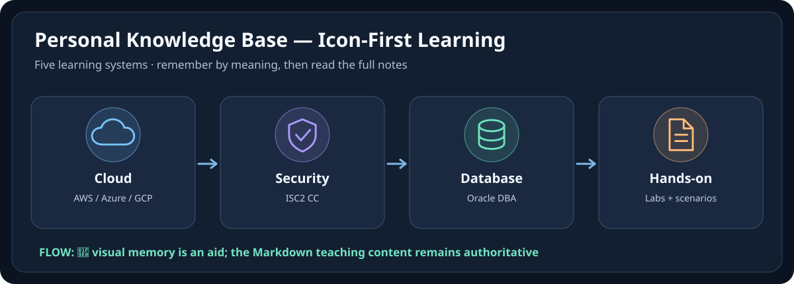

# 📚 Personal Knowledge Base — สมุดโน้ตเรียนรู้ของฉัน

สมุดโน้ตส่วนตัวสำหรับเรียน Cloud, Infrastructure, Security และ Database เน้นอ่านเข้าใจง่าย มีภาพจำ ตัวอย่างงานจริง Lab และเส้นทางการเรียนต่อเนื่อง

เปิดสมุดโน้ตแล้วเลือก **วิชาที่อยากเรียน** จากนั้นอ่านตามบท ฝึกทำและทบทวนได้เลย โดยไม่ต้องกังวลว่าเนื้อหาเก็บไว้ในไฟล์หรือโฟลเดอร์ไหน

> **Repository architecture:** learning system → learning layers → modules/labs/practice/QA  
> **Default explanation language:** Thai, while preserving official English technical terminology  
> **Quality model:** source-of-truth → teachable content → visual learning → practice/troubleshooting → QA

---

## 🎨 เรียนจาก Icon + Diagram ก่อนอ่านเนื้อหา

**🧠 จำภาพก่อน → 📘 อ่าน Markdown → 🧪 ลง Lab → 🩺 Troubleshoot**  
เปิด [Icon-First Visual Gallery](./VISUAL-GALLERY.md) เพื่อดูแผนภาพของทุกวิชา โดยคงเนื้อหา Note, Lab และ Source-of-Truth เดิมครบถ้วน

## 📚 เลือกวิชาที่จะเรียน

| Learning system | Goal | Status |
|---|---|---|
| [AWS-SAA-C03](./AWS-SAA-C03/) | AWS architecture + AWS Certified Solutions Architect – Associate | **Verified learning system** |
| [Azure-AZ-104](./Azure-AZ-104/) | Microsoft Azure Administrator | **Verified Current Objective Scope** |
| [GCP-ACE](./GCP-ACE/) | Google Cloud Associate Cloud Engineer | **Verified Non-Lab Objective Scope** |
| [ISC2-CC](./ISC2-CC/) | ISC2 Certified in Cybersecurity — current 2026 outline | **Verified Current Objective Teaching Scope — 19/19** |
| [Oracle-Database](./Oracle-Database/) | Oracle Database administration — 19c foundation + current 26ai layer | **In Progress — foundation mapped, current layer established** |

~~~mermaid
flowchart LR
    ROOT[Personal Knowledge Base]
    ROOT --> AWS[AWS-SAA-C03]
    ROOT --> AZ[Azure-AZ-104]
    ROOT --> GCP[GCP-ACE]
    ROOT --> CC[ISC2-CC]
    ROOT --> ORA[Oracle-Database]
~~~

### AWS is intentionally one system

AWS-SAA-C03/ contains all AWS learning material needed by this repository:

- 01-Certification-Core/ — current SAA-C03 scope and exam-oriented learning
- 02-Architecture-Foundation/ — Architecting on AWS 7.12.4 long-form theory
- 03-Hands-On-Projects/ — Cloud Engineer Lab Project 00–34

These are **layers of one system**, not separate AWS products in the root catalog.

---

## Repository standards

- [AGENTS.md](./AGENTS.md) — mandatory rules for humans and AI agents
- [SKILL.md](./SKILL.md) — authoring router
- [Authoring Skills](./skills/) — Internet-first and Source-ingestion workflows
- [Repository Architecture](./docs/REPOSITORY-ARCHITECTURE.md)
- [Content Standard](./docs/CONTENT-STANDARD.md)
- [Source & Fact-Checking Policy](./docs/SOURCE-POLICY.md)
- [Visual Learning Standard](./docs/VISUAL-STANDARD.md)
- [Icon-First Learning Standard](./docs/ICON-FIRST-LEARNING-STANDARD.md)
- [Visual Gallery](./VISUAL-GALLERY.md)
- [Quality Gate](./docs/QUALITY-GATE.md)
- [Current Repository Baseline Audit — 2026-10-07](./docs/REPOSITORY-AUDIT-2026-10-07.md)
- [Templates](./templates/)

Historical migration records remain under [docs/](./docs/) but are not the current architecture authority.

---

## Repository structure

~~~text
<repository-root>/
├─ README.md
├─ AGENTS.md
├─ SKILL.md
├─ docs/
├─ skills/
├─ templates/
│
├─ AWS-SAA-C03/
│  ├─ README.md
│  ├─ SOURCE-MANIFEST.md
│  ├─ SYSTEM-QA.md
│  ├─ 01-Certification-Core/
│  ├─ 02-Architecture-Foundation/
│  └─ 03-Hands-On-Projects/
│
├─ Azure-AZ-104/
│  ├─ README.md
│  ├─ SOURCE-MANIFEST.md
│  ├─ AZ104-QA-MATRIX.md
│  ├─ CURRENTNESS-2026.md
│  └─ interactive/
│
├─ GCP-ACE/
│  ├─ README.md
│  ├─ SOURCE-MANIFEST.md
│  ├─ ACE-100-PERCENT-QA-MATRIX.md
│  ├─ Module-01-...
│  └─ Lab-Guide-TH/
│
├─ ISC2-CC/
│  ├─ README.md
│  ├─ SOURCE-MANIFEST.md
│  ├─ SOURCE-COVERAGE.md
│  ├─ CURRENT-EXAM-MAP.md
│  └─ SYSTEM-QA.md
│
└─ Oracle-Database/
   ├─ README.md
   ├─ SOURCE-MANIFEST.md
   ├─ SOURCE-COVERAGE.md
   ├─ VERSION-MAP.md
   ├─ 19c-to-26ai-DELTA.md
   ├─ 01-Core-Architecture/
   ├─ ...
   ├─ 09-Oracle-26ai-Current/
   ├─ 10-Labs/
   └─ SYSTEM-QA.md
~~~

## Why Learning-System First

The old provider-first model (AWS/Courses, AWS/Certifications, AWS/Projects) was technically tidy but poor for learner navigation: one cloud appeared as several unrelated products.

The current rule is:

> **One learner goal = one top-level learning system.**

A system may contain multiple source layers internally. For example, a current certification can use a historical course for deep theory and a project track for hands-on practice without exposing three separate root packages.

If a future topic or certification becomes a real learning goal, create another explicit system such as `Linux-Administration` or `ISC2-CISSP`. Do not add a top-level folder merely because a PDF, ebook or course exists in Drive.

---

## Two ways to build new content

1. **Internet-first** — build from the current official exam guide, learning path, syllabus and product documentation.
2. **Source-ingestion** — start from user-supplied PDFs/slides/docs/course files, reconstruct the learning material faithfully, then add clearly separated current verification where needed.

See [SKILL.md](./SKILL.md).

## Content quality expectations

A strong learning system should answer:

1. What problem does this solve?
2. How does it work?
3. When should I choose it — and when not?
4. What are the tradeoffs?
5. What does the request/data/identity path look like?
6. What commonly fails and where should I check first?
7. What security, availability and cost implications matter?
8. What should I be able to explain or do after learning it?

Diagrams are part of the explanation when relationships or flows matter.

## Accuracy and maintenance

- Prefer current official vendor documentation for changing technical facts.
- Record exam/course verification dates.
- Keep historical/versioned sources identifiable instead of silently rewriting history.
- Do not store secrets, exam dumps, hidden grader logic or unlicensed proprietary figures.
- Treat Verified as a scope/date claim backed by source and QA evidence, never as permanent truth.

---

> Open the repo → choose one active learning goal → follow one coherent path. Google Drive remains the broader source library; GitHub contains the curated knowledge systems.
