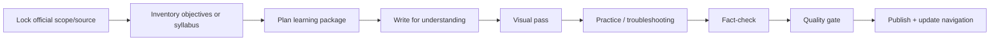

# Cloud Engineer Learning Knowledge Base ☁️

A long-lived personal knowledge base for cloud engineering, infrastructure, DevOps, security, Linux, Kubernetes, automation and certification learning.

This repository is designed to store **structured study notes, diagrams, labs, review material, practice explanations and future learning packages** in one consistent system — not as isolated folders that grow without standards.

> **Repository architecture:** provider/domain → content type → learning package  
> **Default explanation language:** Thai, while preserving official English technical terminology  
> **Quality model:** source-of-truth → teachable content → visual learning → practice/troubleshooting → QA

---

## Start here

### Learning libraries
- [AWS Learning Library](./AWS/)
- [Google Cloud Learning Library](./GCP/)

### Repository standards
- [AGENTS.md](./AGENTS.md) — mandatory rules for humans and AI agents
- [SKILL.md](./SKILL.md) — workflow for building new learning content
- [Repository Architecture](./docs/REPOSITORY-ARCHITECTURE.md)
- [Content Standard](./docs/CONTENT-STANDARD.md)
- [Source & Fact-Checking Policy](./docs/SOURCE-POLICY.md)
- [Visual Learning Standard](./docs/VISUAL-STANDARD.md)
- [Quality Gate](./docs/QUALITY-GATE.md)
- [Repository Audit & Roadmap — 2026-10-06](./docs/REPOSITORY-AUDIT-2026-10-06.md)
- [Templates](./templates/)

---

## Current learning packages

| Provider | Type | Package | Status |
|---|---|---|---|
| AWS | Course | [Architecting on AWS 7.12.4](./AWS/Courses/Architecting-on-AWS-7.12.4/) | **Content-complete, QA migration pending** — Modules 1–13, diagrams, labs, mock exam and review tools exist; repository-wide source/quality gate has not yet been applied retroactively |
| AWS | Certification | [AWS Certified Solutions Architect – Associate (SAA-C03)](./AWS/Certifications/SAA-C03/) | **Practice set complete** — six full practice-exam explanation files; this is not yet a complete certification curriculum mapped to the current official exam guide |
| GCP | Certification | [Associate Cloud Engineer (ACE)](./GCP/Certifications/Associate-Cloud-Engineer/) | **Verified non-lab scope** — mapped to the current Standard Exam Guide + 17 Google Skills activities, with visual guide and objective-by-objective QA matrix |

“Verified” always means verified against a declared scope and date. It does **not** mean permanent truth or guaranteed exam success. See [Quality Gate](./docs/QUALITY-GATE.md).

---

## Repository structure

```text
Cloud-Engineer/
├─ README.md
├─ AGENTS.md
├─ SKILL.md
├─ docs/                         # repository-wide standards
├─ templates/                    # reusable note/lab/package templates
├─ AWS/
│  ├─ README.md
│  ├─ Courses/
│  │  └─ Architecting-on-AWS-7.12.4/
│  └─ Certifications/
│     └─ SAA-C03/
└─ GCP/
   ├─ README.md
   └─ Certifications/
      └─ Associate-Cloud-Engineer/
```

Future domains such as Azure, Kubernetes, Linux, DevOps or Security should be added only when real content exists, following the same taxonomy described in [Repository Architecture](./docs/REPOSITORY-ARCHITECTURE.md).

---

## How content should feel

A learning note in this repository should not stop at “what is this service?”. High-quality content should help answer:

1. **What problem does it solve?**
2. **How does it work / what is the mental model?**
3. **When should I choose it — and when not?**
4. **What are the tradeoffs?**
5. **What does the request/data/identity path look like?**
6. **What commonly fails and where should I check first?**
7. **What security, availability and cost implications matter?**
8. **What should I be able to explain or do after learning it?**

For flow-heavy subjects, diagrams are part of the explanation rather than decoration.

---

## Adding a new course, certification or topic

Follow this sequence:



The detailed workflow is in [SKILL.md](./SKILL.md). Reuse files under [`templates/`](./templates/) rather than inventing a new format for every package.

---

## Accuracy and maintenance principles

- Prefer official exam guides, learning paths and vendor documentation as primary sources.
- Record verification dates for changing certification/course/product scope.
- Avoid freezing volatile pricing, quota, availability or product lifecycle facts as timeless truths.
- Keep official service names, commands, API names and menu labels searchable in English.
- Do not store credentials, production secrets, exam dumps or proprietary grader solutions.
- A structural cleanup should preserve technical meaning; content rewrites and path migrations should be reviewable separately when possible.

---

## Reading on GitHub / mobile / Obsidian

Content is authored primarily in Markdown so it works directly on GitHub and remains portable to editors such as Obsidian. Mermaid is preferred for durable architecture, flow, decision and troubleshooting diagrams.

---

> Build notes that are useful **after the exam**, not only on exam day.
