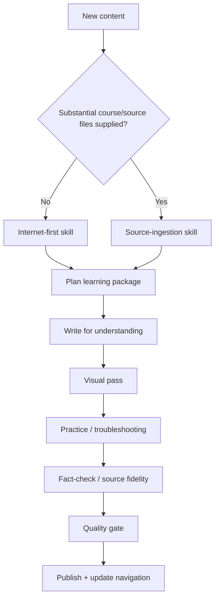

# Cloud Engineer Learning Knowledge Base ☁️

A long-lived personal knowledge base for cloud engineering, infrastructure, DevOps, security, Linux, Kubernetes, automation and certification learning.

This repository is designed to store **structured study notes, diagrams, labs, review material, practice explanations, interactive study tools and hands-on projects** in one consistent system — not as isolated repositories that drift apart.

> **Repository architecture:** provider/domain → content type → learning package  
> **Default explanation language:** Thai, while preserving official English technical terminology  
> **Quality model:** source-of-truth → teachable content → visual learning → practice/troubleshooting → QA  
> **Canonical policy:** new learning-system integration should land here first; standalone repos may remain as mirrors/deployment surfaces when useful

---

## Start here

### Learning libraries

- [AWS Learning Library](./AWS/)
- [Microsoft Azure Learning Library](./Azure/)
- [Google Cloud Learning Library](./GCP/)

### Repository standards

- [AGENTS.md](./AGENTS.md) — mandatory rules for humans and AI agents
- [SKILL.md](./SKILL.md) — authoring router that selects the correct source mode
- [Authoring Skills](./skills/) — Internet-first and Source-ingestion workflows
- [Repository Architecture](./docs/REPOSITORY-ARCHITECTURE.md)
- [Content Standard](./docs/CONTENT-STANDARD.md)
- [Source & Fact-Checking Policy](./docs/SOURCE-POLICY.md)
- [Visual Learning Standard](./docs/VISUAL-STANDARD.md)
- [Quality Gate](./docs/QUALITY-GATE.md)
- [Repository Audit & Roadmap — 2026-10-06](./docs/REPOSITORY-AUDIT-2026-10-06.md)
- [Repository Consolidation — 2026-10-06](./docs/REPOSITORY-CONSOLIDATION-2026-10-06.md)
- [Templates](./templates/)

### Two ways to build new learning content

1. **Internet-first** — build from scratch using the current official exam guide, learning path, course syllabus and product documentation as the source of truth.
2. **Source-ingestion** — start from PDFs/slides/docs/images/course files supplied by the user, read and account for the full source set, then reconstruct it into this repository format. Current web research becomes a clearly labeled supplement when needed.

See [SKILL.md](./SKILL.md) for routing rules.

---

## Current learning packages

| Provider | Type | Package | Status |
|---|---|---|---|
| AWS | Course | [Architecting on AWS 7.12.4](./AWS/Courses/Architecting-on-AWS-7.12.4/) | **Verified Course Scope** — 13/13 module families + 7/7 companion lab guides mapped; 2026 currentness overlay/source map/QA matrix added. known licensed source-image blocker removed from current tree; Git-history caveat documented |
| AWS | Certification | [AWS Certified Solutions Architect – Associate (SAA-C03)](./AWS/Certifications/SAA-C03/) | **Verified Current Objective Scope** — 14/14 tasks and 189/189 current published Knowledge/Skill bullets accounted for as of 2026-10-06, with a current-scope deep dive, hands-on mappings and original scenarios. Legacy practice-question provenance review remains separate |
| AWS | Projects | [Cloud Engineer Lab](./AWS/Projects/Cloud-Engineer-Lab/) | **Imported canonical project track** — project-00 setup + project-01..34, including Terraform, Kubernetes, CI/CD, security, FinOps and observability |
| Azure | Certification | [AZ-104 — Microsoft Azure Administrator](./Azure/Certifications/AZ-104/) | **Imported interactive study system** — current 2026 five-domain / 15-objective-group scope recorded; main-repo fidelity QA pending |
| GCP | Certification | [Associate Cloud Engineer (ACE)](./GCP/Certifications/Associate-Cloud-Engineer/) | **Verified non-lab scope** — mapped to the current Standard Exam Guide + 17 Google Skills activities, with visual guide and objective-by-objective QA matrix |

“Verified” always means verified against a declared scope and date. It does **not** mean permanent truth or guaranteed exam success. See [Quality Gate](./docs/QUALITY-GATE.md).

---

## Repository structure

```text
Cloud-Engineer/
├─ README.md
├─ AGENTS.md
├─ SKILL.md                       # authoring-mode router
├─ skills/
│  ├─ INTERNET-FIRST-CURRICULUM.md
│  └─ SOURCE-INGESTION-CURRICULUM.md
├─ docs/                          # repository-wide standards / audits
├─ templates/                     # reusable note/lab/package templates
├─ AWS/
│  ├─ README.md
│  ├─ Courses/
│  │  └─ Architecting-on-AWS-7.12.4/
│  ├─ Certifications/
│  │  └─ SAA-C03/
│  └─ Projects/
│     └─ Cloud-Engineer-Lab/
├─ Azure/
│  ├─ README.md
│  └─ Certifications/
│     └─ AZ-104/
│        ├─ README.md
│        ├─ SOURCE-MANIFEST.md
│        ├─ SOURCE-COVERAGE.md
│        └─ interactive/           # imported cram-book/site source
└─ GCP/
   ├─ README.md
   └─ Certifications/
      └─ Associate-Cloud-Engineer/
```

Future domains such as Kubernetes, Linux, DevOps or Security should be added only when real reusable content exists, following the same taxonomy described in [Repository Architecture](./docs/REPOSITORY-ARCHITECTURE.md).

---

## How content should feel

A learning note in this repository should not stop at “what is this service?”. High-quality content should help answer:

1. **What problem does it solve?**
2. **How does it work / what is the mental model?**
3. **When should I choose it — and when not?**
4. **What are the tradeoffs?**
5. **What does the request/data/identity path look like?**
6. **What commonly fails and where should I check first?**
7. **What security, availability and cost implications matter?**
8. **What should I be able to explain or do after learning it?**

For flow-heavy subjects, diagrams are part of the explanation rather than decoration.

---

## Adding a new course, certification or topic

The first decision is now the source mode:



The detailed routing and workflows are in [SKILL.md](./SKILL.md) and [`skills/`](./skills/). Reuse files under [`templates/`](./templates/) rather than inventing a new format for every package.

---

## Accuracy and maintenance principles

- Internet-first content should prefer official exam guides, learning paths and vendor documentation as primary sources.
- Source-ingestion content should preserve traceability to the supplied course/source set and label later Internet updates separately.
- Record verification dates for changing certification/course/product scope.
- Avoid freezing volatile pricing, quota, availability or product lifecycle facts as timeless truths.
- Keep official service names, commands, API names and menu labels searchable in English.
- Do not store credentials, production secrets, exam dumps or proprietary grader solutions.
- Do not redistribute proprietary course figures/screenshots without appropriate rights; prefer original explanatory diagrams.
- A structural cleanup should preserve technical meaning; content rewrites and path migrations should be reviewable separately when possible.

---

## Reading on GitHub / mobile / Obsidian

Content is authored primarily in Markdown so it works directly on GitHub and remains portable to editors such as Obsidian. Mermaid is preferred for durable architecture, flow, decision and troubleshooting diagrams.

Interactive study tools and full hands-on project source can live inside a package when they provide real learning value; the package README must still explain source, status, scope and maintenance expectations.

---

> Build notes that are useful **after the exam**, not only on exam day.
