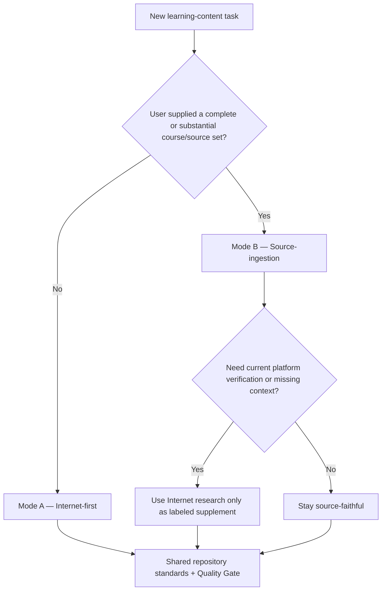

# SKILL.md — Learning Content Authoring Router

Use this file before creating a new course, certification, topic pack, lab set or major content expansion.

The repository supports **two primary authoring modes**. Select the mode from the source situation before writing content.

## Choose the primary mode



### Mode A — Internet-first Curriculum Builder

Read and follow [`skills/INTERNET-FIRST-CURRICULUM.md`](./skills/INTERNET-FIRST-CURRICULUM.md).

Use when:

- no complete course/source set was supplied,
- the user asks to build notes/course content from scratch,
- current certification objectives or current product documentation define the scope,
- Internet/official documentation research is expected to establish the curriculum.

Primary source of truth: **current official Internet sources**.

### Mode B — Source-ingestion Curriculum Builder

Read and follow [`skills/SOURCE-INGESTION-CURRICULUM.md`](./skills/SOURCE-INGESTION-CURRICULUM.md).

Use when:

- the user uploads PDFs, slides, docs, screenshots, lab guides or course exports,
- a named course/book/source set is intended to drive the notes,
- the agent must read/understand the supplied material before constructing the learning package.

Primary source of truth: **the supplied source set**, with Internet content separated as current verification/enrichment when requested.

## Hybrid rule

When both a supplied course and current Internet research matter, **Source-ingestion remains the primary mode**.

Do this:

```text
supplied course
→ complete source inventory and comprehension
→ repository teaching reconstruction
→ optional current official-doc verification
→ clearly labeled supplement/delta notes
```

Do **not** silently replace old course content with current web content or mix the two so the learner cannot tell which source taught what.

## Shared repository contract

Both modes must follow:

- [`AGENTS.md`](./AGENTS.md)
- [`docs/REPOSITORY-ARCHITECTURE.md`](./docs/REPOSITORY-ARCHITECTURE.md)
- [`docs/CONTENT-STANDARD.md`](./docs/CONTENT-STANDARD.md)
- [`docs/SOURCE-POLICY.md`](./docs/SOURCE-POLICY.md)
- [`docs/VISUAL-STANDARD.md`](./docs/VISUAL-STANDARD.md)
- [`docs/QUALITY-GATE.md`](./docs/QUALITY-GATE.md)

## Shared package scaffold

Minimum package shape depends on scope, but substantial learning packages should converge on:

```text
<Learning-System>/
├─ README.md
├─ SOURCE-MANIFEST.md             # strongly recommended; required by both skills for substantial packs
├─ SOURCE-COVERAGE.md             # source-ingestion mode
├─ Module-01-*.md or modules/
├─ Lab-Guide-TH/ or labs/         # when hands-on content exists
├─ assets/                        # original/reusable diagrams/images
├─ CHEAT-SHEET.md                 # optional review layer
├─ GLOSSARY.md                    # optional
└─ QA-MATRIX.md                   # required for formal completeness claims
```

A learning-system README must answer: what this is, who it is for, build mode, source/scope, learning order, status, last verified date, quick links, exclusions and how to know when the learner is done. If multiple course/project/source layers support the same goal, integrate them beneath this system instead of creating separate root packages.

## Shared teaching standard

Every major concept should answer as many of these as applicable:

1. What problem does it solve?
2. What is the mental model?
3. How does data/request/identity flow?
4. When should I choose it?
5. What are the alternatives and tradeoffs?
6. What can fail and how do I investigate it?
7. What security/cost/availability implications matter?
8. What should I be able to explain or do after this section?

Avoid content that is only headings, definitions or product-name lists.

## Shared visual standard

Apply `docs/VISUAL-STANDARD.md` after the first conceptual draft. Add visuals for hierarchies, flows, state/lifecycle, architecture, comparison/decision and troubleshooting paths.

Prefer original Mermaid/flow maps over copied screenshots or proprietary figures.

## Shared practice standard

Use official labs by reference/crosswalk where appropriate and create original companion exercises when useful.

Never copy:

- exam dumps,
- hidden grader logic,
- proprietary challenge answers,
- paid course passages or figures beyond permitted use.

## Shared completion rule

A package cannot be called `Complete`, `Verified`, `100%` or equivalent until:

- its declared scope is explicit,
- its selected authoring skill's coverage requirements pass,
- no known objective/source unit is silently missing,
- content is teachable rather than enumerated,
- visual/decision/operation/troubleshooting coverage exists where applicable,
- provenance/source dates are recorded,
- `docs/QUALITY-GATE.md` passes,
- repository CI/navigation checks pass.

## Publishing

Update in the same change when applicable:

- package README,
- source manifest/coverage files,
- QA matrix,
- learning-system README,
- root README catalog,
- moved-path references.

## Writing style

- Default explanation language: Thai.
- Keep official service names, CLI/API/menu labels and code in English.
- Explain first, then summarize.
- Prefer coherent paragraphs, tables and diagrams over walls of bullets.
- Do not reduce full learning material into a cheat sheet unless the requested artifact is explicitly a cheat sheet.
- Optimize for long-term understanding and maintainability, not maximum file count.
