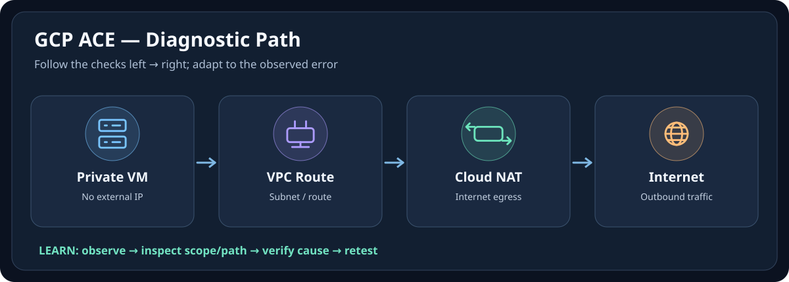
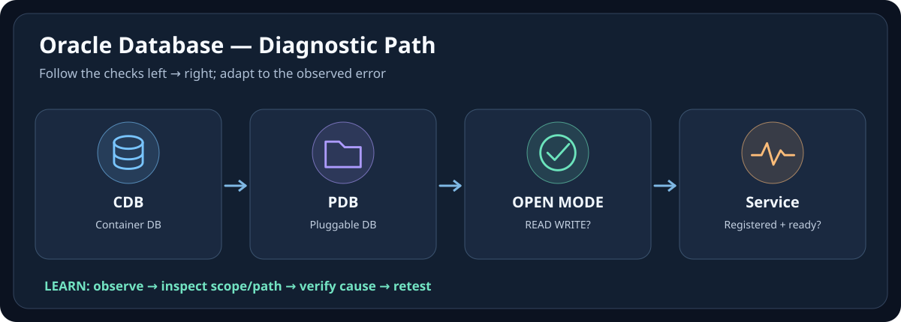

# 🎨 Icon-First Visual Gallery — Personal Knowledge Base

[← Repository](./README.md) · [Icon-First Standard](./docs/ICON-FIRST-LEARNING-STANDARD.md)

> **Visual demonstration for the five learning systems.** All SVG images are original conceptual diagrams stored in the repository. They are not official vendor logos and do not replace source-backed lessons or labs.

| Learning system | Visual guide | 10-second memory cue |
|---|---|---|
| 🌩️ **AWS SAA-C03** | [เปิด Visual Guide](./AWS-SAA-C03/VISUAL-MEMORY-GUIDE-TH.md) | 🌐 Client → ⚖️ ALB → 🖥️ Healthy Target |
| 🔷 **Azure AZ-104** | [เปิด Visual Guide](./Azure-AZ-104/VISUAL-MEMORY-GUIDE-TH.md) | 👤 Principal → 🔑 Role → 🗂️ Scope → ☁️ Resource |
| 🌤️ **GCP ACE** | [เปิด Visual Guide](./GCP-ACE/VISUAL-STUDY-GUIDE-TH.md) | 👤 Principal → 🔐 IAM → 🗂️ Project → ⚙️ Workload |
| 🛡️ **ISC2 CC** | [เปิด Visual Guide](./ISC2-CC/VISUAL-MEMORY-GUIDE-TH.md) | 🔒 Confidentiality · 🧾 Integrity · 🟢 Availability |
| 🗄️ **Oracle Database** | [เปิด Visual Guide](./Oracle-Database/VISUAL-MEMORY-GUIDE-TH.md) | 💻 Client → 📡 Listener → ⚙️ Instance → 🗄️ Datafiles |

## 👀 Preview: choose a diagram first

### 🌩️ AWS SAA-C03

[อ่านคำอธิบายและเชื่อมไปบทเรียนเต็ม](./AWS-SAA-C03/VISUAL-MEMORY-GUIDE-TH.md)

### 🔷 Azure AZ-104

[อ่านคำอธิบายและเชื่อมไปบทเรียนเต็ม](./Azure-AZ-104/VISUAL-MEMORY-GUIDE-TH.md)

### 🌤️ GCP ACE

[อ่านคำอธิบายและเชื่อมไปบทเรียนเต็ม](./GCP-ACE/VISUAL-STUDY-GUIDE-TH.md)

### 🛡️ ISC2 CC

[อ่านคำอธิบายและเชื่อมไปบทเรียนเต็ม](./ISC2-CC/VISUAL-MEMORY-GUIDE-TH.md)

### 🗄️ Oracle Database

[อ่านคำอธิบายและเชื่อมไปบทเรียนเต็ม](./Oracle-Database/VISUAL-MEMORY-GUIDE-TH.md)

## 📖 Note style remains Markdown-first

> [!TIP]
> **🧠 จำภาพ 10 วินาที** → **📘 อ่านหลักการ** → **🧪 ทำ Lab** → **🩺 วิเคราะห์ Error** → **✅ ทบทวน**

❓ ทำไมไม่ใช้โลโก้แทนทุกอย่าง?

Vendor logo อาจเปลี่ยนตาม Branding และไม่ได้บอกบทบาทหรือเส้นทาง Request. เราใช้ไอคอนแสดง Role คู่กับชื่อ Service และลิงก์แหล่ง Logo ทางการ เพื่อให้เข้าใจและตรวจสอบได้จริง

