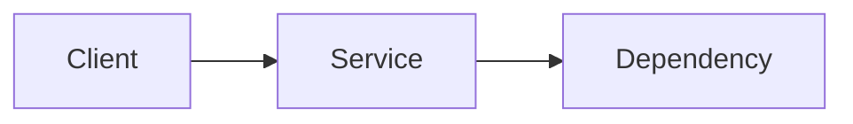

# Lab XX — <Title>

> **Type:** Original companion lab | Official-lab crosswalk  
> **Risk/cost:** <low/medium/high + note>  
> **Cleanup required:** Yes/No

## 🧠 Visual memory

> **🧪 Build → 🔎 Check → ✅ Verify → 🧹 Cleanup.** Link to the learning system visual guide when useful; keep all commands and expected results in searchable Markdown.

## Goal
What the learner will build/verify.

## Architecture

## Prerequisites
- Account/project/sandbox
- APIs/tools
- IAM
- Region/zone constraints

## Plan before commands
List names, network ranges, resources and expected cost/lifecycle.

## Steps
For each step include:
1. purpose,
2. command/UI action,
3. expected result,
4. verification.

## Failure injection / troubleshooting
Create at least one safe failure or diagnostic exercise when appropriate.

## Cleanup
List resources to delete and how to verify cleanup.

## What you should now understand
Connect the lab back to the theory and decision model.

## Sources
Official docs used to design the lab.
