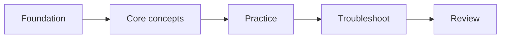

# <Learning Package Title>

> **Status:** Planning | In Progress | Review | Verified  
> **Last verified:** YYYY-MM-DD  
> **Target learner:** <who>  
> **Source of truth:** <official guide/path/course/docs>  
> **Scope:** <included>  
> **Excluded:** <labs/exam dumps/etc.>

## Start here
1. <first step>
2. <second step>
3. <practice/review>

## Learning map

## Modules
| # | Module | Outcome |
|---:|---|---|
| 01 | `Module-01-Topic.md` | <what learner can do> |

Replace the placeholder filename above with a real Markdown link after the module file exists.

## Labs / practice
Explain which items are official external labs versus original companion labs.

## Review resources
- Cheat sheet
- Glossary
- Scenarios / mock questions
- QA matrix

## Sources and maintenance
State what should be rechecked when the vendor/course changes.
