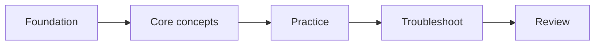

# <Learning Package Title>

> **Status:** Planning | In Progress | Review | Verified  
> **Build mode:** Internet-first | Source-ingestion  
> **Last verified:** YYYY-MM-DD  
> **Target learner:** <who>  
> **Source of truth:** <official guide/path/course/docs or supplied source set>  
> **Scope:** <included>  
> **Excluded:** <labs/exam dumps/etc.>

## Source records

- `SOURCE-MANIFEST.md` — authoritative/source inventory and verification dates
- `SOURCE-COVERAGE.md` — required for Source-ingestion; maps supplied source units to repository coverage
- `QA-MATRIX.md` — required when claiming completeness against a formal scope

If a source artifact is intentionally unnecessary for a small package, explain why instead of creating an empty placeholder.

## Start here

1. <first step>
2. <second step>
3. <practice/review>

## Learning map

## Modules

| # | Module | Outcome |
|---:|---|---|
| 01 | `Module-01-Topic.md` | <what learner can do> |

Replace the placeholder filename above with a real Markdown link after the module file exists.

## Labs / practice

Explain which items are official external labs versus original companion labs.

## Review resources

- Cheat sheet
- Glossary
- Scenarios / mock questions
- QA matrix

## Sources and maintenance

State what should be rechecked when the vendor/course changes.

For Source-ingestion packages, also state the supplied course version/edition and clearly separate later current-documentation supplements from the original course teaching.
