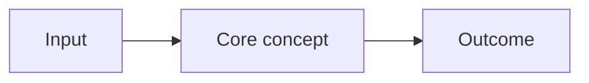

# Module XX — <Topic>

[Back to package README](./README.md)

## Learning outcomes
After this module, you should be able to:
1. ...
2. ...

## 1. Why this exists
Explain the problem before the product/feature.

## 2. Mental model

Explain what the diagram simplifies.

## 3. How it works
Explain scope, components, identity/data/request flow and lifecycle as relevant.

## 4. When to use it
| Requirement | Choose | Why / tradeoff |
|---|---|---|

## 5. Example / workflow
Use a concrete scenario or safe command walkthrough.

## 6. Security, reliability and cost
Cover only the dimensions that materially affect the topic.

## 7. Failure modes and troubleshooting
| Symptom | Check first | Why |
|---|---|---|

## 8. Common misconceptions
- ...

## Review
- Key idea 1
- Key idea 2

### Self-check
1. ...?
2. ...?

## Sources
- Official documentation link
- Last verified: YYYY-MM-DD if needed
